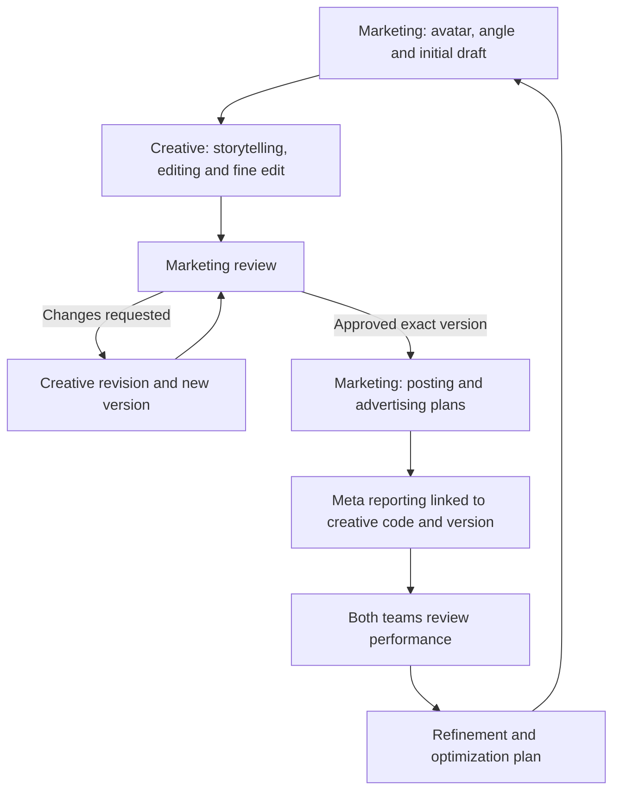

# Creative Marketing Workstation

Requirements and architecture for a shared marketing and creative workstation covering social media content, organic distribution and paid advertising.

## Start here

| Document | Purpose |
|---|---|
| [Product Requirements Document](docs/requirements/creative-workstation-prd.md) | Team responsibilities, six-step workflow, scope, screens, functional requirements and acceptance criteria |
| [Technical Requirements Document](docs/requirements/creative-workstation-trd.md) | Architecture, database keys and relationships, API contracts, review/versioning rules, Meta ingestion, security and verification |
| [Workstation design](docs/superpowers/specs/2026-10-10-marketing-creative-workstation-design.md) | Shared creative card, handoffs, review loop and example record |
| [Database architecture](docs/superpowers/specs/2026-10-10-creative-marketing-performance-design.md) | Detailed logical data model, performance measurement rules and reporting structure |

The PRD and TRD are the requirements baseline. They supersede the supporting exploratory designs where details differ. Deployment choices and operating targets are explicitly marked as proposed.

## Workflow

Every creative has a stable code such as `CR-000123`. Draft revisions have separate versions, and each launch is mapped to the exact approved version. Organic and paid reporting retain their distinct scopes. Findings preserve the evidence used to create follow-up work.

## Repository status

This repository contains documentation only. It does not contain a running workstation, database migrations, authenticated connections or live Meta data. Example creative records and performance figures are illustrative.

V1 includes team workflow, external launch registration, read-only reporting and the optimization loop. Direct publishing, ad creation and automated budget changes are later scope.

## Related foundation

The documents were developed alongside the existing [ContentAI video-production foundation](https://github.com/garyyap13/ContentAI/tree/985d914e3caf125e0d344c1c22caf57063409977). References to the existing React/Fastify/SQLite application concern that separate repository, not an implementation included here.

## Working with the requirements

Preserve requirement identifiers (`FR-*`, `AC-*`, `T-*`) when refining the documents. Keep the product-to-technical traceability current, identify changed assumptions explicitly, and distinguish implemented capabilities from design proposals.
