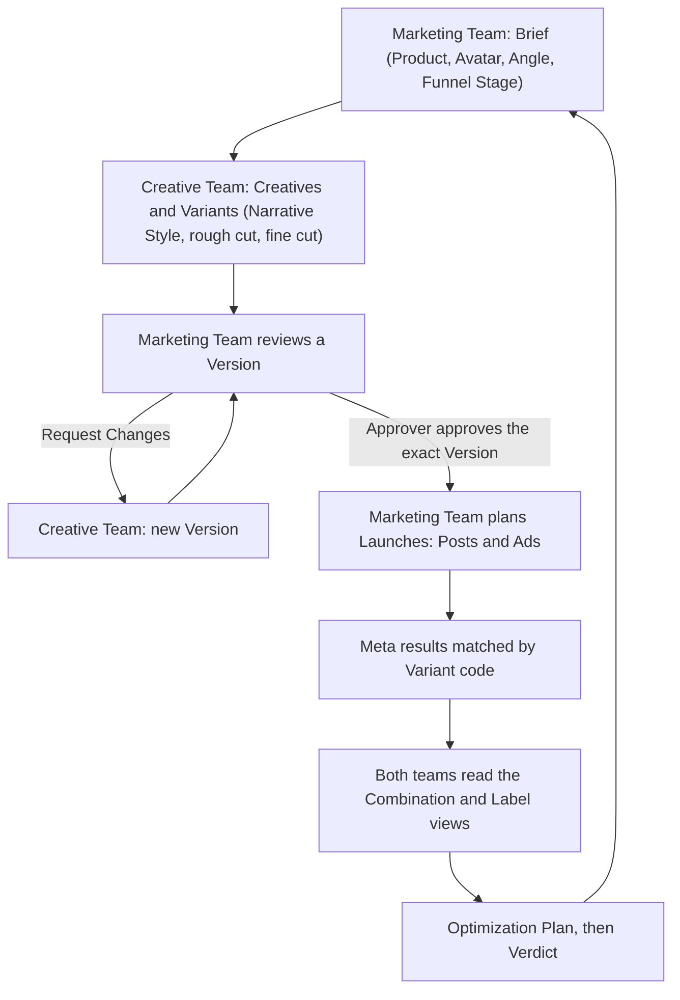

# Creative Marketing Workstation

Requirements and architecture for GML's internal workstation, where the Marketing Team and the Creative Team take a Creative from Brief to a live Post or Ad, read its Meta results, and plan what to make next.

## Start here

| Document | Purpose |
|---|---|
| [Glossary (CONTEXT.md)](CONTEXT.md) | Canonical vocabulary (Brief, Creative, Variant, Version, Launch, Combination, …) and the terms to avoid |
| [Interview decisions](docs/requirements/2026-10-11-interview-decisions.md) | Owner-confirmed decisions D-01…D-71 (including the confirmed defaults D-49–D-62) and the remaining open item O-02. The log wins when documents conflict |
| [Architecture decision records](docs/adr/) | Hard-to-reverse decisions: Supabase, meaning-free codes, separation from the Video Orchestrator, lightweight Launch tracking, single company, commands as Postgres functions, Version files in Google Drive |
| [Product Requirements Document (1.1)](docs/requirements/creative-workstation-prd.md) | Teams and roles, the six-step workflow, scope, screens, functional requirements, acceptance criteria and proposed defaults |
| [Technical Requirements Document (1.1)](docs/requirements/creative-workstation-trd.md) | Supabase architecture, data model, RPC command contract, Meta sync and matching, security, notifications and verification |

The two exploratory designs from 2026-10-10 are superseded by PRD/TRD 1.1 and kept for history only: [Workstation design](docs/superpowers/specs/2026-10-10-marketing-creative-workstation-design.md) and [Database architecture](docs/superpowers/specs/2026-10-10-creative-marketing-performance-design.md).

## Workflow



Every Creative has a code such as `GML-0007`, and each Variant adds a letter, as in `GML-0007-B`. The system writes the Variant code into the ad name (`[GML-0007-B] avatar · angle · narrative`), so Meta results match automatically, and a Meta video ID check catches mismatches. Versions are the numbered revisions of a Variant, and an approval names one exact Version. Organic and paid results keep separate scopes. An Optimization Plan freezes the Evidence it cites.

## Repository status

This repository contains the requirements, the UI concept, the local Supabase database (members, Briefs, Creatives, Variants, Footage, Drive-registered Versions, Reviews, video transcripts and Content Sections, and My Tasks) and the web app, with database tests and browser journeys. It has no hosted Supabase project, authenticated Google, Drive, Meta or WhatsApp connections, or live Meta data yet. Example records and figures are illustrative.

V1 covers the team workflow, Launch records, read-only Meta reporting, WhatsApp notifications and the optimization loop. Publishing, ad creation and budget changes are later scope.

## Local development

Needs Node, pnpm, the Supabase CLI and a container runtime. This Mac uses Colima.

```bash
colima start
supabase start
pnpm install
pnpm test:db
pnpm test:e2e
pnpm web:dev
```

`pnpm web:dev` serves the web app at http://127.0.0.1:5173 against the local stack. Sign in with a magic link or the 6-digit code from the email: invite the person first in Settings, which calls the `invite-member` Edge Function (the first Admin is set up with `bootstrap_admin`), then open the link from the local mail catcher (its URL is in `supabase status`).

`pnpm test:db` resets the local database, sets up a first Admin and runs the database tests in `tests/db`. `pnpm test:e2e` runs the browser journeys in `tests/e2e` with Playwright, driving the installed Google Chrome in a throwaway profile (no browser download), and also resets the local database. Run the two suites one at a time. When a migration adds a schema that `supabase/config.toml` exposes, apply it (`supabase migration up`) before restarting the stack, because the API refuses to start without the schema. Stop the stack with `supabase stop` and the VM with `colima stop`. The local stack's ports are reachable from the local network, so stop it on untrusted networks.

## Related project

The Video Orchestrator ([ContentAI](https://github.com/garyyap13/ContentAI)) is a separate, related project; the workstation does not depend on it ([ADR 0003](docs/adr/0003-workstation-is-separate-from-the-orchestrator.md)).

## Working with the requirements

- Use the CONTEXT.md vocabulary.
- Preserve requirement IDs (`FR-*`, `AC-*`, `T-*`). Mark a requirement that no longer applies as removed instead of renumbering.
- Record newly confirmed decisions in the decision log, and add an ADR when a decision is hard to reverse.
- Keep the PRD-to-TRD traceability current.
- Label anything not yet confirmed as a proposed default.
