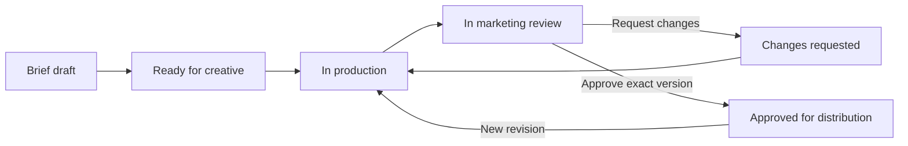

# PRD — Marketing & Creative Performance Workstation

Version: 1.0

Date: 2026-10-10

Status: Requirements baseline derived from the accepted workflow and visual concept; proposed defaults are identified below. No production implementation is claimed.

Audience: Marketing lead, creative lead, product owner, designer, engineering and QA.

Companion: [Technical Requirements Document](creative-workstation-trd.md)

## 1. Product purpose

Build a shared workstation where marketing and creative teams develop, review, distribute and improve social media content. One creative card must connect the original marketing direction to the exact approved execution, the posts and ads that used it, their performance, and the next optimization plan.

The product must support this user-defined workflow:

1. Marketing decides avatar, marketing angle and the video/visual 初稿.
2. Creative decides 叙述方式, performs 剪辑 and 精剪, and submits the execution.
3. Marketing reviews and comments.
4. Creative revises when changes are requested. After approval, marketing decides posting and advertising.
5. Meta reporting feeds performance back to the database against the creative code; both teams review it.
6. Both teams produce refinement or optimization plans and start the next iteration.

## 2. Problems to solve and desired outcomes

| Problem | Required outcome |
|---|---|
| Briefs, files and comments are scattered | One card holds the full history and current next action |
| Teams cannot reliably identify the latest approved draft | Approval names an exact version; previous versions remain accessible |
| Feedback and revisions lose context | Comments reference a specific file/version and location |
| Paid and organic delivery use different identifiers | Every post/ad can be traced to its creative code and exact version |
| Performance is disconnected from creative decisions | Results can be reviewed alongside avatar, angle and storytelling approach |
| Learnings do not become actionable work | Each optimization plan has an owner and linked follow-up creative |

The first successful end-to-end use is one video or visual that completes all six steps, including verified reporting linkage and a follow-up creative. A workflow-only release is an intermediate milestone, not completion of the full product.

## 3. Users and permissions

Access is restricted to assigned workspaces and brands. One person may hold more than one role. The owner of a creative is an assignee, not a substitute for access permissions.

| Capability | Marketing | Creative | Workspace administrator | Viewer |
|---|---|---|---|---|
| Read permitted cards, comments and performance | Yes | Yes | Yes | Yes |
| Author and submit marketing briefs | Yes | Suggest/comment | Only with marketing role | No |
| Create execution versions and submit for review | Only with creative role | Yes | Only with creative role | No |
| Request changes / approve content | Yes, assigned reviewer | No | Only with marketing role | No |
| Decide distribution and register launches | Yes | No | Only with marketing role | No |
| Review performance and propose optimization | Yes | Yes | Yes | Read only |
| Manage members, brand access and connections | No, unless delegated | No | Yes | No |

MVP approval requires one designated marketing reviewer per round. Multi-reviewer approval chains are later scope. Reassignment is explicit and audited.

## 4. Scope

### Included in V1

- Authenticated workspace with marketing, creative and shared queues.
- Video and static visual creative cards; bilingual workflow labels where helpful.
- Versioned briefs, initial drafts, reference attachments and assignments.
- Production notes, storytelling approach, media versions and production substages.
- Anchored review comments, revision responses and explicit approvals.
- Organic and paid distribution planning, marketer-confirmed packages and platform ID registration.
- Read-only Meta reporting for supported accounts/metrics, plus a validated CSV import path.
- Performance by creative code/version and launch, with reporting context and freshness.
- Evidence-linked performance reviews, optimization plans and follow-up creatives.
- In-app handoff notifications, audit history and data-health visibility.

### Later scope

Direct platform publishing, ad creation, automatic budget changes, built-in video editing, generative creative production, other social connectors, multi-reviewer approval chains, customer-level attribution, and automated experiment assignment/statistical analysis.

V1 records posting and advertising decisions; actual platform execution occurs externally. The UI must distinguish a planned launch from a confirmed live post/ad. Meta reporting remains part of full V1; CSV-only operation is a usable interim capability.

## 5. Information architecture

The main navigation exposes My work, All creatives, Performance, Optimization and authorized Settings. The visual concept's “Data backbone” is a design explanation, not required navigation for ordinary team members.

| Workspace view | Primary contents |
|---|---|
| Marketing queue | My briefs, awaiting my review, approved for distribution, performance to review |
| Creative queue | Assigned briefs, in production, changes requested, creative performance |
| Shared creative board | Creative code, title, brand, format, owner, current production/review state, deadline, next action |
| Creative detail | Brief, Production, Review, Distribution, Performance, Optimization tabs |
| Shared performance | Comparable creative/launch results with channel, objective and reporting filters |
| Optimization backlog | Proposed test, supporting evidence, owner, priority, due date, execution status |

Find cards by creative code or title; filter by brand, owner, format and workflow state. A card can show one production state and several independent launch statuses.

## 6. Functional requirements

### FR-01 — Creative identity and ownership

Each creative has an immutable workspace-unique code, such as `CR-000123`, marketing owner, creative owner and deadline. The system generates its internal primary key automatically. Each execution version displays a label such as `CR-000123 / V03`.

Review corrections remain under the same creative code with new versions. A deliberate alternative hook/angle intended for comparative testing receives a new code linked to the original and its optimization plan. Archiving does not remove referenced history.

### FR-02 — Marketing brief / 营销初稿

Marketing saves drafts and submits a brief containing brand, product/service, initiative, audience/persona, marketing angle, objective, primary KPI, video/visual format, initial copy or draft attachment, CTA or explicit “none,” creative assignee and due date. Reference materials are optional.

Incomplete drafts may be saved; handoff identifies missing required fields. The system snapshots the submitted brief. A later direction change creates a new brief version and explicit rebrief handoff; the execution must retain the version of the brief it followed.

“Avatar” is provisionally labelled **Target persona / 客户画像**. An optional presenter field is separate. Confirm the intended term before finalizing the brief form; no persona and presenter data should be conflated.

### FR-03 — Creative production / 叙述方式、剪辑、精剪

Creative selects or describes the storytelling approach, develops the script/design, uploads media and records execution notes. Video substages are storytelling, rough edit, fine edit and ready to submit. Visual substages are concept, layout, refinement and ready to submit.

Submission requires an accessible, verified media version and named marketing reviewer. Draft editing is allowed before submission; submitted executions and files are immutable. Replacing media or changing reviewed content creates a new version. The workstation coordinates editing; editing itself happens in the team's existing tools.

### FR-04 — Marketing review and revision

Marketing previews the submitted version and leaves general comments or anchors them to a video timestamp/range or visual location. Each comment has an author, timestamp, blocking/non-blocking flag, optional assignee and response history.

The reviewer explicitly selects **Request changes** or **Approve**. No comments, inactivity or a closed browser never implies approval. Request changes returns ownership to creative; the team provides a revised version and a response to each blocking item. Marketing accepts resolutions or reopens them. Unresolved blocking feedback carries forward and prevents approval.

The review view shows the version being reviewed, current decision and previous rounds. A stale open tab cannot overwrite another reviewer's newer decision.

### FR-05 — Approval and distribution readiness

Approval applies to one exact creative version. A newer draft does not inherit approval, and creating it does not erase the older version's approval or stop its existing launches. A marketer can withdraw approval with a reason; this blocks new internal launch confirmations but does not automatically remove content from Meta.

Caption, thumbnail and destination are pinned in a distribution package. Marketing confirms the exact package before a plan becomes ready/scheduled. Changing the package requires another confirmation. Changing the underlying creative requires approval of the new creative version.

### FR-06 — Posting and advertising decisions

Marketing selects organic, paid or both and creates independent plans. A plan specifies account, approved creative version, content package, intended date/time and time zone, responsible marketer and channel. Paid plans also capture objective, budget/currency and campaign/ad-group references when known.

After external execution, marketing registers the actual platform object ID and launch time. The system verifies it through the connector where available or records the verified import/manual evidence and its verification state. Unverified registrations remain pending and do not claim confirmed launch or authoritative mapping.

One approved version can support several posts and ads. Organic publication and paid advertising have separate statuses. Repeated registration of the same platform object must not create duplicate launches.

### FR-07 — Meta ingestion and data health

Authorized users connect supported Meta accounts. The system imports relevant platform objects and available performance measurements through read-only reporting. Account-scoped post/ad IDs resolve to launch records and exact creative versions; names or filename matches alone cannot establish a verified mapping.

Both teams can see last successful sync, reporting coverage, errors and unmapped items. Revoked access creates an actionable connection error while preserving historical results. CSV imports require source account, reporting context and validated mappings; imported data retains provenance and cannot duplicate the active API dataset.

### FR-08 — Creative performance review

Both teams see performance for a creative version and each launch. Paid and organic are shown separately. Display available delivery, engagement, video, click, spend and conversion measurements relevant to the objective; unsupported values remain unavailable rather than zero.

Every report exposes date range, period type, channel scope, account time zone, currency, attribution where applicable, source freshness and mapping quality. Ratios show their definition. Combined/unknown post metrics cannot be presented as organic-only metrics. Comparable filters are retained when reviewing alternatives.

### FR-09 — Refinement and optimization

Either team records observations against a saved performance review, proposes a hypothesis/change, identifies what should remain constant, and assigns an owner, priority and due date. Findings are labelled insufficient evidence, observational or experiment-supported.

An optimization plan can create one or more linked follow-up creatives. The plan retains exact evidence even after source reporting is revised. A recommendation to scale/stop is a team decision record; V1 never changes an ad budget automatically.

### FR-10 — Handoffs and activity history

Submission, changes requested, resubmission, approval, rebrief and optimization assignment create in-app notifications for the next owner. Notifications link to the exact record and version and are marked read independently of task completion. Retried events do not create duplicate notifications.

Activity history records actor, action, entity/version, time and reason where required. External email/Slack messages are outside V1.

### FR-11 — Access and file integrity

Permissions apply to records, previews, downloads, exports and background tasks. Users cannot access another brand/workspace by guessing an ID. Failed or incomplete media uploads cannot be submitted for review. Existing rights/approval requirements are preserved when importing assets from the video-production foundation.

### FR-12 — Findability and reporting usability

Direct links open the creative and relevant version. Teams can search/filter their work and identify overdue or blocked tasks. Core navigation, comment entry and decisions work by keyboard; status is conveyed by text as well as colour. Desktop is primary, with usable mobile review and stacked layouts.

## 7. Workflow states and rules

Distribution has independent states: draft, scheduled, launched, failed, cancelled and ended. “Scheduled” means a marketer-confirmed plan with a time; the UI states when it is not an actual platform schedule. A plan with several target objects derives launched only after all declared targets are confirmed; partial completion remains visible per target.

Optimization states: proposed, accepted, in progress, completed and cancelled. Completing a plan requires a linked output and summary; cancelling requires a reason. Performance availability is not a creative workflow state.

## 8. Success measures and proposed quality targets

Targets below are proposed for the pilot, not measured achievements or contractual promises.

| Measure | Definition / initial target |
|---|---|
| Complete delivery lineage | 100% of confirmed internal launches link to approved version and confirmed package |
| Current next action | Every active card identifies its next owner and action |
| Review turnaround | Track median time from submitted round to decision; establish baseline during pilot |
| Revision workload | Track rounds per approved creative and elapsed revision time; do not optimize at the expense of quality |
| Reporting mapping coverage | Mapped in-scope launch objects / imported in-scope launch objects; 100% for the release fixture, real-account gaps visible |
| Learning closure | Accepted optimization plans with linked outputs / accepted plans due in the period |
| Handoff integrity | No duplicated notification or contradictory terminal review decision in release tests |
| Usability | Representative marketer and creative each complete the six-step pilot without database access |

Proposed technical budgets: operational API p95 under 2 seconds; a 90-day report p95 under 5 seconds under the TRD's pilot load; in-app notification available within 60 seconds after committed handoff. Meta sync attempts every 6 hours by default; source availability/rate limits are shown and are not controlled by this product.

## 9. Acceptance criteria and traceability

| ID | Scenario and required result | Requirements |
|---|---|---|
| AC-01 | Submit a complete brief; assigned creative sees the exact direction and initial assets | FR-01, FR-02, FR-10 |
| AC-02 | Submit video and visual versions; both support correct media preview and applicable production stages | FR-03, FR-11 |
| AC-03 | Comment on V01, request changes, submit V02; original anchors remain and unresolved blockers carry forward | FR-04 |
| AC-04 | Leave a review with zero comments and no decision; it remains in review | FR-04 |
| AC-05 | Approve V02; attempt to confirm a launch using V03 or an altered unconfirmed package; reject both | FR-05, FR-06 |
| AC-06 | Register one organic post and multiple paid ads using one approved version; each has correct identity/status | FR-06 |
| AC-07 | Replay identical reporting/import requests; active totals and launches do not duplicate | FR-06, FR-07 |
| AC-08 | Sync fails partway or authorization expires; prior valid data remains and coverage/error is visible | FR-07 |
| AC-09 | Compare paid, organic, lifetime and combined-scope samples; incompatible totals are not summed | FR-08 |
| AC-10 | Correct late conversion data; current report changes while prior review evidence remains reproducible | FR-07, FR-09 |
| AC-11 | Both teams record a performance review and produce a linked new creative from an optimization plan | FR-09 |
| AC-12 | Concurrent conflicting review decisions yield one winner and a reload conflict for the other | FR-04, FR-10 |
| AC-13 | Cross-brand/workspace requests and unauthorized file downloads are denied | FR-11 |
| AC-14 | Search by code, open exact-version links and complete review using keyboard/mobile layout | FR-12 |
| AC-15 | Change a submitted brief; an explicit rebrief retains the direction used by historical executions | FR-02, FR-03 |
| AC-16 | Withdraw approval; new internal confirmations fail and existing external launches remain honestly reported | FR-05 |

## 10. Delivery milestones and dependencies

| Milestone | Deliverable | Exit condition |
|---|---|---|
| M1 — Team workflow | Identity, roles, brief, production, review loop, notifications | AC-01–04, AC-12–15 pass |
| M2 — Distribution and reporting | Approval/package integrity, launch registry, CSV + live read-only Meta connector, performance views | AC-05–10, AC-16 pass; supported account access verified |
| M3 — Learning loop and release | Evidence-linked review, optimization outputs, quality/restore checks | AC-11 and all regression/operational checks pass; both roles finish full pilot |

No duration or cost estimate is committed until staffing, storage, hosting and Meta access are known. Automatic Meta feedback cannot be accepted based only on mock data or CSV fixtures.

## 11. Explicit assumptions and decisions

| Topic | Working default | Decision owner / timing |
|---|---|---|
| Meaning of avatar | Customer persona; separate optional presenter field | Marketing lead before final form design |
| Database | PostgreSQL; provider not selected | Engineering + product before provisioning |
| Launch execution | External tools with verified launch registration in V1 | Product owner before expanding publishing scope |
| Approval policy | One assigned marketing reviewer; no mandatory two-person separation | Marketing lead before pilot |
| Storage / identity / hosting | Provider-independent interfaces; no account purchased or provisioned | Workspace administrator + engineering before deployment |
| Volume, file limit and retention | Proposed technical defaults in TRD | Engineering + workspace owner before production |

## 12. Document precedence

This PRD is the product baseline for the six-step workstation. The companion TRD defines its engineering contract. Together they supersede earlier exploratory designs where they differ. The visual preview contains illustrative data and is not a source of real performance, production status or feature completion.
