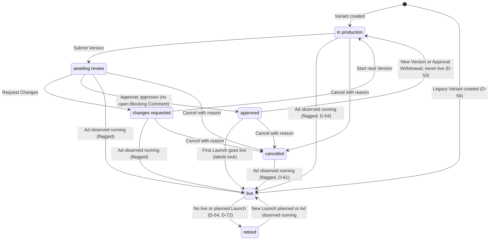
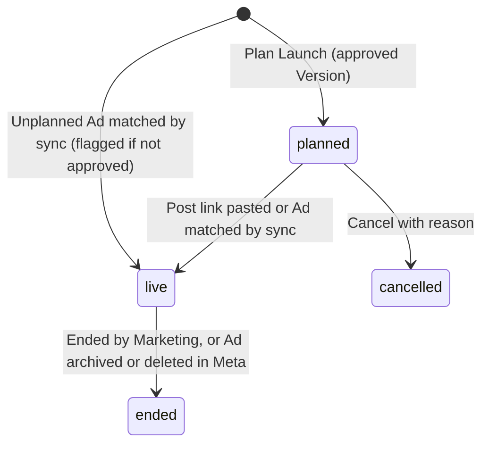

# PRD — Marketing & Creative Performance Workstation

Version: 1.1

Date: 2026-10-11

Status: Requirements baseline revised to match the owner-confirmed [interview decisions](2026-10-11-interview-decisions.md) (D-01…D-79), including the defaults confirmed in later passes (D-49–D-59, D-61, D-66–D-79), the clarifications in D-60 and D-62, the retrospective in D-63 and Version files in Google Drive (D-64, D-65). The one remaining proposed default, PD-25's Drive check timing, is listed in §11.3; PD-26–PD-28 are confirmed as D-77 and PD-29 as D-79. Sizing and operations numbers stay proposed (D-58). No production implementation is claimed.

Audience: Marketing Team, Creative Team, product owner, designer, engineering and QA.

Companions: [Technical Requirements Document](creative-workstation-trd.md) · [Glossary (CONTEXT.md)](../../CONTEXT.md) · [ADRs](../adr/) · [Decision log](2026-10-11-interview-decisions.md)

Vocabulary follows CONTEXT.md. If this document conflicts with the decision log, the log wins until this document is corrected.

## Changes in 1.1

- **One company, no tenancy.** One brand (GML), about seven people. Workspaces, brand memberships and the viewer and workspace-admin roles are removed, and everyone signed in sees everything. Roles are Marketing or Creative plus an Approver flag, and the workstation owner holds the Admin flag (D-01–D-03, D-49, ADR 0005).
- **Platform and sign-in.** Supabase (Postgres, Auth, Storage, scheduled jobs) with company Google sign-in and a magic-link fallback. Domain commands run as Postgres functions (D-04, D-06, D-48, ADR 0001, ADR 0006).
- **Glossary vocabulary.** Brief → Creative → Variant → Version (D-09, D-10). Codes `GML-0007` / `GML-0007-B` replace `CR-000123`, and older codes stay valid as Legacy Codes (D-11, D-12, ADR 0002).
- **Labels.** Fixed per-level lists; Product and Initiative on the Brief; labels lock at go-live; only the Marketing Team sets or confirms Format (D-13–D-15, D-51; new FR-13).
- **Brief lifecycle.** Hand-off lock and Rebrief; owners and due dates; Production Stages; video, static and carousel. Brief attachments may be uploaded or linked (D-16–D-19, D-52).
- **Review.** Variant states including cancelled and retired; Blocking vs suggestion Comments; no per-resolution acceptance; Approval Withdrawal; a frozen Live Variant file (D-20–D-25, D-53).
- **Launch.** One Launch record (Post or Ad) replaces the distribution package / plan / target / binding chain. Ads match by the code in the ad name plus a Meta video ID check. Untracked and Mismatched Ads, pasted post links, Ads promoting a Post, and Dynamic Ads at ad level. Meta's reality wins for running Ads (D-26–D-31, D-54, ADR 0004; new FR-14).
- **Meta data.** Read-only system user; 6-hourly sync plus a daily 28-day re-pull; 6-month backfill with Legacy Creatives; configurable Breakdowns; CSV or manual entry for other platforms; data health page (D-32–D-38).
- **Reading results.** Result and Cost per Result as the final judge; Combination view and Label view; spend share; Controlled Test (D-39–D-41; new FR-15).
- **Learning.** v1.0 performance reviews fold into the Optimization Plan, which carries frozen Evidence and a Verdict (D-42, D-43, D-57).
- **Notifications.** One-to-one WhatsApp plus in-app My Tasks, with Untracked Ads as one Marketing Team task. Activity log. Archive, never delete, except files that were never attached (D-44–D-46, D-56, D-59).
- **Separate system.** No import bridge from the Video Orchestrator (D-05, ADR 0003).
- **Confirmed defaults (second pass).** The first draft's proposed defaults PD-01…PD-18 are now decisions D-49–D-59. The owner changed several:
  - Brief attachments may be uploaded (D-52).
  - Only the Marketing Team sets or confirms Format (D-51).
  - An Ad seen running is recorded live even without approval, and is flagged; Legacy Variants start live (D-54).
  - A single-code carousel is not a Dynamic Ad (D-58).
  - Untracked Ads become one Marketing Team task (D-56).
  - Never-attached uploads are hard-deleted after 30 days, and CSV files live in a private import area (D-59).
- **Third pass.**
  - Video Versions store measured duration, Transcripts and Content Sections (D-60; new FR-16).
  - PD-19–PD-22 are confirmed as D-61.
  - V1 stores only pasted Google Drive links; the never-attached file purge runs in an Edge Function; Launch thumbnails are stored files (D-62).
- **Fourth pass.**
  - Creative Retrospective / 复盘 inside Optimization Plans (D-63; new FR-17).
  - Every Version file, drafts and completed, stays in Google Drive. The workstation records each file's identity through read-only Drive access and flags later changes; Supabase Storage no longer holds review or final files (D-64, D-65, ADR 0007). This amends the Storage parts of D-06, D-07, D-52 and D-62, and of ADR 0001, for Version files.
  - PD-23 and PD-24 are confirmed, with SRT/WebVTT transcript import and no automatic transcription (D-68). Most of PD-25 is confirmed as the Drive Version file rules (D-69).
  - Briefs gain an optional hypothesis (D-67). The web client is a Vite + React + TypeScript single-page app (D-66).
  - Sign-in uses Google with personal Gmail accounts, limited to invited members, with magic links as a backup (D-70).
  - Raw footage is tracked as Footage with `RAW-` codes, linked to the Variants that use it (D-71; new FR-18).
- **Requirement IDs.**
  - Added FR-13–FR-18 and AC-17–AC-33.
  - AC-30 (the Evidence check on annotation revisions) was split from AC-29.
  - Removed the cross-workspace part of AC-13; its ingest and Claude-role part moved to AC-27.
  - Removed the package part of AC-05.

## 1. Product purpose

Build an internal workstation where GML's Marketing Team and Creative Team take a Creative from Brief to a live Post or Ad, read how it performs on Meta, and plan what to make next. One Creative record connects:
- the Brief version it followed;
- every Variant and Version;
- the Reviews;
- the Launches that used it, and their results;
- the Optimization Plans that follow.

The six-step workflow:

1. The Marketing Team writes a Brief: Product, Avatar, Angle, Funnel Stage, optional Initiative, key message and CTA. Optional attachments include a script, references or rough material (初稿).
2. The Creative Team decides each Creative's Narrative Style (叙述方式), produces Variants through rough cut (粗剪) and fine cut (精剪), and submits Versions for review.
3. The Marketing Team reviews each Version and comments.
4. The Creative Team makes a new Version when changes are requested. After an Approver approves, the Marketing Team plans Launches (Posts and Ads), and people execute them in Meta.
5. Meta results sync back against each Variant's code, and both teams read them in the Combination view and the Label view.
6. Both teams write an Optimization Plan. Its actions start a new Brief, a new Variant or an ad-side change, and it receives a Verdict at its check date.

## 2. Problems to solve and desired outcomes

| Problem | Required outcome |
|---|---|
| Briefs, files and comments are scattered | One Creative record holds the full history and the next action |
| Teams cannot tell which Version is approved | Approval names an exact Version; earlier Versions stay accessible |
| Feedback loses context | Comments attach to an exact Version and position, marked blocking or suggestion |
| Posts and Ads cannot be traced to what they ran | Every Post and Ad links to a Variant code and its launched Version |
| Results are disconnected from creative decisions | Results are read by Combination and by label (Avatar, Angle, Format, Narrative Style, hook type) |
| Learnings do not become work | Each Optimization Plan has an owner, actions, a check date and a Verdict |

The first successful end-to-end use is one Creative completing all six steps. That includes Ads matched by code, results in both views, and an Optimization Plan with a recorded Verdict. A workflow-only release is an intermediate milestone.

## 3. Users and permissions

The workstation serves one company with one brand (D-01, ADR 0005). Everyone signed in sees everything: Briefs, files, Comments and results (D-02). People sign in with Google using their personal Gmail accounts, or with an email magic link as a backup; only members the Admin has invited can sign in (D-04, D-70).

Each person is Marketing or Creative. One or more Marketing Team members carry the Approver flag (D-03). The workstation owner holds the Admin flag (D-49).

| Capability | Marketing Team member | Creative Team member | Approver flag | Admin flag (D-49) |
|---|---|---|---|---|
| See every Brief, file, Comment and result | Yes | Yes | — | — |
| Create, write, hand off and Rebrief a Brief; upload or link its attachments; maintain the Marketing label lists (Product, Initiative, Avatar, Angle, Funnel Stage, Format) | Yes | No | — | — |
| Create a Creative | Yes (D-51) | Yes; the Format stays unconfirmed (D-51) | — | — |
| Set or confirm a Creative's Format | Yes (D-51) | No | — | — |
| Set Narrative Style; create Variants and set their labels before go-live; set Production Stage; register Version files from Drive; submit Versions; save video annotations; resolve Comments; maintain the Creative label lists | No | Yes | — | — |
| Comment on a Version | Yes | Replies | — | — |
| Request Changes | Yes (D-50) | No | — | — |
| Approve; withdraw an approval; record a Verdict | No | No | Yes | — |
| Plan, confirm, end and cancel Launches; add Launch thumbnails; resolve Untracked and Mismatched Ads; import CSV; enter results by hand | Yes (D-55, D-61, D-62) | No | — | — |
| Add and edit Footage (D-71) | Yes | Yes | — | — |
| Record which Footage a Variant uses, before go-live (D-71) | No | Yes | — | — |
| Write an Optimization Plan | Yes | Yes | — | — |
| Archive a record (D-61): a Brief by its Marketing Owner; a Creative by its Creative Owner or the Brief's Marketing Owner; an Optimization Plan by its owner or an Approver; a label item by its owning team; Footage by the member who added it (D-79) | When owner | When owner | Any Optimization Plan | Any record |
| Manage members and flags, the team time zone (D-78), the Meta connection, WhatsApp settings and Breakdown settings | — | — | — | Yes |

One Approver's decision approves a Version (D-50); multi-approver chains are later scope. Changes of owner, role or flag are logged (D-45).

## 4. Scope

### Included in V1

- Sign-in, My Tasks and shared boards for Briefs, Creatives and Variants, with bilingual labels where helpful.
- Briefs with labels, a Marketing Owner, uploaded or linked attachments, the hand-off lock and Rebriefs.
- Creatives, Variants and Versions for video, static image and carousel (D-19), with Production Stages, Version files registered from Google Drive (D-65) and linked working files.
- A Footage library with `RAW-` codes, linked to the Variants that use it (D-71).
- Reviews with anchored blocking and suggestion Comments, explicit decisions and Approval Withdrawal.
- Launch records for Posts and Ads, generated ad names, and matching to Meta by code and video ID.
- Read-only Meta sync (Marketing API plus Page and Instagram insights) with a 6-month backfill, Breakdowns and a data health page. Manual entry and validated CSV import for other platforms.
- Results by Variant, Combination and label, with Cost per Result as the final judge.
- Optimization Plans with frozen Evidence and Verdicts.
- One-to-one WhatsApp notifications, My Tasks, an activity log, and a read-only reporting role for Claude.

### Later scope

- Direct publishing, ad creation and budget changes.
- Built-in editing and generative production.
- An import bridge from the Video Orchestrator (D-05).
- Automated connectors for TikTok, Xiaohongshu and YouTube.
- Importing offline/CRM sales (D-39).
- Multi-approver chains.
- Email and Slack notifications.
- Automated statistical testing.

V1 records posting and advertising decisions, and people execute them in Meta (D-26). The UI always distinguishes a planned Launch from a live one.

## 5. Information architecture

The main navigation is My Tasks, Briefs, Creatives, Footage, Results, Optimization, Data health and Settings.

| View | Primary contents |
|---|---|
| My Tasks | Actions waiting for me: hand-offs, Versions to review, changes requested, Launches to plan, Mismatched Ads, Verdicts due. Marketing Team members also see the shared Untracked Ads task |
| Briefs | Brief, Marketing Owner, labels, Brief version, Creatives and Variant counts by state |
| Creative board | Creative Code, title, Format, Narrative Style, Creative Owner, due date, Variants by state, next action |
| Creative detail | Brief (version followed), Variants and Versions with the Footage each uses, Review, Launches, Results, Optimization |
| Footage | Footage Code, title, source, date, presenter, Drive folder, usable-until date, Variants using it |
| Results | Combination view (per ad set and period), Label view, Variant results, Breakdowns |
| Optimization | Creative Retrospective (复盘): video, transcript, Content Sections, scoped results, team findings and Plans with Evidence, owner, priority, due date, check date, state and Verdict |
| Data health | Last sync, coverage, errors, Untracked Ads, Mismatched Ads, Ads live without approval, Legacy Creatives awaiting labels, Version files changed or unreadable in Drive |
| Settings | Team label lists; members and flags, the team time zone that "today" follows for due and check dates (Asia/Kuala_Lumpur, D-78), Meta connection, WhatsApp and Breakdowns (Admin, D-49) |

Records can be found by Creative Code, Variant code, Legacy Code or title, and filtered by label, owner, state and due date. A Creative shows each Variant's state and each Launch's status independently.

## 6. Functional requirements

### FR-01 — Creative identity and ownership

Each Creative receives a Creative Code when it is created: the brand prefix plus a sequence number, e.g. `GML-0007` (D-11). Each Variant's code is the Creative Code plus a letter, e.g. `GML-0007-B`, and letters continue AA, AB… after Z (D-58). Versions display as `GML-0007-B v3`.

Codes carry no other meaning and are never reused, including for cancelled Variants (ADR 0002). Older codes such as `GML-TESTI-0007` remain valid as Legacy Codes (D-12). Brand is a plain field on each Creative (D-01).

Every Brief has a Marketing Owner. Every Creative has a Creative Owner and a due date (D-17). A different Narrative Style or Format makes a new Creative. A different Hook, length or aspect ratio makes a new Variant of the same Creative (D-10). Records are archived, never hard-deleted (D-46). The one exception is files that were never attached (FR-11).

### FR-02 — Brief

The Marketing Team writes a Brief with these fields:
- Product, Avatar, Angle, Funnel Stage and an optional Initiative (D-13);
- the key message;
- a CTA, or an explicit "none";
- an optional hypothesis: what the team wants to learn (D-67);
- optional attachments (script, references, rough material 初稿), each uploaded within a size limit or linked (D-52; the limit is in TRD §7).

An incomplete Brief can be saved, and handing it off lists the missing fields. Hand-off also requires at least one Creative, created by the Marketing Team, with a Format, a Creative Owner and a due date (D-51).

The Brief locks when it is handed to the Creative Team. Any later change is a Rebrief: a new Brief version with a reason, handed off again (D-16). Each Creative keeps the Brief version it followed. A Creative that has never been live may move to the new version; a Creative that has been live keeps its version (D-51, D-14).

### FR-03 — Creative production / 叙述方式、粗剪、精剪

Only the Marketing Team sets or confirms a Creative's Format. The Format must be confirmed before the Creative's first Version is submitted, so a Creative created by the Creative Team waits for a Marketing Team member to confirm it (D-51). The Creative Team sets the Narrative Style (D-13).

The Creative Team creates Variants and sets their labels: a hook type (video only), length and aspect ratio (D-13, D-19). The labels can be edited until the go-live lock (D-14). Narrative Style and the Variant labels are required before a Variant's first Version is submitted (D-51).

Each Variant moves through its Production Stages (D-18; carousels follow the static track, D-58):
- video: 叙述方式 → rough cut (粗剪) → fine cut (精剪) → ready;
- static image and carousel: concept → layout → refinement → ready.

Working files stay in the Creative Team's editing tools (Google Drive), and only their pasted links are kept on the Variant (D-07, D-62). Each Version file, from the first draft to the completed file, is a specific file in the team's Google Drive folder, registered with the workstation (D-64, D-65; FR-11). Storage holds only Brief attachments, Launch thumbnails and CSV import files (D-52, D-59, D-62).

A Version can be submitted only with a verified file (FR-11). A submitted Version is immutable, so any change is a new Version in a new Drive file. Once a Variant is live its file is frozen, and any change becomes a new Variant letter (D-25). The workstation cannot stop someone editing a file in Drive, so it flags a Version file that changes after registration instead (FR-11).

### FR-04 — Review and revision

The Marketing Team reviews one exact Version at a time. A Comment attaches to that Version, optionally at a video timestamp or range, an image position or a carousel card (D-22). Each Comment is marked blocking (必改) or suggestion (建议). The Creative Team replies to and resolves Comments.

An unresolved Blocking Comment stays open on the Variant across Versions and prevents approval; suggestions never block. Marketing does not accept each resolution separately: the Approver's approval accepts them (D-23). If a resolution is not good enough, the Marketing Team leaves a new Blocking Comment or requests changes.

Every Review ends in an explicit Approve or Request Changes. Any Marketing Team member may request changes (D-50). Comments alone, inactivity or a closed tab never approve (D-21). Review rounds are counted. The review screen shows the Version under review, its decision and earlier rounds. A stale tab cannot overwrite a newer decision (D-47).

### FR-05 — Approval and launch readiness

Only an Approver can approve, and one Approver's decision is enough (D-03, D-50). Approval applies to one exact Version and is impossible while the Variant has an unresolved Blocking Comment. If the Creative Team starts a new Version of an approved Variant that has never been live, that approval no longer allows a Launch (D-53).

An Approver may withdraw an approval with a reason (Approval Withdrawal). After that, no one can plan a new Launch of that Version or confirm a planned Post with it. Before go-live the Variant returns to in production; after go-live it stays live (D-53). Existing live Posts and Ads are unaffected and keep being reported honestly (D-24). If Meta shows an Ad running anyway, the sync still records it live and flags it (D-54).

The v1.0 distribution package and its confirmation are removed in 1.1 (D-27). Caption, thumbnail and ad copy are recorded on the Launch itself.

### FR-06 — Launches

A Launch is one showing of a Variant to people, as a Post or as an Ad (D-27). It is normally planned for an approved Variant and becomes live once confirmed. An Ad seen running without a plan is recorded as an unplanned live Launch (D-54). A Launch is recorded as one of:
- a **Post**: page or account, caption, thumbnail and date;
- an **Ad**: ad account, Meta campaign, ad set, ad copy and planned budget.

A Launch thumbnail is an uploaded, stored file, and it may be added even while the Variant is live (D-62).

A planned Launch's status runs planned → live → ended or cancelled, and cancelling needs a reason. An unplanned Launch starts live. One Variant can have many Launches, each with its own status.

For an Ad, the system generates:
- the ad name `[<variant code>] avatar · angle · narrative`, e.g. `[GML-0007-B] Working mums · Saves time · Testimonial` (D-28);
- the URL parameter `utm_content=<variant code>` (D-39).

How a Launch goes live and ends (D-29, D-54):
- A **Post** goes live when its link is pasted into the Launch. The post ID is resolved in the background, and a failure is flagged on data health.
- An **Ad** Launch goes live when the sync matches its Ad (FR-14). A matched Ad with no planned Launch creates a live Launch marked unplanned.
- An Ad Launch ends when Meta reports the ad archived or deleted, or when the Marketing Team ends it. A paused ad stays live.

**Meta's reality wins** (D-54). An Ad observed running is recorded live even if its Version was never approved or its approval was withdrawn, and it is flagged on data health. Variants created from Legacy Codes start live. The details are in D-61:
- A sync-created Launch records the Variant's latest submitted Version, or none.
- The Variant moves to live from any never-live state, including cancelled.
- An open Review can still be decided, and approving the recorded Version clears the flag.

An Ad that promotes an existing Post links to that Post's Launch, and their numbers are never added together (D-30). The same Meta post or ad never backs two Launches.

### FR-07 — Meta ingestion and data health

The workstation reads Meta with read-only access (D-32):
- the Meta Marketing API for Ads;
- Page and Instagram insights for organic Facebook and Instagram Posts.

Access goes through a Business Manager system user with read-only permissions, set up once by a Business Manager admin. Who that admin is, and which accounts are connected, is still open (O-02).

The sync runs every 6 hours. Each day it re-pulls the last 28 days, or the attribution window if that is longer, and it keeps raw responses (D-33). The first import backfills 6 months (D-34).

Breakdowns are configurable in Settings, with age × gender and placement on by default (D-35). A Breakdown that is turned on is collected from the next sync and over the 28-day window; older history needs an explicit backfill (D-58).

TikTok, Xiaohongshu and YouTube results are entered by hand by the Marketing Team (D-61) or through validated CSV import with provenance (D-36, D-55). CSV files are kept in a separate private import area (D-59). Missing metrics stay null, never zero (D-37). Repeated syncs or imports never duplicate totals.

A data health page shows the following (D-38, D-54):
- the last successful sync, coverage and errors;
- Untracked Ads and Mismatched Ads;
- Ads live without approval.

If Meta access is revoked, the page shows an actionable error and earlier results are kept.

### FR-08 — Reading results

**Result** is whatever the ad set is optimised for, such as a lead, a message or a purchase, as Meta reports it. The result type is never hard-coded. **Cost per Result** is the final judge. Funnel metrics explain why (D-39):
- hook rate = 3-second plays ÷ impressions;
- hold rate = ThruPlays ÷ 3-second plays;
- CTR;
- conversion rate = Results ÷ link clicks.

The hook rate, hold rate and conversion rate formulas are from D-58.

Metric rules (D-37):
- Compute ratios from summed numerators and denominators; never average ratios.
- Keep organic, paid and combined scopes separate.
- Never mix currencies, time zones or attribution windows.
- Never sum Reach.

Every result shows its date range, scope, account time zone, currency, attribution setting, freshness and match quality, and each ratio shows its definition. Breakdowns appear per Ad, and in pooled views only where the figures are compatible (D-35).

Offline/CRM sales are not imported in V1. Ad IDs and `utm_content=<variant code>` are kept so they can be joined later (D-39).

### FR-09 — Optimization Plans and Verdicts

After reading results, both teams write an Optimization Plan (D-42). It holds:
- Evidence: the cited numbers, frozen when the plan is written so later data corrections cannot change it;
- a hypothesis;
- actions: a new Brief, a new Variant of an existing Creative, or an ad-side change;
- an owner, priority, due date and state (proposed, accepted, in progress, completed, cancelled);
- a check date and a minimum spend.

The plan's owner or an Approver changes its state (D-55). Each plan carries an evidence class: insufficient evidence, observational, or experiment-supported. Experiment-supported needs a Controlled Test (D-41).

At the check date both teams agree a Verdict (confirmed, not confirmed or not enough data), and an Approver records it (D-43). The minimum spend counts spend on Launches linked to the plan's actions between acceptance and the check date (D-57). If that spend is below the minimum, the Verdict is automatically "not enough data". There is no universal threshold.

Completing a plan requires its actions to be linked, and cancelling it requires a reason. A plan to scale or stop an Ad is only a decision record: V1 never changes a budget (D-26).

### FR-10 — Notifications, My Tasks and activity log

Every action is recorded in an activity log with actor, time, entity and reason. My Tasks items, notifications and review round counts all derive from that log's events (D-45).

Each handoff notifies the person who must act, in two ways (D-44; routing D-56 in §11.1; number O-02):
- a My Tasks item in the workstation;
- one one-to-one WhatsApp message through the official WhatsApp Cloud API, from the dedicated business number.

Untracked Ads are the exception. They form one task addressed to the whole Marketing Team, shown in every Marketing Team member's My Tasks, with no WhatsApp message (D-56).

Each task links to the exact record and Version, and read and done are tracked separately. A retried event never duplicates a task or a message. If a WhatsApp send fails, the task stays in My Tasks and shows the failure. WhatsApp groups are not used, and email and Slack are out of scope.

### FR-11 — Access, files and data access

Only signed-in members can reach records, previews, downloads and exports (D-02, D-04). Team and flag rules are enforced on the server for every command (D-48).

**Version files in Google Drive** (D-64, D-65). Every Version file, review drafts and completed files alike, for video, static image and carousel, stays in the team's Google Drive folder. The workstation never moves these files, changes their sharing or makes them public, and members view them under Drive's own sharing.
- The Creative Team registers a Version file by pasting its Drive link. Through read-only Drive access, the workstation records the file's identity: Drive file ID, revision, checksum, size, type, dimensions and, for video, duration. A file stays unverified until Drive reports this metadata, and an unverified file cannot be submitted.
- Submitting a Version freezes that record. Each Version uses its own Drive file; replacing a file's content in Drive does not make a new Version.
- A scheduled check re-reads recorded files. A file that has changed, been trashed or can no longer be read is flagged on the Version and on data health. Approval never carries over to changed content: the existing new-Version or new-Variant path applies (D-25, D-53).
- Working files remain paste-only links with no Drive access (D-62). A working-file link is never accepted as a Version file, and pasting any Drive link does not itself submit or approve a Version.
- Each Version's file is named `<variant code>_v<number>`, e.g. `GML-0007-B_v2.mp4`. A Drive file backs at most one Version, and nobody uploads new content over an older Version's file. Access is a read-only Google service account with Viewer access to the folder. While a file is flagged, its Version cannot be submitted, approved or used for a new Launch. V1 has no write access, so Drive may purge a replaced revision; the flag and recorded identity remain. In-app playback is chosen after testing Drive's embedded preview against a streaming player (D-69).
- The check timing is proposed under PD-25.

**Storage** is private. It holds Brief attachments, Launch thumbnails and CSV import files, and the CSV files sit in a separate private import area (D-52, D-59, D-62).

Every upload to Storage is verified for type, size and checksum, and images also for their dimensions (D-47, D-58). Proposed limits are 50 MiB per image, including Launch thumbnails, plus a size limit for Brief attachments (D-52; TRD §7). The proposed 1 GiB video limit (D-47) applies to registered Drive video as a sanity check. A failed or incomplete upload cannot be attached.

Claude gets a read-only database role that sees only curated reporting views, never raw tables. The `content-ads-monitor` skill moves from its JSON ledger to these views (D-08). Raw Meta responses are never exposed to the browser.

Nothing is hard-deleted (D-46), with one exception: a file uploaded but never attached to any record is hard-deleted after 30 days (D-59). The deletion runs in an Edge Function through the Storage API (D-62). It applies only to Storage uploads: the workstation never deletes, trashes or edits a Drive file.

The v1.0 clause on importing files from the video-production foundation is removed in 1.1: there is no import bridge in V1 (D-05, ADR 0003).

### FR-12 — Findability and usability

Direct links open the Creative, the Variant and an exact Version. Teams can:
- search by Creative Code, Variant code, Legacy Code or title;
- filter by label, owner, state and due date;
- see overdue or blocked work.

Core navigation, Comment entry and decisions work by keyboard, and state is shown in text as well as colour. Desktop is primary, and review is usable on mobile.

### FR-13 — Labels and label lock (new in 1.1)

Labels are fixed lists. Each team adds items to its own lists, and renaming or merging an item carries its history (D-13).

| Level | Labels | Owning team |
|---|---|---|
| Brief | Product, Avatar, Angle, Funnel Stage, optional Initiative | Marketing |
| Creative | Format (set or confirmed before the first submission, D-51) | Marketing |
| Creative | Narrative Style | Creative |
| Variant | hook type (video only), length, aspect ratio | Creative |

An Avatar is the customer a Creative is aimed at. On-screen presenters, if tracked, are a separate list and never Avatars (D-15).

A Creative's labels, its Variants' labels and the Brief version it follows lock when its first Variant goes live, so analysis cannot drift afterwards (D-14). Legacy Creatives have no Brief, so their Brief-level labels are filled in on the Creative later (D-34). Legacy Variants start live (D-54), so each empty label on a Legacy Creative can be filled once and then locks (D-61). Before go-live, Variant labels can be set and edited, and they are required before the first submission (D-51).

### FR-14 — Ad matching and reconciliation (new in 1.1)

The sync matches each Meta ad by the code in its name (D-28, ADR 0004):
- The first matched Ad for a Variant records the Variant's Meta video ID. For static images and carousels, the Meta image hashes stand in (D-58).
- A later Ad with the same code but a different video becomes a **Mismatched Ad**.
- An ad with no recognisable code is an **Untracked Ad**.
- A Marketing Team member resolves both lists, and each resolution is logged (D-55). Untracked Ads also form one task for the whole Marketing Team (D-56).

Two further cases are covered by D-61:
- An Ad whose media changes after it was matched becomes a Mismatched Ad.
- An ad name with a Creative Code but no Variant letter is Untracked, with that Creative suggested.

A **Dynamic Ad** rotates several Variants inside one ad (D-58):
- A Launch may be marked Dynamic and list its Variants, and its generated name lists every Variant code (D-61).
- An ad whose creative holds several videos, or several images that are not a single-code carousel, is treated as Dynamic.
- A carousel carrying one Variant code is not a Dynamic Ad.

Dynamic Ads are reported at ad level only and excluded from single-Variant ranking (D-31).

The 6-month backfill handles older ads like this (D-34, D-54, D-58):
- An ad carrying a Legacy Code creates a Legacy Creative. It has no Brief and its labels are filled in later.
- Each Legacy Creative gets a new Creative Code, keeps its Legacy Code as a matching alias, and starts with a live Variant `-A`.
- An ad with no code goes to Untracked.

### FR-15 — Combination view and Label view (new in 1.1)

Two views reflect Meta Andromeda's creative-led delivery (D-40):
- **Combination view:** the Live Variants in one ad set over a period. It shows blended Cost per Result, each Variant's spend share, and diversity across Avatar, Angle, Format, Narrative Style and hook type. Dynamic Ad, Untracked and Mismatched spend appear as their own slices, so the shares add up to 100%.
- **Label view:** results pooled by each label across ad sets. Pooling only combines figures with the same Result type, currency and attribution setting (D-37).

Low spend share reads as "Meta didn't pick it", not "it lost". Only a Meta A/B test is a Controlled Test, and every other comparison is labelled observational (D-41). Dynamic Ads appear at ad level only.

### FR-16 — Video duration, transcript and content sections

Store and display the actual duration, transcript and Content Sections of each exact video Version (D-60). Actual duration comes from the verified media, as Drive reports it for the registered file (D-65); it is separate from the Variant's planned length label. Keep this searchable metadata in the database alongside the file reference, regardless of where the video itself is stored.

The annotation model (D-68) uses timestamped speech cues with a language, plus a separate Content Section timeline. Main section types are Hook, Body, CTA and Other; optional detail labels include problem, solution, demo, benefit, proof/testimonial, objection handling and offer. Sections may repeat, and a video need not contain every type. Silence is not a missing transcript error, and absent/unprocessed speech is distinguishable from confirmed no speech. On-screen copy is separate from spoken words.

Both teams can read the transcript and timeline. The Creative Team can enter or import annotations, correct words and adjust section boundaries. Import accepts SRT and WebVTT subtitle files exported from the editing tool, and imported cues start as a draft transcript for the Creative Team to review (D-68). Each published correction creates an annotation revision while preserving previous revisions; it does not change the approved media or require a fake video Version. A recut is a new video Version and gets its own annotations. Automatic transcription or section detection is optional future integration work until its provider, costs and permissions are selected.

The proposed interface shows duration and a clickable section timeline beside the transcript; selecting a cue or section seeks to its start when the selected file preview supports seeking. Optimization Plan Evidence records the exact annotation revision it cites. Do not infer section-level Results or Cost per Result from whole-ad metrics.

### FR-17 — Creative Retrospective / 复盘

Both teams can start a retrospective from a Creative, Variant or Results selection (D-63). It is the analysis within an Optimization Plan (FR-09), not the pre-launch approval Review. The workspace (D-68) follows this sequence:

1. **Recall the intent.** Show the Brief version, Avatar, Angle, Narrative Style, the Result type of the selected Launches and the hypothesis alongside the exact live Version. The hypothesis comes from the Brief version's optional hypothesis and, when the Brief or Variant came from an Optimization Plan action, from that plan; with neither, the workspace says none was recorded (D-67). Display any unknown or mismatched Version explicitly rather than substituting the latest edit.
2. **Inspect the content.** Show the video, measured duration, transcript and Hook/Body/CTA timeline. Each finding can cite an exact section or time range, or the whole video. Authorized playback may seek to the cited time; inaccessible media or missing annotations remain visible as limitations.
3. **Read the evidence.** Show selected Launches, paid/organic scope, dates, Result type, spend and spend share where applicable, Results, Cost per Result and available funnel metrics. Keep comparison scopes compatible under FR-08. An optional comparison identifies a baseline Variant or earlier Optimization Plan. Missing metrics remain unavailable; low delivery is not a failed creative.
4. **Record the team's interpretation.** Separate measured observations from hypotheses. Marketing contributes notes on audience, angle, offer and delivery context; Creative contributes notes on hook, pacing, narrative, proof and CTA. Record what to keep, change or test, with an author and evidence reference. These prompts are guidance, not mandatory role-specific forms.
5. **Plan and return.** Link each next action to its finding, owner, due date and intended change. Use the existing new-Brief, new-Variant and ad-side action types. At the check date, compare the resulting work with the frozen baseline and record the existing Verdict, including not enough data when appropriate. Keep the chain from finding to action to outcome searchable.

A section diagnosis is a hypothesis unless the cited data actually measures that interval. Never spread whole-ad Results across sections, invent a retention curve, or label the first three seconds as the performance of a five-second Hook. A valid audience-retention series, if available for the exact video and scope, may be aligned with the timeline with its source and time buckets visible; acquiring it is not a V1 dependency. Only a Controlled Test supports experiment-supported conclusions (D-41).

Saving the plan freezes the cited metric data, comparison scopes, media identity and annotation revisions. Subsequent transcript corrections or Meta updates do not rewrite that baseline. A retrospective may be recorded without performance data but must then be labelled insufficient evidence. Search past findings and Verdicts by Creative/Variant code, section type and existing labels to inform later Briefs.

### FR-18 — Footage (raw footage library)

Raw footage is tracked as Footage: one batch of unedited material from one shoot session or one creator's delivery, kept in one Google Drive folder (D-71). Each Footage gets a permanent, never-reused Footage Code: `RAW-0001`, `RAW-0002` and so on. The code is a plain sequence without meaning, and it can never be mistaken for a Creative, Variant or Legacy Code in ad names (ADR 0002).

Either team adds Footage with a title, its source (own shoot, creator, stock or product shots), the date it was shot or received, the on-screen presenter where relevant (from the presenter list, D-15) and the Drive folder link. Creator footage may carry an optional usable-until date for its usage rights. The Drive folder is only a link: the workstation never checks it, and it never becomes a Version file (D-62).

The Creative Team records which Footage each Variant uses. A Variant can use several Footage items, and one Footage item can be reused across Variants and Creatives. Like the labels, a Variant's Footage locks when its Creative first goes live (D-14).

Either team corrects a Footage item's details later. Its presenter is fixed once a Variant using it has gone live, so past results never move to another presenter (following D-14's go-live lock). The member who added Footage, or the Admin, archives it (D-79): archived Footage stays on the Variants that already use it, as history, but can't be added to more (D-78).

Later steps build on this. Planning a Launch for a Variant whose Footage is past its usable-until date shows a warning (M2), and results and 复盘 can be read by Footage, for example by shoot or presenter (FR-15, FR-17).

### FR-19 — Canvas views

Four visual views help both teams see and shape the work (D-75):
- **Creative canvas.** One map per Creative, laid out automatically: Brief → Creative → Variants → Versions and their Review outcomes → Launches with their results → 复盘, with each 复盘 pointing to the follow-up Variants it created. Every box opens its record.
- **Variant wall.** Every Variant as a tile with its labels, state and results, filtered by labels and Footage and sorted by cost per result. Only results of one currency, result type, attribution, time zone and channel are compared; others are marked not comparable, never converted (D-37). Tiles show placeholders until thumbnails exist.
- **Review canvas.** A large player with the Content Sections and comment pins on one timeline, beside the comments. Until the B2 playback test decides otherwise, Drive's embedded preview plays the video: it needs a Google sign-in with access to the file, often fails in Safari and on iPhone, and cannot jump to a time, so a pin shows the time to scrub to (D-69). The same preview appears on the Video content page and the 复盘.
- **Whiteboard.** Boards of text sticky notes and labelled frames that both teams arrange, optionally attached to a Brief or Creative and linking to Briefs, Creatives, Variants, Footage and Findings. Each note saves on its own with a version check, so a teammate's newer words are never replaced without the person knowing. Removing archives, and Undo puts it back; an archived board stays readable.

## 7. Workflow states and rules

Variant states (D-20, D-53, D-54):

Launch status (D-27, D-54):

Rules:
- **Briefs.** A Brief version can be edited until it is handed off, then it locks; a Rebrief adds a new version. Brief and Creative states are derived from their Variants (D-20), and the boards show Variant counts by state.
- **Approval path to live.** The normal path to live runs through an approved Version. The user commands that plan a Launch or confirm a Post require that approval (D-24).
- **Observed path to live.** The sync records any Ad it sees running, whatever the approval state (D-54).
  - It moves a never-live Variant to live and flags it on data health. D-61 covers the cancelled case and the Version the Launch records.
  - Legacy Variants start live (D-54).
- **Variants.**
  - Cancelling is possible only while a Variant has never been live, and needs a reason; a Retired Variant has been live and cannot be cancelled.
  - A Live Variant takes no new Versions (D-25).
  - After an Approval Withdrawal a Live Variant stays live, but no new Launch may use that Version (D-53).
- **Retired.** A Live Variant becomes Retired automatically once none of its Launches, Post or Ad, is live or planned (D-54, D-72). A paused ad stays live, so it keeps the Variant live.
- **Optimization Plans.** States run proposed → accepted → in progress → completed, or cancelled. Completing needs linked actions and a summary; cancelling needs a reason. The Verdict is recorded at or after the check date.
- **Results** are not a workflow state.

## 8. Success measures and proposed quality targets

These targets are proposed for the pilot. They are not measured achievements or contractual promises.

| Measure | Definition / initial target |
|---|---|
| Launch lineage | 100% of planned Launches link to a Version that was approved and in effect when planned; every Launch that went live without approval is flagged on data health (D-54) |
| Current next action | Every active Variant shows its next owner and action |
| Review turnaround | Median time from submission to decision; baseline set during the pilot |
| Review rounds | Rounds per approved Variant, from the activity log; never optimised at the expense of quality |
| Match coverage | Matched Ads ÷ synced Ads in connected ad accounts; Untracked and Mismatched Ads always visible; 100% on the release fixture |
| Learning closure | Plans past their check date that have a Verdict ÷ all plans past their check date |
| Notification integrity | No duplicated task or WhatsApp message, and no contradictory review decision, in release tests |
| Usability | One Marketing Team member and one Creative Team member each complete the six-step pilot without database access |

Proposed technical budgets, sized for about seven users (they stay proposed, D-58):
- operational commands: p95 under 2 seconds;
- a 90-day results view: p95 under 5 seconds on the TRD's pilot dataset;
- a My Tasks item within 60 seconds of a committed handoff;
- a WhatsApp message handed to the Cloud API within 5 minutes.

The Meta sync runs every 6 hours (D-33). Meta's availability and rate limits are shown to users but are not controlled by this product.

## 9. Acceptance criteria and traceability

| ID | Scenario and required result | Requirements |
|---|---|---|
| AC-01 | Hand off a complete Brief with one Creative. The Creative Owner gets a My Tasks item and a WhatsApp message, and sees the exact Brief version and its attachments | FR-01, FR-02, FR-10 |
| AC-02 | Submit a video Version and a static Version. Each previews correctly and follows its Production Stages, and the Variant keeps its working-file link | FR-03, FR-11 |
| AC-03 | Leave a Blocking Comment and a suggestion on Version 1, request changes, and submit Version 2. The anchors stay on Version 1; the open Blocking Comment carries forward and blocks approval, and the suggestion does not | FR-04 |
| AC-04 | Open a Review and leave no Comment and no decision. The Variant stays awaiting review | FR-04 |
| AC-05 | Try to plan a Launch for a Version that is not approved, or whose approval was superseded or withdrawn: rejected. Plan one for the approved Version: accepted. *(Package-substitution part removed in 1.1, see D-27.)* | FR-05, FR-06 |
| AC-06 | Plan one Post and three Ads for one approved Variant, paste the post link, and let the sync match the Ads by their generated names. Each Launch shows the right identity and status, and no Meta object backs two Launches. A thumbnail uploaded to the Post Launch after the Variant is live is accepted (D-62) | FR-06, FR-14 |
| AC-07 | Replay identical sync pages, CSV files and commands, including Comment commands. Launches, Comments, tasks and totals do not duplicate | FR-04, FR-06, FR-07, FR-10 |
| AC-08 | A sync fails partway or Meta access is revoked. Earlier complete data remains, and the data health page shows the error and the coverage | FR-07 |
| AC-09 | Compare paid, organic, combined-scope and lifetime samples, plus an Ad promoting a Post. Incompatible numbers are never summed, and Reach is never summed | FR-06, FR-08 |
| AC-10 | Meta corrects late results inside the 28-day re-pull. Current results change, while an Optimization Plan's frozen Evidence stays the same | FR-07, FR-09 |
| AC-11 | Both teams write an Optimization Plan from results; its action creates a new Variant of an existing Creative; an Approver records the Verdict at the check date. Below the minimum spend (D-57 basis), the Verdict is automatically "not enough data" | FR-09 |
| AC-12 | Two conflicting review decisions race. One wins, and the other gets a conflict and reloads | FR-04, FR-10 |
| AC-13 | These are denied: unauthenticated requests, non-members, and commands that break role rules (a Creative Team member approving or setting a Format, a non-Approver withdrawing). *(Cross-workspace part removed in 1.1, see D-01; the ingest and Claude-role checks moved to AC-27.)* | FR-11 |
| AC-14 | Search by Creative Code, Variant code and Legacy Code; open an exact-Version link; complete a Review by keyboard and on a mobile layout | FR-12 |
| AC-15 | Rebrief a handed-off Brief. Existing Creatives keep the Brief version they followed. A Creative that has never been live may move to the new version, and one that has been live cannot | FR-02, FR-03, FR-13 |
| AC-16 | Withdraw an approval. No new Launch of that Version can be planned, and its planned Post cannot be confirmed. An Ad for it that Meta shows running is still recorded live and flagged (D-54). Existing live Posts and Ads are still reported | FR-05, FR-06 |
| AC-17 | Before go-live, a Variant's hook type, length and aspect ratio can be set and changed. After a Variant goes live, editing its Creative's or its Variants' labels is rejected. Renaming or merging a label item keeps history and results | FR-13 |
| AC-18 | Sync an Ad named `[GML-0007-B] …`: it matches and records the video ID. A second `GML-0007-B` Ad with another video becomes a Mismatched Ad. An ad with no code becomes an Untracked Ad and appears in one task for the whole Marketing Team, with no WhatsApp message. A backfilled `GML-TESTI-0007` ad creates a Legacy Creative whose Variant `-A` starts live | FR-07, FR-10, FR-14 |
| AC-19 | A Dynamic Ad appears at ad level only and is excluded from single-Variant ranking. A carousel ad carrying one Variant code is matched normally, not as a Dynamic Ad | FR-14, FR-15 |
| AC-20 | For an ad set with three Live Variants and a Dynamic Ad, the Combination view shows blended Cost per Result, label diversity, and spend shares that add up to 100% of the ad set's spend for the period: one share per Variant plus Dynamic, Untracked and Mismatched slices. Comparisons without a Meta A/B test are labelled observational | FR-08, FR-15 |
| AC-21 | The Label view pools across ad sets only for matching Result type, currency and attribution setting. Age × gender and placement Breakdowns are on by default, and turning another Breakdown on in Settings adds it from the next sync | FR-07, FR-08, FR-15 |
| AC-22 | Request changes. Exactly one WhatsApp message goes to the Creative Owner and one My Tasks item appears; a retried event sends nothing new; a failed send leaves the task visible with the failure | FR-10 |
| AC-23 | Import a TikTok CSV with one invalid row. Valid rows import with provenance and the invalid row is rejected with a reason. Then enter one Xiaohongshu result by hand, which records the actor. Nothing is labelled as API data | FR-07 |
| AC-24 | Cancel a never-live Variant with a reason; cancelling a Live or Retired Variant is rejected. The Brief's Marketing Owner archives the Brief, and a non-owner who is not the Admin is refused (D-61). Nothing is hard-deleted, and history and results stay reachable | FR-03, FR-11 |
| AC-25 | Meta shows an Ad named `[GML-0009-A] …` running while that Variant is still awaiting review. The sync records an unplanned live Launch, moves the Variant to live, and flags it on data health | FR-06, FR-14 |
| AC-26 | Upload one Brief attachment within the size limit and link another; an over-limit upload is rejected. A file uploaded but never attached is hard-deleted after 30 days; attached files never are | FR-02, FR-11 |
| AC-27 | The browser cannot read raw ingest tables. Claude's role can read reporting views only and cannot write *(split from AC-13 in 1.1)* | FR-11 |
| AC-28 | A Creative Team member creates a Creative. Its first Version cannot be submitted until a Marketing Team member sets or confirms the Format, and the Creative Team cannot set the Format | FR-03, FR-13 |
| AC-29 | A 30-second Version has its measured duration, transcript and timed Hook/Body/CTA sections. Out-of-bounds or overlapping primary sections are rejected. Silent and not-yet-transcribed states differ. Correcting a transcript keeps the previous annotation revision, and a recut has separate annotations | FR-16 |
| AC-30 | Write an Optimization Plan whose Evidence cites a Version's annotations, then correct that transcript. The Evidence still cites the original annotation revision *(split from AC-29 in 1.1)* | FR-09, FR-16 |
| AC-31 | Start a retrospective for an exact live Version; cite a Hook, record an observed metric separately from a hypothesis, and link the finding to a new-Variant action. After data/transcript corrections, the baseline still shows its original Evidence. At the check date the action's outcome and Verdict are reachable from the finding. Missing data stays insufficient, incompatible comparisons are rejected and no section-level Results are fabricated | FR-09, FR-16, FR-17 |
| AC-32 | Register a Drive video for a Version. Its file ID, revision, checksum, size and duration are recorded, and it cannot be submitted while Drive is still processing it. A working-file link, a folder or a file already used by another Version is rejected. After the file's content is replaced in Drive, the scheduled check flags it on the Version and on data health, and no new Launch can be planned from that Version. The workstation never moves, shares or deletes the Drive file | FR-03, FR-05, FR-11 |
| AC-34 | A Creative with two Variants, Versions, Launches with results and a 复盘 shows them all on its canvas, with the 复盘 pointing to its follow-up Variant; each box opens its record and the map pans and zooms *(D-75)* | FR-19 |
| AC-35 | On the Variant wall, filtered to one Brief's angle, Variants in the same currency and result type sort by cost per result; one with results in another currency is "not comparable" and one never launched has "no results yet" *(D-75)* | FR-19 |
| AC-36 | The review canvas plays the Version in Drive's preview, shows the Hook/Body/CTA sections and comment pins on one timeline, says where to scrub for a picked pin, and takes new comments *(D-75)* | FR-19 |
| AC-37 | Both teams add notes and frames to a board on a Brief and link a note to a Variant; a stale move is refused rather than overwriting a newer one, and words typed over a teammate's newer edit are kept and saved only on purpose; removing a note archives it and Undo puts it back; only the board's creator or the Admin archives the board, which then cannot be changed *(D-75)* | FR-19 |
| AC-33 | Either team adds Footage and gets the next `RAW-` code, and a retried request gets the same code. A Variant lists two Footage items, and one of them is also used by another Variant. Only the Creative Team changes a Variant's Footage. After the Creative first goes live, changing a Variant's Footage is rejected *(go-live part tested in M2)* | FR-13, FR-18 |

## 10. Delivery milestones and dependencies

No milestone's exit condition depends on a capability from a later milestone.

| Milestone | Scope | Exit condition |
|---|---|---|
| M1: Team workflow | Sign-in, roles, labels, Briefs and attachments, Creatives/Variants/Versions with Version files registered from Drive, Review loop, My Tasks and WhatsApp | AC-01–04, AC-12, AC-13, AC-22, AC-26, AC-28, AC-29, AC-32 and AC-33 pass; Version files verified on the real Drive folder |
| M2: Launches and results | Approval integrity, Launches and the observed-live path, Meta sync and matching, Legacy backfill, CSV and manual entry, Combination and Label views, data health, archiving | AC-05–09, AC-14–21 and AC-23–25 pass; system-user access verified on real accounts |
| M3: Learning loop and release | Optimization Plans, frozen Evidence and Verdicts, Claude's reporting role, restore and load checks | AC-10, AC-11, AC-27, AC-30, AC-31 and all regression and operational checks pass; both teams finish the full pilot |

No duration or cost estimate is committed until staffing, the Supabase plan (re-evaluated now that Version files stay in Drive, D-06, D-65) and the O-02 setup facts are known. Automatic Meta feedback cannot be accepted on mock data or CSV fixtures alone.

## 11. Decisions, open items and remaining proposed defaults

### 11.1 Decided

| Topic | Decision | Source |
|---|---|---|
| Users and tenancy | One company, one brand, about seven people; no multi-tenancy; everyone sees everything | D-01, D-02, ADR 0005 |
| Roles and sign-in | Marketing or Creative plus an Approver flag; Google sign-in with personal Gmail for invited members, with a magic-link backup | D-03, D-04, D-70 |
| Admin | The workstation owner holds the Admin flag, which manages members and flags, the Meta connection, WhatsApp settings and Breakdown settings | D-49 |
| System boundary | Separate from the Video Orchestrator; no import bridge in V1 | D-05, ADR 0003 |
| Platform | New Supabase project (Postgres, Auth, Storage, scheduled jobs). The paid-plan expectation rested on video size and is re-evaluated, since Version files stay in Drive | D-06, D-65, ADR 0001 |
| Where commands run | Postgres functions called through Supabase RPC; Edge Functions only for external calls; no API server | D-48, ADR 0006 |
| Files | Every Version file stays in Google Drive and is registered through read-only Drive access, frozen at submission and checked for later changes. Storage holds Brief attachments (uploaded within a size limit, or linked), Launch thumbnails and CSV import files, with CSV in a separate private import area. Working files are kept only as pasted Google Drive links, with no Drive picker or API, and access follows Drive sharing | D-07, D-52, D-59, D-62, D-64, D-65, ADR 0007 |
| Claude access | Read-only role on curated reporting views | D-08 |
| Structure and codes | Brief → Creative → Variant → Version; `GML-0007` / `GML-0007-B`; Legacy Codes | D-09–D-12, ADR 0002 |
| Labels | Fixed per-level lists; lock at go-live; Avatar is not a presenter | D-13–D-15 |
| Creatives and Format | Marketing creates at least one Creative before hand-off; either team may add more. Only Marketing sets or confirms Format, before the first submission. Narrative Style and Variant labels are required before the first submission. A never-live Creative may follow a Rebrief | D-51 |
| Brief lifecycle | Hand-off lock, Rebrief, owners and due dates, Production Stages, three formats | D-16–D-19 |
| Review | Variant states; explicit decisions; blocking and suggestion Comments; no per-resolution acceptance; Approval Withdrawal; frozen live file | D-20–D-25 |
| Review roles | Any Marketing Team member may Request Changes; only an Approver approves; one Approver is enough | D-50 |
| Approval after a new Version or a withdrawal | A new Version of an approved, never-live Variant supersedes the approval. A withdrawal before go-live returns the Variant to in production; after go-live the Variant stays live | D-53 |
| Launch | One record (Post or Ad); name and video-ID matching; pasted post link; Ad promoting a Post; Dynamic Ads | D-26–D-31, ADR 0004 |
| Launch and Variant lifecycle | A Post goes live on its pasted link, with the post ID resolved in the background. An Ad goes live when matched. A matched Ad with no planned Launch creates an unplanned Launch. End rules. Meta's reality wins: running Ads are recorded live and flagged. Legacy Variants start live. Retired is automatic | D-54 |
| Command ownership | Marketing resolves Untracked and Mismatched Ads and imports CSV. The Creative Owner or the Marketing Owner cancels a Variant. The plan owner or an Approver changes a plan's state | D-55 |
| Meta data | System user; 6-hourly sync plus a daily 28-day re-pull; 6-month backfill; Breakdowns; CSV for other platforms; metric rules; data health | D-32–D-38 |
| Reading results | Result and Cost per Result; Combination and Label views; Controlled Test | D-39–D-41 |
| Learning | Optimization Plan with frozen Evidence and a Verdict; the minimum spend counts linked Launches between acceptance and the check date | D-42, D-43, D-57 |
| Notifications and history | One-to-one WhatsApp plus My Tasks, routed as below; Untracked Ads form one Marketing Team task; activity log; archive only | D-44–D-46, D-56 |
| Deletion exception | Files never attached to any record are hard-deleted after 30 days by an Edge Function through the Storage API. This is the only exception to D-46 | D-59, D-62 |
| Video content metadata | Each video Version stores its measured duration, Transcript and Content Sections; the annotation model is confirmed, with SRT/WebVTT import | D-60, D-68 |
| Creative Retrospective | 复盘 inside Optimization Plans, extending the existing learning loop; the FR-17 / T-18 design is confirmed | D-63, D-68 |
| Version files in Google Drive | Drafts and completed files for every format stay in Drive, with read-only registration, a frozen identity and change flags; the D-69 rules apply, and only the check timing remains PD-25 | D-64, D-65, D-69, ADR 0007 |
| Frontend stack | Vite + React + TypeScript single-page app using the Supabase client directly, styled from the mockup's tokens; hosting chosen before deployment | D-66 |
| Brief hypothesis | Optional "what we want to learn" on the Brief version, shown in the retrospective with any source plan's hypothesis | D-67 |
| Footage | Raw footage batches with `RAW-` codes, linked to Variants, locked at go-live, optional usable-until date | D-71 |
| Matching, observed-live, archiving and manual-entry details | See below | D-61 |
| Drive and thumbnails | Working files are Drive links only; Launch thumbnails are stored files and may be added while the Variant is live | D-62 |
| Technical defaults | See below | D-58 |
| Engineering rules | Idempotency, optimistic locking, audit and outbox together, file verification, backup and performance targets | D-47 |

The technical defaults (D-58) are:
- image hashes stand in for the video ID on statics and carousels;
- a single-code carousel is not a Dynamic Ad, and Dynamic Ads are detected as described in FR-14;
- Legacy Creatives get new codes, keep their Legacy Code as an alias, and start with Variant `-A`;
- the hook rate, hold rate and conversion rate formulas in FR-08;
- a new Breakdown is collected from the next sync and the 28-day window;
- Variant letters continue AA, AB… after Z, and carousels follow the static Production Stages;
- file verification runs in an Edge Function (as does the D-59 purge, per D-62);
- sizing and operations numbers stay proposed.

D-61 confirms the former PD-19–PD-22:
- An Ad whose media changes after matching becomes Mismatched.
- An ad name with a Creative Code but no Variant letter is Untracked, with that Creative suggested.
- A Dynamic Launch's name lists every Variant code.
- Each empty Legacy Creative label can be filled once, then locks.
- An Ad that goes live without approval follows the rules in FR-06.
- Archive rights are as in §3.
- The Marketing Team enters manual results.

Notification routing (D-56):

| Event | Who is notified |
|---|---|
| Hand-off or Rebrief | The Creative Owners |
| Version submitted | The Brief's Marketing Owner, plus the Approvers if that owner is not one |
| Changes requested | The Creative Owner |
| Version approved | The Marketing Owner |
| Approval withdrawn | Both owners |
| Mismatched Ad | The Marketing Owner |
| Untracked Ads | One task addressed to the whole Marketing Team, with no WhatsApp message |
| Variant overdue | The Creative Owner |
| Plan check date reached | The plan owner and the Approvers |
| Sync failure | The Admin |

### 11.2 Open

| ID | Question | Needed by |
|---|---|---|
| O-02 | Setup facts: the dedicated WhatsApp number; the Business Manager admin; the list of ad accounts, Pages and Instagram accounts; the Google Drive folder for Version files and the account that owns it. The team uses personal Gmail, not Google Workspace (answered 2026-10-12); sign-in follows D-70 | Before integration (the WhatsApp number and Drive folder in M1, Meta access in M2) |
| PD-25 | Drive change-check timing and scope (see §11.3) | Before the Drive integration in M1 is finalised |

The former O-01 (where domain commands run) is decided as D-48 / ADR 0006. The Shared Drive vs My Drive question is closed by D-62.

### 11.3 Remaining proposed defaults

PD-01…PD-18 are now decisions D-49–D-59, PD-19…PD-22 are D-61, PD-23 and PD-24 are D-68, PD-25 is D-69 apart from the item below (see §11.1), PD-26–PD-28 are D-77, and PD-29 is D-79. The item below remains unconfirmed. Sizing and operations numbers stay proposed by decision (D-58) and are not listed here.

| ID | Proposed default | Where used |
|---|---|---|
| PD-25 | Drive change check: runs every 6 hours and on request from a Version or plan page, covering the files of Versions under review, approved Versions in effect, Versions of Live Variants and files cited as Evidence. The rest of the former PD-25 is D-69 | FR-11, AC-32 |

## 12. Document precedence

CONTEXT.md defines the vocabulary, the ADRs record hard-to-reverse decisions, and the decision log records confirmed decisions; the log wins on conflict. This PRD and TRD 1.1 supersede the exploratory designs in `docs/superpowers/specs/2026-10-10-*`. Examples such as ad names are illustrative, not real data.
