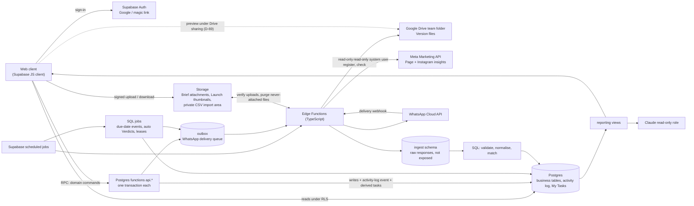

# TRD — Marketing & Creative Performance Workstation

Version: 1.1

Date: 2026-10-11

Status: Engineering specification revised to match the owner-confirmed [interview decisions](2026-10-11-interview-decisions.md) (D-01…D-80). The platform is Supabase (ADR 0001), and domain commands run as Postgres functions called through Supabase RPC (ADR 0006). Sizing and operations numbers stay proposed (D-58). This document creates no database, connector or deployment.

Audience: Engineering, database, integration, QA and operations.

Product contract: [PRD](creative-workstation-prd.md) · Vocabulary: [CONTEXT.md](../../CONTEXT.md) · Decisions: [ADRs](../adr/), [decision log](2026-10-11-interview-decisions.md). No proposed product defaults remain (PRD §11.3); sizing and operations numbers stay proposed (D-58).

## Changes in 1.1

- **Single company.** Workspaces, brand memberships, tenant-qualified keys, viewer and workspace-admin roles, cross-tenant tests and the `/workspaces/{id}` prefix are removed. Roles are Marketing or Creative plus an Approver flag, and the workstation owner holds the Admin flag (D-01–D-03, D-49, ADR 0005).
- **Supabase.** Postgres, Auth, Storage and scheduled jobs. Raw ingest is never exposed, and Claude's role is read-only on reporting views (D-06–D-08, ADR 0001).
- **Execution.** Domain commands are Postgres functions called through Supabase RPC. Edge Functions handle only external calls, and there is no API server. The v1.0 `/api/v1` route table is replaced by an RPC command list (D-48, ADR 0006).
- **Glossary model.**
  - `concept` → Creative; `variant` + `variant_versions` → Creative / Variant / Version; `CR-000123` → `GML-0007` / `GML-0007-B`.
  - Audiences → Avatar labels; storytelling → Narrative Style; publications → Posts; ad groups → ad sets.
  - Labels lock at go-live (D-09–D-15, ADR 0002; new T-13).
- **Launch.** The package / confirmation / plan / revision / target / registration / binding chain becomes one `launch.launches` record. Ads match by the name code plus the Meta video ID, and Posts by a pasted link (D-26–D-31, ADR 0004; new T-14).
- **Review.** Blocking and suggestion Comments. The `comment_resolutions` and `blocker_links` tables are removed because resolutions are not accepted separately (D-22–D-24).
- **Meta.** System user; 6-hourly sync plus a daily 28-day re-pull; 6-month backfill with Legacy Creatives; configurable Breakdowns; CSV for other platforms; data health (D-32–D-38).
- **Results.** Combination view, Label view, spend share and Controlled Test (D-35, D-39–D-41; new T-15).
- **Learning.** v1.0 performance reviews fold into Optimization Plans with frozen Evidence and a Verdict (D-42, D-43).
- **Notifications.** One-to-one WhatsApp Cloud API plus My Tasks (D-44; new T-16), activity log, and archive, never delete (D-45, D-46).
- **Confirmed defaults (second pass)** are now decisions D-49–D-59:
  - Only Marketing sets or confirms Format (D-51).
  - Brief attachments and CSV files go in Storage, CSV in a private import area (D-52, D-59).
  - Meta's reality wins for running Ads: sync-created Launches skip the approval check and are flagged, and Legacy Variants start live (D-54).
  - Single-code carousels are not Dynamic (D-58).
  - Untracked Ads form one team task (D-56).
  - Never-attached uploads are hard-deleted after 30 days (D-59).
- **Third pass.**
  - Video annotations (D-60; new T-17).
  - The former PD-19–PD-22 are confirmed (D-61).
  - Drive links only; the never-attached purge runs in an Edge Function; Launch thumbnails are stored files (D-62).
  - New commands: `set_variant_labels`, `set_launch_thumbnail` and `save_video_annotations`.
- **Fourth pass.**
  - Creative Retrospective / 复盘 extends Optimization Plans (D-63; new T-18, confirmed as D-68), with the command `append_retrospective_finding`.
  - Version files stay in Google Drive (D-64, D-65, ADR 0007; new T-19, details confirmed in D-69, check timing in D-80). The `review` and `final` file kinds merge into `version_media`, registered by `register_drive_media` and checked by a scheduled Drive check. Storage keeps Brief attachments, Launch thumbnails and CSV imports.
  - The web client is a Vite + React + TypeScript single-page app (D-66). Brief versions gain an optional hypothesis (D-67). Transcripts can be imported from SRT or WebVTT (D-68). Sign-in uses Google with personal Gmail for invited members, with a magic-link backup (D-70). Footage with `RAW-` codes, linked to Variants (D-71; new T-20).
- **Tasks model.** My Tasks and notifications derive from activity-log events inside the command transaction. The outbox is only the WhatsApp delivery queue (D-45).
- **Repository boundary.** The ContentAI import bridge and the plan to add modules to the existing API are removed (D-05, ADR 0003), and T-11 is rewritten.
- **Sizing.** Pilot and NFR numbers are rescaled to one company of about seven people and stay proposed (D-58).

## 1. Technical objective and boundaries

The goal is one shared Creative record whose lineage survives handoffs, review rounds, many Launches and Meta data corrections. The identity chain is:

`Brief version → Creative (GML-0007) → Variant (GML-0007-B) → Version → approval → Launch (Post | Ad) → Meta post/ad → observation → Optimization Plan Evidence → Verdict`

Boundaries:
- V1 coordinates the work, records Launches and reads Meta data. It never publishes, creates ads or changes budgets (D-26).
- It serves one company (D-01), so no table has a tenant key and every signed-in member can read everything (D-02).
- It is a separate system from the Video Orchestrator (ContentAI), in its own repository, with no import bridge and no dependency on it (D-05, ADR 0003). If the two are linked later, the link is the Creative Code.

## 2. System architecture



| Component | Responsibilities |
|---|---|
| Web client | Vite + React + TypeScript single-page app (D-66) in `web/`, using React Router and TanStack Query; only the publishable key reaches the browser: My Tasks, boards, Creative detail, previews, anchored Comments, lock-conflict UX and results views. Reads tables and views through the Supabase client under RLS. Writes only by calling RPC command functions |
| Supabase Auth | Google sign-in with personal Gmail, limited to invited members, with a magic-link backup. Issues the JWT that every command checks (D-04, D-70) |
| Postgres command functions (`api.*`) | Each domain command runs the full T-03 sequence in one transaction: caller identity from the JWT, idempotency, row lock, `lock_version`, validation, then the writes, the activity-log event, the My Tasks rows derived from it and any outbox rows (D-48, ADR 0006) |
| Postgres | Business tables, constraints, RLS, activity log, My Tasks, WhatsApp outbox, jobs, measurement, normalisation and matching SQL, reporting views |
| Storage | Private buckets for Brief attachments and Launch thumbnails, plus a separate private import area for CSV files (D-52, D-59, D-62). Access is by signed URL. Version files are not stored here (D-65) |
| Google Drive | The team's existing folder holds every Version file, drafts and completed (D-64, D-65). The workstation has read-only access and never moves, shares or deletes a file; members view files under Drive's own sharing (T-19) |
| Supabase scheduled jobs | SQL jobs for due-date and check-date events, automatic Verdicts, idempotency expiry and lease recovery. They also trigger the Edge Functions, including the daily never-attached file purge |
| Edge Functions (TypeScript) | External calls only (D-48): the Meta sync, re-pull and backfill; post-link resolution; WhatsApp sending from the outbox; the WhatsApp delivery webhook; Drive registration and the scheduled Drive check (T-19); `invite-member`, which creates an invited person's sign-in account through the Auth admin API (T-09). Two narrow extensions also run here because they need Storage object access: file verification (D-58), and the never-attached file purge through the Storage API (D-59, D-62) |
| Reporting views | Curated, compatible aggregates for the browser. They are the only surface Claude's role can read (D-08) |

There is no separate API server (D-48). Each environment is its own Supabase project, with staging and production kept separate; that operations default stays proposed (D-58). No warehouse or microservice split is needed, and Postgres-backed jobs and outbox are sufficient.

## 3. Identity, ownership and conventions

**T-01.** Primary keys are generated UUIDs. No table has a `workspace_id`, `brand_id` or tenant-qualified key (D-01, ADR 0005). Brand is a plain text column on `creative.creatives`, defaulting to `GML`.

Creative Codes are `<brand prefix>-<sequence>`, zero-padded to four digits and allowed to grow (`GML-0007` … `GML-10000`) (D-11):
- The `create_creative` transaction issues the code from a row-locked counter for the prefix.
- Codes are never reused, and gaps are allowed.
- Idempotency (T-03) stops a retried create from consuming a second code.

A Variant code is the Creative Code plus `-` and the Creative's next letter, e.g. `GML-0007-B`; after `Z` come `AA`, `AB` and so on (D-58). Codes carry no other meaning (ADR 0002). Footage Codes are a separate sequence, `RAW-0001` and so on, with no brand prefix, so the brand prefix may never be `RAW` (D-71). Each code is unique across Creatives, Variants and Legacy Codes. Legacy Codes such as `GML-TESTI-0007` are kept as aliases in `creative.legacy_codes`, and the ad-name parser accepts them (D-12).

Data types:
- Platform IDs are text, unique per platform, account and object type.
- Timestamps are `timestamptz`, and source reporting dates, period boundaries and account time zones are preserved.
- Money is exact `numeric` with a currency. Whole counts are `bigint`; attributed counts may be fractional. Large numbers are serialised as strings so JavaScript floats cannot lose precision.

Mutable aggregates carry `lock_version`: Brief, Creative, Variant, Review, Launch and Optimization Plan. Immutable records carry a checksum and a creation time, and runtime roles cannot update them: handed-off Brief versions, Versions, review decisions, Evidence, the activity log and raw responses.

Nothing is hard-deleted (D-46). Runtime roles have no `DELETE` on business tables, and records carry `archived_at`. The only exception is the D-59 purge of never-attached files (T-05).

"Never live" means a Variant's `live_at` is null, or a Creative's `first_live_at` is null. Both are set on the first go-live and never cleared, so a Retired Variant has been live.

## 4. Database model

This is the proposed physical model, not an applied migration. Schemas group tables by area:
- Command functions live in an `api` schema exposed to RPC.
- Business tables are readable under RLS but never writable by browser roles.
- `ingest` is never exposed.

Unless stated otherwise, the primary key is a UUID `id`.

### 4.1 People, settings, files and labels

| Table | Fields / relationships | Constraints |
|---|---|---|
| `core.members` | → `auth.users`, set when the invitation is accepted; email (unique, case-insensitive); display name; team (`marketing`/`creative`); `is_approver`; `is_admin` (held by the workstation owner, D-49); WhatsApp number; WhatsApp opt-in time; active; archived time | Unique auth user. `is_approver` only for Marketing. Only the Admin changes flags |
| `core.settings` | brand prefix (`GML`), team time zone (`Asia/Kuala_Lumpur`, D-78), reporting currency | Single row. "Today" for due dates, Verdict check dates and plan actions is the team's date in this zone (`app.team_today()`); results keep each account's own time zone |
| `core.code_counters` | prefix, last issued number | Row-locked while issuing (T-01) |
| `core.breakdown_settings` | breakdown set (e.g. age + gender, placement), enabled, changed by and time | On by default: age × gender and placement (D-35) |
| `core.files` | kind (`version_media`, `brief_attachment`, `launch_thumbnail`, `csv_import`); provider (`google_drive` for `version_media`, `supabase_storage` otherwise); Storage bucket and path, or Drive file ID, head revision ID and Drive version; checksum and its algorithm (SHA-256, or Drive's MD5 when Drive reports no SHA-256); MIME; bytes; width, height and duration (media only); verification state; drift state (`unchanged`/`changed`/`trashed`/`inaccessible`) and last checked time (Drive only); registered or uploaded by and at; attached at | Ready only after verification (T-05, T-19). The kind fixes the provider. A Drive file ID backs at most one attached `version_media` row (T-19). `launch_thumbnail` files may be attached to a Launch while the Variant is live (D-62). `csv_import` files live in the private import bucket (D-59). A row is hard-deleted only by the D-59 purge, only if it was never attached, and never for a Drive file |
| `core.file_checks` | → file; checked at; observed revision ID, Drive version, checksum, bytes, trashed and access result; outcome | Append-only. Written by the Drive check (T-19) |
| `label.items` | kind; owning team; name; media kind (Format only: video, image, carousel); start and end dates (Initiative only); `merged_into_id`; archived time | Unique active (kind, name). The kind fixes the owning team |
| `label.item_events` | A view over `audit.activity_log`: each label item's events (added, renamed, and later merged or archived), actor, time and payload with the old and new name | Read-only; nothing is stored twice |

**T-13. Labels and label lock.** Label kinds and their owning teams follow D-13:
- Brief: `product`, `avatar`, `angle`, `funnel_stage` and `initiative` (Marketing).
- Creative: `format` (Marketing) and `narrative_style` (Creative).
- Variant: `hook_type`, `length` and `aspect_ratio` (Creative).
- An optional `presenter` list is never used as an Avatar (D-15).

Item changes:
- Only the owning team adds, renames or merges items, through `add_label_item`, `rename_label_item` and `merge_label_items` (D-13). Archiving uses `archive_record` (D-61).
- A rename keeps the item's ID.
- A merge sets `merged_into_id`. Reporting resolves to the surviving item, and the original assignment rows stay unchanged.

Label columns on Brief versions, Creatives and Variants are foreign keys to `label.items`, and the command checks each item's kind. `hook_type` is required when the Format's media kind is video, and null otherwise.

The Creative Team sets Variant labels (hook type, length, aspect ratio) with `create_variant` and edits them with `set_variant_labels` until the go-live lock (D-13, D-14). `submit_version` requires them (D-51).

Only the Marketing Team sets or confirms the Format (D-51). This happens either through `create_creative` called by a Marketing Team member, or through `confirm_format`. `submit_version` rejects a Creative whose Format is unconfirmed.

When a Creative's first Variant goes live, including through an observed Ad (D-54), that transaction sets `creatives.first_live_at`. After that, commands reject changes to the Creative's Format, Narrative Style or Brief version, and to any of its Variants' labels (D-14).

Legacy Variants start live (D-54). On a Legacy Creative, therefore, each empty label can be filled once with `fill_legacy_labels` and then locks (D-61).

### 4.2 Briefs, Creatives, Variants and Versions

| Table | Fields / relationships | Constraints |
|---|---|---|
| `brief.briefs` | Marketing Owner (→ member), title, current version, archived time, `lock_version` | |
| `brief.brief_versions` | → brief; version number; → Product, Avatar, Angle, Funnel Stage, optional Initiative; key message; CTA or explicit none; optional hypothesis (D-67); state (`editing`/`handed_off`); handed off by and at; Rebrief reason; checksum | Unique (brief, version). One `editing` version per Brief. Immutable once handed off (D-16) |
| `brief.attachments` | → brief version; either a link URL or → `core.files` (`brief_attachment`); label; role (script, reference, rough material 初稿) | Exactly one of link or file (D-52). Frozen with the version |
| `creative.creatives` | Creative Code; brand; title; → Brief version followed; `is_legacy`; → Format; Format confirmed by and at; → Narrative Style; Creative Owner; due date; Brief-level labels (Legacy Creatives only); `first_live_at`; archived time; `lock_version` | Unique code. Brief version required unless `is_legacy` (D-34). Format confirmed only by Marketing (D-51). Label changes rejected after `first_live_at` (T-13) |
| `creative.legacy_codes` | Legacy Code, → creative, → variant | Unique code (D-12, D-58) |
| `creative.variants` | → creative; letter; Variant code; → hook type, length, aspect ratio; state (§5); Production Stage; working-file link (D-07); Meta media ID (video ID, or image hashes per D-58); → derived-from Variant; `live_at`; retired and cancelled times; cancel reason; live-without-approval flag; `lock_version` | Unique (creative, letter) and unique code. No new Versions once live (D-25) |
| `creative.versions` | → variant; version number; → Brief version at submission; submitted by and at; notes; checksum | Unique (variant, number). Immutable |
| `creative.version_files` | → version, → `core.files` (`version_media`, D-65), card position | PK (version, card position). Only carousels have more than one card |

Production Stages follow D-18:
- video: `narrative` (叙述方式), `rough_cut` (粗剪), `fine_cut` (精剪), `ready`;
- static image and carousel: `concept`, `layout`, `refinement`, `ready` (carousels use this track, D-58).

### 4.2.1 Video content annotations (T-17)

D-60 requires duration, transcript and Content Sections per exact video Version. The owner confirmed this design as D-68; the local migration `20261012090000_video_annotations.sql` implements it (milestone A2). Metadata is independent of the file storage provider.

| Record | Proposed fields | Identity and rules |
|---|---|---|
| `core.files` video metadata | `duration_ms` (bigint), verification time, existing SHA-256 and media metadata | Taken from the duration Drive reports for the registered revision (T-19), positive for a verified video; null before verification. Display seconds from this value. The Variant's length label remains a separate planning/classification field |
| `creative.annotation_revisions` | UUID `id`; `version_id`; `file_id`; revision number; prior revision ID; source (`manual`/`import`/`automatic`); source reference; language; transcript state (`not_started`/`draft`/`reviewed`/`no_speech`); section state (`not_started`/`draft`/`reviewed`); created by and at | FK to the exact Version and a file attached to that Version. Unique (version, file, revision). Published revisions and their child rows are append-only; source/provenance is retained |
| `creative.transcript_cues` | UUID `id`; annotation revision FK; sequence; `start_ms`; `end_ms`; text; optional speaker label | Unique (annotation revision, sequence). Actual spoken words; never silently substitute a script. Overlapping speech cues are allowed for different speakers |
| `creative.content_sections` | UUID `id`; annotation revision FK; sequence; section type (`hook`/`body`/`cta`/`other`); optional detail label; `start_ms`; `end_ms`; optional on-screen text and notes | Unique (annotation revision, sequence). Section types may repeat. Detail labels initially include problem, solution, demo, benefit, proof/testimonial, objection handling and offer |

Use half-open intervals `[start_ms, end_ms)`, with `0 <= start_ms < end_ms <= duration_ms`, for cues and sections. Primary sections cannot overlap within one annotation revision. Unlabelled gaps are shown honestly; no section type or full coverage is universally mandatory. Speech cues map to sections by time overlap, so a cue may span a boundary. Section duration is derived as `end_ms - start_ms`.

`save_video_annotations` RPC: Creative Team only; uses T-03 identity, idempotency, locking, validation, audit and outbox rules. Validate the referenced file belongs to the Version and has verified duration; insert the complete next annotation revision and children atomically. Use an expected prior revision ID so concurrent edits return a conflict. An annotation correction may occur after approval or go-live because it does not replace media; old annotations and approval history remain intact. A changed media checksum requires the existing new-Version/new-Variant workflow, never reuse of old timestamps without verification.

Validation details as built:
- Each message names the first cue or section at fault by its position in the list as sent (for example "Cue 3 ends at 00:30.04, after the video ends at 00:30"), so a long imported transcript can be fixed without searching.
- Transcript states: `not_started` and `no_speech` have no cues; `reviewed` has cues; an `import` revision is a `draft` and carries a source reference. V1 accepts only `manual` and `import` sources. A Content Section state of `not_started` has no sections.
- Limits: cue text up to 2,000 characters, speaker up to 100, on-screen text up to 1,000, notes up to 2,000; at most 3,000 cues and 200 sections. Times are whole milliseconds. A cue with no speaker counts as one unnamed speaker for the overlap rule.
- Cues and sections are stored in time order, whatever order they were entered in.
- A stale expected prior revision returns `conflict` with `currentRevisionId`. Because saved revisions never change, the editor offers to keep the person's changes and save them as the next revision, or discard them and load the latest.
- A file flagged by the Drive check (T-19) is refused with reason `file_changed_in_drive`.
- A later save of an imported transcript is recorded as `manual`; the prior-revision chain keeps the import's provenance.

The editor lives on the Version's video content page; the Review shows a read-only Content timeline where picking a section shows the words spoken during it and its on-screen text.

SRT and WebVTT subtitle files exported from the editing tool are parsed in the browser into cues and saved through `save_video_annotations` with source `import`. The source reference records the subtitle file's name and SHA-256; the subtitle file itself is not stored. The file is read as UTF-16 when it starts with a UTF-16 byte-order mark, otherwise as UTF-8, or as Windows-1252 when its bytes are not valid UTF-8, as older Windows editing tools save it (D-78). Imported cues start as a `draft` transcript, because editing-tool captions can include on-screen text that is not speech. A cue that ends up to one second after the measured duration, as editing tools often export, is trimmed to the duration at import and the person is told. No automatic transcription runs in V1 (D-68).

Reads follow member RLS. Search indexes spoken text and section types; the transcript view derives full text from ordered cues. Optimization Evidence records the annotation revision ID alongside the existing metric snapshot. File previews must support authorized seeking before promising clickable playback. Missing annotations do not create a new approval gate (D-68). Automatic analysis is not provisioned by this design, and ad-level performance is never presented as measured section-level performance.

### 4.2.2 Footage (T-20)

D-71 tracks raw footage as Footage, linked to the Variants that use it.

| Table | Fields / relationships | Constraints |
|---|---|---|
| `creative.footage` | Footage Code; title; source (`own_shoot`/`creator`/`stock`/`product_shots`); shot or received date; → presenter (`label.items`, kind `presenter`); Drive folder link; optional usable-until date; added by; archived time; `lock_version` | Unique code, issued from the `RAW` counter in the same transaction (T-01). The folder link is never checked (D-62) |
| `creative.variant_footage` | UUID `id`; → variant; → footage; added at; removed at | One current link per (variant, footage) (partial unique index where not removed). A removed link is marked removed, never deleted (D-46). Changed only before the Creative's first go-live (T-13) |

Commands: `add_footage` and `update_footage` for either team; `archive_footage` for the member who added the Footage or the Admin (D-79; built in the deferred polish, D-78); `set_variant_footage` for the Creative Team, replacing a Variant's Footage list before go-live. `update_footage` takes the expected lock version, refuses dates that don't exist or a usable-until date before the shot date, logs each changed field's old and new values, and refuses a presenter change once a Variant using the Footage has gone live, because the Label view reads the Footage's presenter (following D-14's go-live lock). Archived Footage keeps its links as history: a Variant may keep or drop an existing link to it, but it is never linked anew. A Launch planned for a Variant whose Footage is past its usable-until date returns a warning, not an error (M2). The Label view and 复盘 can pool results by Footage (T-15, T-18).

### 4.2.3 Canvas views (T-21)

D-75 adds four views; the first three only read existing records.
- **Creative canvas** (`/creatives/:id/canvas`): the client reads the Creative, its Brief, Variants, Versions, Reviews, Launches, `reporting.variant_daily_results` and the Optimization Plans and plan actions, and lays the map out itself. A Launch shows cost per result only when its rows share one currency, result type, attribution, time zone and channel scope, and never for Reach.
- **Variant wall** (`/creatives/wall`): `reporting.variant_totals(p_from, p_to)` (security invoker) sums each Variant's paid results per scope in the database. The client compares Variants within one scope only.
- **Review canvas** (`/reviews/:id/canvas`): the Review page's own data and commands in a larger layout. Drive's embedded preview (`https://drive.google.com/file/d/<id>/preview`) loads only when asked. Only the Version's own comments are pinned; carried-over comments keep the earlier cut's times and are listed without a pin.
- **Whiteboard**:

| Table | Fields / relationships | Constraints |
|---|---|---|
| `board.boards` | title; optional → Brief or → Creative; created by and at; archived time and by; `lock_version` | At most one home. Archived, never deleted |
| `board.items` | → board; kind (`note`/`frame`); text; note colour (`yellow`/`green`/`blue`/`purple`); position; frame size; optional link (`brief`/`creative`/`variant`/`footage`/`finding` and its ID); created by and at; updated by and at; archived time; `lock_version` | Notes up to 1,000 characters, frame names up to 120. A link must point at a record of its kind. Archived, never deleted |

Commands: `create_board`, `add_board_item`, `update_board_item` (any subset of text, colour, position, size and link, with the expected lock version), `archive_board_item` and `restore_board_item` for either team; `archive_board` for the board's creator or the Admin. A patch may hold only fields the item's kind has (a colour for notes, a size for frames), and a link is set or cleared as a pair. An archived board is frozen: item commands share-lock the board after locking the item and refuse with `board_archived`. The client refreshes a board every few seconds and saves each edit against the version the edit began from, one command per item at a time. If someone else changed the item first, a move shows their version, and typed words stay in the box until the person saves them over the newer text or chooses to see it. There are no live cursors yet.

### 4.3 Review and approval

| Table | Fields / relationships | Constraints |
|---|---|---|
| `review.reviews` | → version (exact); round number; opened at; decision (`approve`/`request_changes`); decided by and at; approval ended at and why (`withdrawn`/`superseded`); `lock_version` | One open Review per Variant (partial unique index). One immutable decision per Review. `approve` only by an Approver (D-50). An approval is in effect until it is withdrawn or superseded (D-53) |
| `review.comments` | → version; → review; author; → parent (reply); body; kind (`blocking`/`suggestion`); anchor (video ms range, normalised image box, carousel card); resolved by, at and note; → resolving Version | Anchor validated against that Version's files. Resolved only by the Creative Team |
| `review.approval_withdrawals` | → approving review, → version, Approver, reason, time | At most one per approval. The original decision is kept |

Review rules:
- Approval requires no unresolved Blocking Comment on any Version of the Variant. Suggestions never block (D-22, D-23).
- The v1.0 `review.comment_resolutions` and `review.blocker_links` tables are removed (D-23).
- The round number is the count of submission events for the Variant in the activity log (D-45). It is written in the submission transaction.
- Decisions and anchors are never rewritten.

### 4.4 Launches and Meta objects

| Table | Fields / relationships | Constraints |
|---|---|---|
| `launch.accounts` | platform (`facebook_page`, `instagram`, `meta_ad_account`, `tiktok`, `xiaohongshu`, `youtube`); external ID; name; time zone; currency; source (`api`/`manual`) | Unique (platform, external ID) |
| `launch.launches` | kind (`post`/`ad`); → variant; → version (null only for sync-created Launches with no submitted Version, D-61); status; planned by (null for a sync-created Launch); planned date; origin (`planned`/`unplanned`, D-54); approval flag (`never_approved`, `withdrawn`, `superseded` or none); thumbnail (→ `core.files` `launch_thumbnail`, settable while the Variant is live, D-62).<br/>Post: → account, caption, post link and its normalised key, → `meta.posts`.<br/>Ad: → ad account, Meta campaign and ad set (ID or name), ad copy, planned budget and currency, generated ad name, `utm_content`, → promoted Post Launch, `is_dynamic`, → `meta.ads`.<br/>Cancel reason; `lock_version` | CHECKs per kind. A Meta post or ad backs at most one Launch.<br/>The approval rules are below the table |
| `launch.dynamic_ad_variants` | → launch, → variant | PK (launch, variant). Only when `is_dynamic` (D-58) |
| `meta.campaigns` | → ad account, external ID, name, objective | Unique (account, external ID) |
| `meta.ad_sets` | → campaign, external ID, name, optimisation goal, result indicator, attribution setting | Unique (account, external ID) |
| `meta.ads` | → ad set; external ID; name; parsed code; media IDs; creative type (single, carousel, multi-asset); effective status; match state (`matched`/`mismatched`/`untracked`/`dynamic`/`kept_out`); → variant; → launch; → promoted post; first and last seen; resolution (`linked`/`kept_out`, → resolved variant, the media it was linked with, by, at, reason; A5a) | Unique (account, external ID). A resolution holds through later syncs (§8.5) |
| `meta.posts` | → account, external ID, permalink, published time, → launch | Unique (account, external ID) |
| `meta.ad_match_events` | → ad; from and to state; → variant; actor (system or member); reason; time | Append-only |
| `meta.object_history` | object type and ID, status and configuration snapshot, observed time | Append-only |

Launch approval rules:
- **User commands** (`plan_launch`, `confirm_post_live`) require the Version to be approved and still in effect.
- **The sync** (`match_ads`) is exempt. It records an observed running Ad live whatever its approval state, and sets the approval flag, which data health shows (D-54).

The following v1.0 tables are removed (D-27, ADR 0004): `distribution.package_versions`, `package_confirmations`, `plans`, `plan_revisions`, `plan_targets`, `plan_launches`, `delivery_bindings`, `binding_revisions` and `registration_attempts`. Effective-dated bindings are unnecessary because a Live Variant's file never changes (D-25). The v1.0 "ambiguous interval" rule is replaced by the media-change rule in T-14.

### 4.5 Ingest and measurement

| Table | Fields / relationships | Constraints |
|---|---|---|
| `ingest.connections` | kind (`meta_system_user`); → accounts; Vault secret reference; granted permissions; capabilities; authorisation state | No token stored in tables |
| `ingest.sync_runs` | → connection; kind (`six_hourly`, `daily_repull`, `backfill`, `manual`); account; window; generation; API version; state; coverage; counts; errors | One authoritative run per scope at a time |
| `ingest.raw_responses` | → run, request parameters, page cursor, checksum, received time, payload | Immutable. Replays deduplicate. Never exposed (D-06, D-08) |
| `ingest.quarantine_rows` | → raw response or CSV import, row locator, error, resolution | No silent coercion |
| `ingest.csv_imports` | → `core.files` (`csv_import`, private import area); platform; account; uploader; column mapping; report context; validation summary; state | Provenance on every revision (D-36, D-59) |
| `ingest.manual_entries` | A view over the runs of kind `manual_entry` and their published revisions: who entered it and when, platform, account, Launch and Variant code, period, channel, currency, result type, the values, and whether a later entry replaced it | Read-only and not exposed through the API; each entry is a published revision (A5c, §8.3), and `reporting.manual_results` gives the current ones |
| `measure.reporting_entities` | typed reference to a Meta ad, ad set, campaign or post, or a manual entity for another platform | Typed unique registry |
| `measure.metric_definitions` | source field, semantic key, version, unit, numerator and denominator, aggregation rule | Immutable versions |
| `measure.report_scopes` | account, entity level, channel scope, period kind, time zone, currency, attribution setting, breakdown schema, definition version | Canonical non-null identity |
| `measure.observations` | → entity, → scope, period start and end, breakdown values, source action type | Unique grain (§8.1) |
| `measure.observation_revisions` | → observation; source (raw response, CSV import or manual entry); generation; checksum; quality | Append-only. The current view picks the published generation |
| `measure.metric_values` | → revision, → definition, value, availability reason | PK (revision, definition) |

### 4.6 Learning, activity and work

| Table | Fields / relationships | Constraints |
|---|---|---|
| `learning.optimization_plans` | author; hypothesis; owner; priority; due date; state; evidence class; check date; minimum spend and currency; Verdict; Verdict by (Approver or `system`); Verdict time and note; completion summary; cancel reason; `lock_version` | Verdict only on or after the check date (D-43) |
| `learning.plan_evidence` | → plan; frozen rows (values, filters, scope, definition versions); → observation revisions; → Controlled Test (Meta A/B test ID) when cited; frozen time | Immutable once written (D-42) |
| `learning.plan_actions` | → plan; kind (`new_brief`/`new_variant`/`ad_side_change`); → brief; → variant; → launch; description | A `new_variant` action must belong to an existing Creative |
| `audit.activity_log` | actor (member, worker or `system`); time; entity and version; action (domain event type); reason; payload; correlation ID; before and after checksums | Append-only. Readable by members. The single source of My Tasks, notifications and round counts (D-45) |
| `work.tasks` | → activity-log event; kind; recipient member, or recipient team (`marketing`); action needed; → entity; created; done time | Exactly one recipient kind. Unique (event, recipient member). At most one open team task per kind (partial unique index), used for Untracked Ads (D-56) |
| `work.task_reads` | → task, member, read time | PK (task, member). Read is tracked per person, including on the team task |
| `work.outbox` | → task; recipient number; template; payload; delivery state; attempts; next attempt; WhatsApp message ID; delivery status; last error | WhatsApp delivery queue only. Unique task. Never used for team tasks (D-56). Statuses come from verified webhooks |
| `work.jobs` | type, payload, state, lease, attempts, next attempt, last error | At-least-once delivery; idempotent handlers |
| `work.idempotency_keys` | actor, command, key, request hash, result, expiry | Unique (actor, command, key) |

### 4.7 Creative Retrospective / 复盘 (T-18)

D-63 extends the existing Optimization Plan, Evidence and action records. The owner confirmed this design as D-68, and D-74 settled the open details; the local migration `20261014060000_retrospectives.sql` implements it (milestone A4).

| Record | Proposed additions / fields | Integrity |
|---|---|---|
| `learning.plan_evidence` | Baseline role; exact Variant, Version and file IDs plus checksum; annotation revision IDs; selected Launch IDs; comparator identity; existing frozen metrics, filters, source revisions and scope; missing-data reasons | Freeze at plan creation. Referenced annotations and files belong to the cited Version. Unknown live Version stays unknown; never default to the latest Version |
| `learning.retrospective_findings` | UUID `id` PK; `plan_id` FK; `evidence_id` FK; target (`whole_video`/`section`/`time_range`); optional section ID or start/end milliseconds; observed fact; interpretation/hypothesis; disposition (`keep`/`change`/`test`); author; created at; optional superseded finding ID | Append-only. A correction preserves the prior entry. Evidence belongs to this plan; section belongs to its frozen annotation revision; time range stays inside the cited video's duration. A no-data finding describes content or missing evidence, not invented performance |
| `learning.action_findings` | `action_id`, `finding_id` | Composite PK; both records belong to the same plan. Many findings may motivate one action |
| `learning.plan_actions` | Action owner FK; due date; intended change; success criterion; baseline Evidence FK, alongside existing output Brief/Variant/Launch links | Required for a retrospective follow-up action. Preserve existing plan state and Verdict permissions |

The retrospective's intent shows the Brief version's optional hypothesis and, when the Brief or Variant was produced by a plan action, that plan's hypothesis; with neither, it says none was recorded (D-67).

Extend `write_optimization_plan` to accept retrospective context and initial findings, saving the plan, frozen baseline and findings atomically under T-03. When no measurements exist, store the chosen scope and missing-data reasons, force `insufficient_evidence`, and allow the content analysis to be recorded. Never fabricate zero-valued metrics to satisfy input requirements.

Proposed `append_retrospective_finding` allows either team to add or correct a finding on an active plan with caller identity, expected plan lock version, idempotency and audit in one transaction. Extend `link_plan_action` under existing owner/Approver permissions to attach findings and follow-up details. Corrections do not mutate frozen Evidence. Verdicts continue through `record_verdict`; no second review-state machine or approval flag is introduced.

Reporting joins Plans, frozen Evidence, findings, action outputs and Verdicts under member RLS. Search uses cited section types and the labels attached to the cited Creative. Compare only compatible Result types, currencies, scopes, attribution settings and source metric definitions. Show delivery context and date windows explicitly; date ranges may differ in a before/after comparison but that alone never establishes a Controlled Test.

As built in milestone A4:
- `write_optimization_plan` takes `version_id`, an optional hypothesis, owner and priority, and the Evidence dates with an optional comparator Variant; initial actions are refused and are linked afterwards. The Version must have a Launch that went live. Evidence freezes, per role, the Version's file IDs with checksums, the latest annotation revision, the Launch IDs, the scope, the totals and every cited daily row with its observation revision ID (`learning.evidence_rows`); a comparator of another kind is refused. With no rows the class is forced to `insufficient_evidence`; `experiment_supported` waits for Controlled Tests (B3).
- A Finding is one `observation` or `hypothesis` with a disposition; an Observation is whole-video and cites frozen Evidence; a section must belong to the frozen annotation revision and a time range stays inside the video. Appending bumps the plan's lock version. One or more current Findings motivate an action (`learning.action_findings`, since the schema completion); `link_plan_action` takes `finding_ids`, or one `finding_id`.
- `change_plan_state(p_plan_id, p_state, p_note, p_expected_lock_version)` accepts, completes (Verdict and summary needed) or cancels (reason needed). `link_plan_action(p_plan_id, p_action, p_expected_lock_version, p_idempotency_key)` creates a `new_variant` action on an accepted plan: the follow-up Variant of the baseline's Creative, derived from the baseline with its labels, a task for the action owner (closed when the Variant's first Version is submitted), and the plan's check date and minimum spend.
- `record_verdict` is for Approvers from the check date; below the minimum only "not enough data" is accepted, and an automatic Verdict stands. `worker.run_due_checks(p_today)` combines `emit_due_events` and `auto_verdicts` for plans; the day defaults to the team's today (D-78). Tests call it with a date, and a schedule arrives with the hosted project (B1). `reporting.plan_spend` shows counted and uncounted spend by currency.
- "Today" is the team's date in its time zone (`app.team_today()`, D-78).

Whole-ad metrics remain at ad/Variant scope. Optional time-series evidence retains exact media identity, time bucket, unit, denominator, source and scope; do not invent missing retention observations or derive section-level Cost per Result. Retrieval failures do not erase prior Evidence. Automatic transcription, retention acquisition and AI diagnosis are separate integration choices.

### 4.8 Schema completion (2026-10-15)

The tables §4 listed but the milestones had not built are built locally, with worker stand-ins where a real service is needed, so the B phase only connects Google Drive, Meta and the scheduler. Migrations `20261015060000`–`20261015060600`:
- **`work.jobs`.** Background jobs with a lease: `claim_jobs` leases due jobs to one worker at a time (a lapsed lease is claimed again, and parked after 8 attempts), `complete_job` is safe to repeat, and `fail_job` retries after Meta's hint or 30 seconds doubled per attempt with jitter, up to 6 hours, and parks a job after 8 attempts or at once when retrying cannot help (the numbers are proposed, D-58). A worker passes the attempt it claimed, so a worker whose lease lapsed can't finish or fail a job claimed since. One job waits per key. Members see a job's kind, key, state, attempts and error, never its payload; errors lose credentials (tokens in query strings, bearer tokens, bare Meta tokens) before they are stored. `reporting.parked_jobs` lists the parked ones.
- **`label.item_events` and `ingest.manual_entries`.** Views over the activity log and the manual-entry revisions, as above.
- **`learning.action_findings`.** Both sides carry their plan, so a link can only join an action and a Finding of the same 复盘; the former `plan_actions.finding_id` links moved here and the column went. The follow-up form lists the current Findings as checkboxes.
- **`core.breakdown_settings`.** Sets Meta documents as allowed together (checked 2026-10-15): `age_gender` and `placement` (`publisher_platform, platform_position`) on by default (D-35), and `placement_device` (`publisher_platform, impression_device`), `country` and `region` off; the extra sets are proposed (D-58). The Admin toggles them in Settings (`set_breakdown`); `worker.enabled_breakdowns()` gives the sync the sets on and when each was turned on.
- **`ingest.connections`.** The system user connection names its Vault secret, never the token (a name with capitals is refused), with the permissions Meta granted, capabilities and authorisation state; accounts and sync runs point at it. Losing it asks every active Admin to reconnect, and data health shows the state.
- **`ingest.raw_responses`.** Every sync payload is kept with credentials removed (keys such as `access_token`, tokens in paging links and cursors, bearer tokens and bare Meta tokens), once per request, cursor and page by checksum, and never changes; quarantined rows point at it. Connection errors lose credentials the same way. Not exposed (D-08).
- **`meta.object_history`.** Each change to a campaign's, ad set's or ad's status or setup is appended by trigger.
- **`meta.posts`.** `confirm_post_live` on a Facebook Page or Instagram account queues a `resolve_post` job. `worker.record_meta_posts` records an account's posts (`id`, `permalink_url` or `permalink`, `created_time` or `timestamp`), ties each to the Post Launch with the same normalised link (one post per Launch), finishes its job and links Ads whose creative names the post through `launch.launches.promoted_post_launch_id` (D-30). An ad keeps both its Facebook story ID (`effective_object_story_id`) and Instagram media ID (`effective_instagram_media_id`) and matches either. It takes turns with matching. Post Launches already live when this was built had their lookups queued. `reporting.unresolved_posts` lists live Posts still waiting. B3 must check that pasted links normalise to the permalink Meta reports.
- **`creative.legacy_codes`.** A Legacy Code is the brand prefix, 2–12 letters and up to 6 digits, e.g. `GML-TESTI-0007`, found anywhere in the ad name (D-80). A sync of kind `backfill` turns an unknown one into a Legacy Creative: a new Creative Code, the brand, the ad's name as title, no Brief, owned by the Admin and due the day it was found, with a Variant `-A` live from the start (D-54). That Variant's ads are not flagged as live without approval, an exception to D-54 confirmed in D-80 because they predate the workstation; Variants added to the Creative later are flagged as usual, and its Mismatched Ads go to its owner, since it has no Brief. Later syncs match the alias, and an unknown code outside the backfill stays Untracked. Each empty label of a Legacy Creative can be filled once, then locks (D-61), from the Creative and Variant pages; the Hook type waits for a video Format, since a filled label can't be cleared.
- **`launch.dynamic_ad_variants`.** An ad naming several Variants gets one unplanned Dynamic Launch listing the Variants it names, with their position in the name, the first as its Variant; codes no Variant has are left out. Once shown, every listed Variant goes live and is flagged if its approval isn't in effect (D-80); the ad stays Dynamic if renamed. `app.lock_launch` locks every listed Variant (Creatives first, in id order), and ending or cancelling the Launch, by Meta or by hand, refreshes each one's liveness. Results stay at ad level (D-31). Each listed Variant's page shows the Launch.
- **`core.file_checks`.** `worker.record_drive_check` takes Drive API v3 metadata (`headRevisionId`, `version`, `sha256Checksum`, `md5Checksum`, `size`, `trashed`) or a refusal, compares like with like, and records the outcome. A new flag routes a task to the Creative Owner and shows on the Variant page and data health (`reporting.drive_flags`); permission denied also gives each Admin one task to share the folder again, closed only once no file's latest check is refused. `worker.drive_files_to_check()` returns the confirmed scope (D-80): open Reviews, approvals in effect, planned or live Launches, and Evidence. `request_drive_check` queues a check on request; its button arrives with the Drive check itself (B2).

## 5. Workflow state machines and command rules

The states are:
- **Brief version:** `editing` → `handed_off`, which is immutable. Brief and Creative display states are derived from their Variants (D-20).
- **Variant** (D-20, D-53, D-54; the PRD §7 diagram is authoritative):
  - Main path: `in_production` → `awaiting_review` → `approved` → `live` → `retired`.
  - Revision loop: `awaiting_review` → `changes_requested` → `in_production`.
  - `cancelled` from any never-live state.
  - `approved` → `in_production` when a new Version is started or the approval is withdrawn, before go-live (D-53).
  - **Observed live:** an Ad observed running moves a never-live Variant to `live` and flags it (D-54). This includes a cancelled Variant (D-61).
  - **Legacy:** Legacy Variants are created `live` (D-54).
  - `live` → `retired` when none of its Launches, Post or Ad, is live or planned; a paused ad stays live. `retired` → `live` when a Launch is planned or an Ad is observed running (D-54, D-72).
- **Launch** (D-27, D-54): `planned` → `live` → `ended`, or `planned` → `cancelled`. For a matched Ad with no planned Launch, the sync creates a `live` Launch marked `unplanned`.
- **Optimization Plan** (D-42): `proposed` → `accepted` → `in_progress` → `completed`, or `cancelled` from any state that is not terminal. The Verdict is set on or after the check date.

**T-02.** Transitions are domain commands, never arbitrary status updates. Each command is one RPC function (§6).

| Command | Actor | Preconditions | Committed result |
|---|---|---|---|
| `create_brief` | Marketing | — | Brief with an `editing` version and a Marketing Owner |
| `save_brief` | Marketing | Brief version `editing`; matching lock version; each attachment is a link or a ready `brief_attachment` file (D-52) | Version updated; attached files marked attached |
| `hand_off_brief` | Marketing | Required labels and fields, listed when missing; at least one Creative with a confirmed Format, a Creative Owner and a due date on any version of the Brief, so a Rebrief can be handed off before Creatives move up (D-51) | Brief version immutable; one task per Creative Owner of the Brief's Creatives |
| `rebrief` | Marketing | Brief handed off; reason | New `editing` version. Existing Creatives keep their version |
| `create_creative` | Marketing or Creative | The Brief's latest version | Creative Code issued; Creative Owner and due date set. The Format counts as confirmed only when the caller is Marketing; from the Creative Team it stays unconfirmed (D-51) |
| `confirm_format` | Marketing | Creative never live; once any Version exists only the same Format can be confirmed (D-10); a non-video Format is refused while a Variant has a Hook type | Format set or confirmed (D-51); Variants not on the new Format's stage track move to its first stage |
| `adopt_brief_version` | Marketing or Creative | Creative never live; target is a newer handed-off version (D-51) | Creative follows the new version; the Creative Owner's hand-off task for the Brief closes |
| `set_creative_labels` | Creative (Narrative Style) | Creative never live | Narrative Style updated |
| `add_label_item`, `rename_label_item`, `merge_label_items` | Owning team (D-13) | Item kind owned by the caller's team; a merge target has the same kind | Item added, renamed or merged; `label.item_events` row |
| `create_variant` | Creative | Creative active; labels valid | Letter and code issued; `in_production` |
| `set_variant_labels` | Creative | Variant's Creative not locked (`first_live_at` null); hook type only for video Formats | Hook type, length and aspect ratio set or changed (D-13, D-14); required before the first submission (D-51) |
| `set_production_stage` | Creative | Variant `in_production` or `changes_requested`; any stage on the Format's track, not only the next one (proposed default) | Stage updated |
| `add_footage`, `update_footage` | Marketing or Creative (D-71) | Title, source and Drive folder link valid; presenter, if given, is a `presenter` label item; real dates, usable-until not before the shot date; `update_footage` takes the expected lock version, and keeps the presenter once a Variant using the Footage has gone live | Footage added with the next `RAW-` code, or updated |
| `archive_footage` | The member who added it, or the Admin (D-79) | Not already archived; expected lock version | Footage archived; its links stay (D-78) |
| `set_variant_footage` | Creative | Variant's Creative never live; every Footage item active, or archived but already linked to this Variant | The Variant's Footage list replaced (D-71) |
| `set_working_file_link` | Creative | An `https://` link; never checked and never a Version file (D-62) | Working-file link set |
| `register_drive_media` | Creative | Variant never live; a Drive link or file ID for a file that is not a folder, shortcut or Google Docs editor file and is not attached to another Version (T-19) | `version_media` file row `pending`; Drive registration job queued (T-19) |
| `create_upload_intent`, `complete_upload` | Marketing for Brief attachments (Brief version `editing`), Launch thumbnails (Launch not cancelled or ended, even while the Variant is live, D-62) and CSV files | Declared size within the kind's limit | Signed upload path in the kind's bucket; verification job queued (T-05) |
| `submit_version` | Creative | Variant `in_production`; the Creative's Brief version handed off (D-16); ready `version_media` files registered for this Variant that fit its Format, carry no drift flag, are different Drive files and are not used by any other Version (D-69, T-19); Format confirmed; Narrative Style and Variant labels set (D-51); no open Review. Missing items are listed as field errors | Immutable Version and open Review; `awaiting_review`; round number; tasks for the Marketing Owner, plus the Approvers if that owner is not one (D-56); the hand-off and changes-requested tasks it completes close |
| `save_video_annotations` | Creative | The file belongs to the exact video Version and has a verified duration; the file carries no drift flag (T-19); the expected prior revision matches; cues and sections pass T-17 validation. Allowed after approval or go-live, because the media does not change | Next annotation revision and its cues and sections inserted atomically (D-60, D-68) |
| `add_comment` | Marketing (replies: anyone) | Anchor valid for that Version's files; a Blocking Comment is refused while an approval of the Variant is in effect, so the Approver withdraws it first (D-23, D-24) | Blocking or suggestion Comment |
| `resolve_comment` | Creative | Comment open | Resolved, with a note and an optional Version |
| `request_changes` | Marketing (D-50) | Open Review; matching lock version | Review decided; `changes_requested`; task for the Creative Owner |
| `approve_version` | Approver (D-50) | Open Review for this exact Version; no unresolved Blocking Comment on any Version of the Variant; matching lock version; the Version's files carry no drift flag (T-19, D-69) | Review decided; `approved`; task for the Marketing Owner |
| `start_next_version` | Creative | `changes_requested`, or `approved` and never live, which supersedes the approval (D-53) | `in_production` |
| `withdraw_approval` | Approver | Approval in effect; reason | Withdrawal recorded; user commands can no longer launch that Version. A never-live Variant returns to `in_production`; a Live Variant stays live (D-53) |
| `cancel_variant` | Creative Owner or Marketing Owner (D-55) | Variant never live; reason | `cancelled` |
| `plan_launch` | Marketing | Version approved and not withdrawn or superseded; valid Post or Ad fields; promoted Post Launch exists, if given; the Version's files carry no drift flag (T-19, D-69) | Launch `planned`; for an Ad, the ad name and `utm_content` are generated. Footage past its usable-until date returns a warning (D-71); a retired Variant returns to live (D-54) |
| `confirm_post_live` | Marketing | Post Launch `planned`; approval still in effect; link not already linked to another Launch | Launch `live`; Variant `live` and labels locked on the first go-live; post-ID resolution job queued (D-54) |
| `set_launch_thumbnail` | Marketing | Launch `planned` or `live`; a ready `launch_thumbnail` file; allowed while the Variant is live (D-62) | Thumbnail set; file marked attached |
| `end_launch`, `cancel_launch` | Marketing | Launch `live` (end) or `planned` (cancel, with a reason) | `ended` or `cancelled`. The Variant retires once none of its Launches is live or planned; a paused ad stays live (D-54, D-72) |
| `resolve_ad` | Marketing (D-55) | Ad is Mismatched or Untracked | Linked to a Variant, or kept out with a reason; logged; the team task closes when no Untracked Ad remains |
| `fill_legacy_labels` | Owning team | Legacy Creative; label empty | Label set and locked (D-61) |
| `import_csv` | Marketing (D-55) | Ready `csv_import` file in the private import area (D-59); platform, account and report context | Import job queued; file marked attached |
| `enter_manual_results` | Marketing (D-61) | Platform, account, post or ad ID or Variant code, period, metric values and currency are valid (D-36) | `ingest.manual_entries` row and observation revisions with source `manual` |
| `write_optimization_plan` | Marketing or Creative | Evidence rows selected from reporting views; or explicit missing-data context with insufficient evidence for a retrospective (T-18) | Plan `proposed`; Evidence and any initial retrospective findings frozen |
| `append_retrospective_finding` | Marketing or Creative | Plan not completed or cancelled; matching plan lock version; target valid under T-18 | Finding appended; a correction supersedes the earlier finding and never edits it (T-18, D-68) |
| `link_plan_action`, `change_plan_state` | Plan owner or Approver (D-55) | Valid transition. Completing needs linked actions and a summary; cancelling needs a reason | Actions or state updated |
| `record_verdict` | Approver | On or after the check date | Verdict recorded |
| `archive_record` | Per D-61: a Brief by its Marketing Owner; a Creative by its Creative Owner or the Brief's Marketing Owner; an Optimization Plan by its owner or an Approver; a label item by its owning team; any record by the Admin | Record not already archived | `archived_at` set; the record is hidden, but its history, Launches and results are kept and no state changes (D-46, D-61) |
| `mark_task_read` | Recipient (any Marketing Team member for a team task) | Task addressed to the caller or the caller's team | `work.task_reads` row |
| `invite_member`, `update_member` | Admin (D-49) | Valid email, name and team; only Marketing Team members can be Approvers; an invited email is not already a member or invited; `update_member` takes the expected lock version and never demotes or deactivates the last active Admin (D-78); only Admins who have signed in count, a safeguard added in implementation | Member invited, or name, team, flags, active state, WhatsApp number or WhatsApp opt-in changed |
| `accept_invitation` | Any signed-in user | An active, unaccepted invitation for the email address in the verified sign-in token (D-70) | Sign-in linked to the member |
| `update_team_settings`, `request_sync` | Admin (D-49) | A time zone the database knows; the expected lock version | Team time zone or sync job updated (D-78) |
| `set_breakdown` | Admin (D-49) | One of the listed Breakdown sets; on or off; the expected lock version | The set turned on or off; collected from the next sync and the 28-day re-pull (D-35, D-58) |
| `request_drive_check` | Any member | The Version exists | A `drive_check` job queued for each of its Drive files, once while one waits (D-80) |

Worker-only functions, never executable by browser roles:
- `match_ads`: runs after each published sync generation (T-14). It is exempt from the approval check and flags instead (D-54).
- `worker.record_launch_accounts` and `worker.record_meta_sync`: stand-ins for the Meta connection until B3. They take Graph API-shaped accounts and one generation's campaigns, ad sets, ads and insights, then normalise, match and publish. Exposed only to the worker role.
- `record_file_verification`: called by the file-verifier Edge Function for Storage uploads (D-58).
- `worker.record_drive_metadata`: called by the Drive registration Edge Function with the Drive API's file metadata (T-19). Exposed only to the worker role; tests stand in for the worker until B2.
- `record_drive_check`: called only by the Drive check Edge Function. It appends a `core.file_checks` row, updates the file's drift state and, on a new flag, appends the activity-log event that data health and routing use (T-19). Built as `worker.record_drive_check`, with `worker.drive_files_to_check` listing the files due.
- `worker.claim_jobs`, `complete_job`, `fail_job` and `enqueue_job`: the job queue's interface for every worker (`work.jobs`).
- `worker.record_meta_connection`, `record_connection_state`, `record_raw_response`, `record_meta_posts` and `enabled_breakdowns`: the Meta connection's interface, used by stand-ins until B3.
- `record_whatsapp_status`: called by the webhook Edge Function.
- `emit_due_events`: a scheduled SQL job. It appends activity-log events when a Variant passes its due date or a plan reaches its check date, and routing then creates the tasks (D-56).
- `auto_verdicts`: a daily SQL job. It records "not enough data" when spend falls below the plan's minimum. Spend counts the Launches linked to the plan's actions between acceptance and the check date, in the minimum's currency only (D-43, D-57, D-74). Built in A4 as `worker.run_due_checks` together with the plan part of `emit_due_events`.
- `record_file_purge`: called only by the purge Edge Function. It deletes a `core.files` row after its Storage object is gone, and only if the file was never attached and is older than 30 days (D-59).

The never-attached file purge (`purge_unattached_files`) is an Edge Function run daily by a scheduled job, not a SQL-only job. Supabase Storage objects are deleted through the Storage API, not by SQL (D-62).
- It selects Storage files (`supabase_storage`) that were never attached and are older than 30 days. Drive files are never selected.
- It deletes each Storage object through the Storage API.
- It then calls `record_file_purge` for the row.

This is the only hard delete in the system (D-59).

Operator-only: `bootstrap_admin` creates the first Admin (D-49). It is run once with the secret key from an operations script and is refused once any Admin exists.

General rules:
- No transition happens through silence or a missing Comment.
- Every cancellation is explicit and records a reason.
- A Rebrief never changes the Brief version stored on an existing Version.

### Transaction and concurrency requirements

**T-03.** Each command function runs in the single transaction of its RPC call and performs these steps in order (D-47, D-48):

1. **Identify the caller.** Read the user ID from the verified Supabase Auth JWT, as `auth.uid()` does, and load the active `core.members` row. The command functions read the request claims directly, so they need no grants on the `auth` schema. Identity, team and flags never come from arguments.
2. **Authorise.** Check the caller's team and flags for this command.
3. **Validate** the arguments.
4. **Check idempotency.** The same key with the same request hash returns the stored result. The same key with a different request returns `conflict`. Results are kept for at least 30 days; after that, domain uniqueness still prevents duplicates.
5. **Lock** the aggregate row (`SELECT … FOR UPDATE`) and compare `p_expected_lock_version`. A mismatch returns `conflict` with the current version. A conflicting user decision is never retried silently.
6. **Check preconditions** on related rows, e.g. that no Blocking Comment is unresolved.
7. **Write.**
   - Perform the writes and append the domain event to `audit.activity_log`.
   - The routing function (T-16) derives the `work.tasks` rows from that event and enqueues one `work.outbox` row for each personal task that needs a WhatsApp message.
   - Increment `lock_version`.
   - The function returns, and the RPC transaction commits as a whole. Functions never commit partway.

Worker-only functions follow the same steps, identified by their worker role.

Database-level guards:
- a partial unique index for one open Review per Variant;
- a unique decision per Review;
- a unique Meta object per Launch;
- CHECKs on kind-specific Launch fields;
- exactly one recipient kind per task;
- one open team task per kind.

Commands that touch several aggregates lock rows in one order: Brief, Creative, Variant, then Review. This prevents deadlocks between, for example, a withdrawal and a new Version. Cross-row rules run inside the locked transaction, or in deferred triggers, not in cross-table CHECKs. When two decisions race, the second transaction waits on the row lock, then sees the new `lock_version` and gets `conflict`.

## 6. Command contract (RPC)

**T-04.** Every write is a call to one `api.*` function listed in §5. The browser calls it with `supabase.rpc('<command>', args)`. Every command function follows these rules:
- It is `SECURITY DEFINER` and owned by a dedicated non-login owner role. It sets `search_path = ''` and starts with the T-03 identity check.
- `EXECUTE` is revoked from `public` and `anon` and granted to `authenticated`. Worker-only functions are granted only to worker roles.
- It returns `jsonb` with `{id, state, lock_version, correlation_id}` plus command-specific fields. A decision also returns the Review ID, the exact Version ID and the decision.
- Mutations of existing aggregates take `p_expected_lock_version int`.
- These commands take `p_idempotency_key uuid`: create, Drive registration, submit, annotation, comment, resolve, decide, launch, thumbnail, finding, Verdict, import and manual-entry commands.

Supabase's security advisor flags `SECURITY DEFINER` functions that `authenticated` can run. Each such finding is reviewed and expected for `api.*`.

Representative signatures (arguments beyond the common ones are illustrative):

```sql
api.create_brief(p_title text, p_marketing_owner_id uuid, p_idempotency_key uuid) returns jsonb
api.hand_off_brief(p_brief_id uuid, p_expected_lock_version int, p_idempotency_key uuid) returns jsonb
api.rebrief(p_brief_id uuid, p_reason text, p_expected_lock_version int, p_idempotency_key uuid) returns jsonb
api.create_creative(p_brief_version_id uuid, p_title text, p_format_id uuid, p_creative_owner_id uuid, p_due_date date, p_idempotency_key uuid) returns jsonb
api.confirm_format(p_creative_id uuid, p_format_id uuid, p_expected_lock_version int) returns jsonb
api.add_label_item(p_kind text, p_name text, p_idempotency_key uuid) returns jsonb
api.merge_label_items(p_from_item_id uuid, p_into_item_id uuid, p_reason text) returns jsonb
api.create_variant(p_creative_id uuid, p_labels jsonb, p_derived_from_variant_id uuid, p_idempotency_key uuid) returns jsonb
api.set_variant_labels(p_variant_id uuid, p_labels jsonb, p_expected_lock_version int) returns jsonb
api.create_upload_intent(p_kind text, p_target_id uuid, p_file_name text, p_mime text, p_bytes bigint) returns jsonb
api.register_drive_media(p_variant_id uuid, p_drive_ref text, p_idempotency_key uuid) returns jsonb
api.submit_version(p_variant_id uuid, p_file_ids uuid[], p_notes text, p_expected_lock_version int, p_idempotency_key uuid) returns jsonb
api.save_video_annotations(p_version_id uuid, p_file_id uuid, p_expected_prior_revision_id uuid, p_annotations jsonb, p_idempotency_key uuid) returns jsonb
api.add_comment(p_version_id uuid, p_body text, p_kind text, p_anchor jsonb, p_parent_id uuid, p_idempotency_key uuid) returns jsonb
api.resolve_comment(p_comment_id uuid, p_note text, p_resolving_version_id uuid, p_idempotency_key uuid) returns jsonb
api.request_changes(p_review_id uuid, p_expected_lock_version int, p_idempotency_key uuid) returns jsonb
api.approve_version(p_review_id uuid, p_version_id uuid, p_expected_lock_version int, p_idempotency_key uuid) returns jsonb
api.withdraw_approval(p_review_id uuid, p_reason text, p_expected_lock_version int, p_idempotency_key uuid) returns jsonb
api.plan_launch(p_version_id uuid, p_kind text, p_fields jsonb, p_idempotency_key uuid) returns jsonb
api.confirm_post_live(p_launch_id uuid, p_post_link text, p_expected_lock_version int, p_idempotency_key uuid) returns jsonb
api.end_launch(p_launch_id uuid, p_expected_lock_version int) returns jsonb
api.cancel_launch(p_launch_id uuid, p_reason text, p_expected_lock_version int) returns jsonb
api.set_launch_thumbnail(p_launch_id uuid, p_file_id uuid, p_expected_lock_version int, p_idempotency_key uuid) returns jsonb
api.resolve_ad(p_meta_ad_id uuid, p_variant_id uuid, p_reason text, p_idempotency_key uuid) returns jsonb
api.import_csv(p_file_id uuid, p_platform text, p_account_id uuid, p_mapping jsonb, p_idempotency_key uuid) returns jsonb
api.enter_manual_results(p_platform text, p_account_id uuid, p_entity_ref text, p_period daterange, p_values jsonb, p_currency text, p_idempotency_key uuid) returns jsonb
api.write_optimization_plan(p_fields jsonb, p_evidence jsonb, p_actions jsonb, p_idempotency_key uuid) returns jsonb
api.append_retrospective_finding(p_plan_id uuid, p_finding jsonb, p_expected_lock_version int, p_idempotency_key uuid) returns jsonb
api.record_verdict(p_plan_id uuid, p_verdict text, p_note text, p_expected_lock_version int, p_idempotency_key uuid) returns jsonb
api.link_plan_action(p_plan_id uuid, p_action jsonb, p_expected_lock_version int, p_idempotency_key uuid) returns jsonb
api.change_plan_state(p_plan_id uuid, p_state text, p_note text, p_expected_lock_version int) returns jsonb
api.archive_record(p_entity_type text, p_entity_id uuid, p_reason text, p_expected_lock_version int) returns jsonb
```

**Reads.** The browser reads business tables and `reporting` views directly through the Supabase client, under RLS that allows SELECT for active members (D-02). Lists use keyset pagination: the default page is 50 rows and the Data API's maximum is set to 200. Nothing outside `reporting` and the business schemas is readable, and `ingest` never is.

**Errors.** Each function raises an error with a stable `code` as the message, and a JSON detail holding `{fieldErrors?, correlationId, currentLockVersion?}`. The SQLSTATE uses the `PTnnn` form so that the Data API returns HTTP status `nnn`; verify this mechanism against the pinned Supabase version. The client maps the error to `{code, message, fieldErrors?, correlationId, currentLockVersion?}`. A signed-out caller is refused by the API before any command runs, with HTTP 401 and no correlation ID; the client treats any 401 as `unauthenticated`.

| Code | SQLSTATE | Meaning |
|---|---|---|
| `unauthenticated` | `PT401` | No valid session, or not an active member |
| `forbidden` | `PT403` | Team or flag does not allow this command |
| `not_found` | `PT404` | Record absent or archived |
| `conflict` | `PT409` | Lock version, idempotency or state conflict |
| `invalid` | `PT422` | Argument or precondition failure |
| `throttled` | `PT429` | Rate limit, mainly from Edge Function paths |

A command that queues work returns a job ID. Success is not implied until the job finishes, and job state is readable from the data health and job views.

## 7. Files and review implementation

**T-05.** File rules:
- Version files, drafts and completed alike, stay in the team's Google Drive folder and are registered, not uploaded (D-64, D-65; T-19).
- Storage holds Brief attachments, Launch thumbnails and CSV import files, all in private buckets (D-52, D-62). CSV files live in a separate private import bucket (D-59).
- Working files are links on the Variant, in the same Drive (D-07 follow-up).
  - V1 stores only the pasted link. Working files get no Drive picker and no Drive API access, and access is governed by Drive's own sharing (D-62).
  - A working-file link must never be treated as an immutable submitted Version.
- `create_upload_intent` returns a signed upload path tied to one file kind and target. The targets are an `editing` Brief version for attachments, a Launch for thumbnails (allowed while the Variant is live, D-62), or, as built (A5c), a TikTok, Xiaohongshu or YouTube account entered by hand for a CSV import. The browser cannot write to arbitrary paths.
- Uploads and Drive registrations move from pending to verifying, then to ready or failed. A file becomes attached when a command links it to a record.

For Storage uploads, the file-verifier Edge Function (D-58) streams the object and checks:
- the actual size, against the kind's limit;
- the MIME type, sniffed from the content;
- the SHA-256 checksum;
- the dimensions of images, including Launch thumbnails;
- UTF-8 text for CSV files; the import checks the header and rows (§8.3).

Drive registrations are verified from Drive's metadata instead (T-19).

It then records the result through `record_file_verification`. A mismatch fails with an actionable error.

Proposed limits (sizing stays proposed, D-58):
- 50 MiB per image, including Launch thumbnails (D-47);
- 1 GiB per Version video, checked on Drive's metadata as a sanity check rather than a storage limit (D-47, D-65);
- 25 MiB per Brief attachment (D-52);
- 20 MiB per CSV file. As built (A5c), 5 MiB and 5,000 rows, what one import can process in one go (proposed, D-58).

The chosen Supabase plan's per-file limit must exceed the Storage limits. Version video no longer passes through Storage (D-65), so the plan is re-evaluated before provisioning (D-06).

Submission requires ready files, and a carousel Version lists its cards in order. Once a file is ready, its identity and metadata freeze; changed content is a new file, and after submission a new Version. Storage downloads use short-lived signed URLs issued to members, and there are no public URLs. Version files are viewed under Drive's own sharing, and the preview method is chosen by test (T-19, D-69). Filenames are display labels only.

**As built (A1c).** Storage uploads work as follows; the owner confirmed the details in D-77 (formerly PD-26):
- **Upload slots.** `create_upload_intent` returns the bucket and a path `<target id>/<file id>`. Storage row-level security lets only the member who opened the slot upload to that path, within an hour. There are no update or delete policies. Each bucket also limits the size and the declared type. The declared type must match the file name's ending, and names and labels may not carry control or direction-changing characters. The browser takes the type from the name's ending, because browsers report some types differently.
- **Checking files.** The `verify-upload` Edge Function runs straight after the upload, while the person waits. It calls `complete_upload` as the uploader and reads the whole object (at most 50 MiB) with the secret key. It works out the content family, a picture's dimensions and the SHA-256, with text checked a megabyte at a time.
  - It stores those exact bytes at `checked/<slot path>`, a path no member can write. Then it reports through `worker.record_file_verification`, which compares the report with the declared type and the kind's limit and marks the file ready or failed.
  - A ready file's path becomes the checked copy. So bytes swapped into the slot afterwards, for example through an upload link made to overwrite, are never read. The slot's copy is then removed.
  - A check that cannot read or write Storage leaves the file being checked, so calling again retries. Content that opens like markup (web pages, SVG) is never accepted.
- **Reading files.** Members read a file only once it is ready, and only from its checked copy; the uploader can also read the slot while the file is being checked. Reads use short-lived signed URLs, which the page renews, and downloads keep the file's name.
- **Attachments.** `add_brief_attachment` and `remove_brief_attachment` handle attachments in place of attachment fields on `save_brief`. They lock the Brief, so they are ordered with hand-off, but they neither take nor bump its lock version (D-77). Removing marks the row removed; nothing is deleted. `rebrief` copies the current attachments to the new version, and a file uploaded to any version of the Brief can be attached to its editing version.
- **Thumbnails.** `set_launch_thumbnail` points the Launch at a ready picture uploaded for it. A newer one replaces it on screen, and the earlier file stays attached.
- **Purge.** The purge of never-attached files is not built yet; it waits for scheduling in B1.

**Unattached files (D-59).** A file uploaded but never attached to any record is hard-deleted 30 days after upload by the `purge_unattached_files` Edge Function. It deletes the Storage object through the Storage API, then the row through `record_file_purge` (D-62). This is the only exception to D-46. Attached files, and every other record, are never deleted. The purge never touches Drive: a never-attached Drive registration keeps its row, and the Drive file is never deleted or trashed.

Comment anchors refer to the original media:
- video: integer milliseconds, with `0 ≤ start ≤ end ≤ duration`;
- image: a normalised `x`, `y`, `width`, `height` box within [0, 1];
- carousel: the card position, optionally with an image box.

Anchors are validated against the exact Version's files. Preview proxies never change the reviewed source.

### 7.1 Version files in Google Drive (T-19)

D-64 and D-65 keep every Version file in the team's Google Drive folder. The owner confirmed the access mechanism, naming, blocking and playback approach below as D-69, and the check timing as D-80. Verify Drive API behaviour against Google's current documentation during integration.

**Access.** The Drive registration and Drive check Edge Functions read Drive metadata with a read-only scope, as a Google Cloud service account given Viewer access to the folder (D-69). If a Google Workspace policy blocks sharing the folder with a service account, that is raised as a new decision. The key lives in Edge Function secrets or Vault. The workstation has no write scope: it never moves, renames, shares, trashes or deletes a Drive file, and never makes one public. Members view files under Drive's own sharing, which the workstation does not grant.

**Registration.** `register_drive_media` stores the pasted link or file ID as a `pending` `version_media` row and queues a job. The registration Edge Function reads the file's metadata: ID, name, MIME type, size, SHA-256 and MD5 checksums, head revision ID, version, modified time, trashed state, and video or image metadata. It rejects:
- folders, shortcuts and Google Docs editor files;
- a MIME type that does not fit the Creative's Format;
- a file already attached to another Version. A Drive file ID backs at most one Version, so new content needs a new Drive file. The name is `<variant code>_v<number>` (D-69), e.g. `GML-0007-B_v2.mp4`, but the name is never trusted for identity.

Drive may report video metadata some time after upload. The file stays `verifying` while the job retries with backoff, and after a bounded wait it fails with an actionable error. On success `worker.record_drive_metadata` records the identity and media metadata and marks the file ready. A file that is not media of the Creative's Format, is trashed, has no checksum or exceeds the proposed size limits (1 GiB video, 50 MiB image) fails with a reason.

**Identity.** A Version file's identity is its Drive file ID, head revision ID, checksum and size. SHA-256 is preferred; Drive's MD5 is recorded when no SHA-256 is reported, and the algorithm is stored with the checksum. `submit_version` freezes the identity with the Version, and T-17 annotations, T-18 Evidence and Review anchors cite it.

**Change check.** A scheduled Drive check Edge Function runs every 6 hours, and on request from a Version or plan page (D-80). It re-reads the files of Versions with an open Review, approved Versions in effect, Versions of Live Variants and files cited by Evidence, then calls `record_drive_check`:
- same revision, checksum and size: `unchanged`;
- a different revision, checksum or size: `changed`;
- trashed: `trashed`;
- not found or permission denied: `inaccessible`.

A new flag appends an activity-log event, appears on the Version and on data health, and routes a task to the Creative Owner. While a file is flagged, `submit_version`, `approve_version` and `plan_launch` reject its Version (D-69). The fix is a new Version before go-live, or a new Variant after (D-25, D-53). A Live Variant's existing Posts and Ads keep being reported honestly, and Meta's copy is checked by its Meta video ID (T-14). A flag clears only when a later check finds the recorded identity again, for example after a restore from Drive's trash. Earlier records, approvals and Evidence are never rewritten.

**Revision retention.** Drive purges a revision that is not kept forever 30 days after newer content is uploaded to the same file, and only write access can keep one. V1 has no write access, so a replaced file's approved revision may disappear from Drive. The workstation keeps the recorded identity and shows the loss; keeping revisions or a protected copy needs a later decision.

**Preview and playback.** The playback method is chosen after a test (D-69):
- Drive's embedded preview uses the viewer's Google sign-in and Drive sharing. It offers no programmatic seeking and may fail where the browser blocks third-party cookies.
- An authenticated streaming Edge Function proxies byte ranges through the service account into the workstation's own player, which allows seeking. Edge Function limits and egress must be measured first.

Until then, seeking from a Comment, cue, section or Finding stays conditional (FR-16, FR-17).

**Failures.** Drive errors and rate limits are retried with backoff. Revoked folder access flags files `inaccessible` and raises a task for the Admin, and earlier records stay. The Drive check never deletes a record.

## 8. Measurement contract, Meta ingestion and matching

### 8.1 Observation grain

**T-06.** The canonical unique observation is:

`account + typed reporting entity + scope + period_start + period_end + canonical breakdown values + source action type`

Scope includes:
- entity level and channel scope;
- period kind and time zone;
- currency;
- attribution setting and the action report-time basis;
- breakdown schema;
- source and metric definition version.

Empty dimensions and inapplicable attribution are explicit normalised values, so nulls cannot create duplicate totals. Hashes speed up lookup, but equality is checked against the full canonical identity.

Raw source values, normalised values and provenance are all stored, and business metric meanings are kept separate from platform field names. The Result is stored with Meta's result indicator for the ad set's optimisation goal and is never hard-coded (D-39). Overlapping source action types are not added together.

A missing value carries an availability reason (`unsupported`, `permission_denied`, `not_returned` or `not_applicable`) and stays null, never zero. A reported zero stays zero (D-37).

Aggregation rules:
- Daily periods, rolling periods and lifetime snapshots are different scopes. Lifetime snapshots are never summed or differenced into daily values.
- Reach is never summed.
- Campaign, ad set and ad totals are separate aggregation paths from Breakdown rows, and the two are never summed together.
- Channel scope is `organic_only`, `paid_only`, `combined` or `unknown`.
- When an Ad promotes a Post, the Post's combined metrics are never added to the Ad's (D-30).
- Currencies, time zones and attribution settings are never mixed or silently converted (D-37).

### 8.2 Meta connector and normalisation pipeline

**T-07.** Access is read-only through a Business Manager system user, set up once by a Business Manager admin (D-32). Who that admin is, and which accounts are connected, is still open (O-02). The token lives in Supabase Vault.

The connector uses the Meta Marketing API for Ads, and Page and Instagram insights for organic Posts. Permission names and account eligibility are verified against Meta's current requirements during integration. The adapter records which fields, breakdowns and contexts each account supports; unknown capabilities stay unavailable.

The Meta sync Edge Function runs in bounded, resumable chunks so it fits Edge Function time limits:

1. Allocate a sync generation and a lease for each account and scope, so authoritative requests never overlap.
2. Fetch objects and insights pages. Store request parameters, cursors and responses in `ingest.raw_responses` with checksums, with credentials redacted.
3. SQL normalisation validates periods, definitions and scope, stages observations and revisions, and quarantines invalid rows.
4. Reconcile page completeness and row counts. A partially fetched scope stays unpublished.
5. Publish the completed generation atomically. Earlier published data stays accessible.
6. Run `match_ads` (T-14), update coverage and freshness, and refresh the reporting views. Errors are recorded without deleting earlier complete data.

Later serialised generations win, so an older backfill that finishes late never overrides newer data. A missing row is never treated as a zero or a deletion; coverage is flagged instead.

The schedule (D-33–D-35):
- a 6-hourly sync;
- a daily re-pull of the last 28 days, or of the attribution window if that is longer;
- a first import that backfills 6 months;
- raw responses kept.

Each enabled Breakdown in `core.breakdown_settings` is its own breakdown schema, pulled alongside the totals. A newly enabled Breakdown is collected from the next sync and over the 28-day window; older history needs an explicit backfill (D-58).

As built (2026-10-18), against the stand-in: a sync payload carries `breakdown_insights`, a list of `{ breakdown_set, rows }`, each row an insights row with the set's fields (e.g. `age`, `gender`). `app.record_insights` records a set's rows with the set's fields as the breakdown schema and the canonical JSON of the values as the breakdown key, with the same checks as totals. A set that isn't turned on is set aside whole; a row missing a value is set aside with the field named. The totals views read only rows without a breakdown, so the two paths never add up together. The Variant page shows a Breakdowns panel: its matched ads pooled per value within the scope with the most spend, other scopes named, missing figures shown as "—", and no Reach.

Retries use bounded exponential backoff with jitter and honour Meta's retry hints. Once the retry budget is spent, a job is parked with a resumable cursor. Authorisation errors raise a reconnect task for the Admin; rate limits stay retryable.

### 8.3 CSV import and manual entry

TikTok, Xiaohongshu and YouTube results are entered by hand by the Marketing Team (`enter_manual_results`, D-61) or through CSV (`import_csv`) (D-36, D-55). CSV files come from the private import area (D-59). Each row must include, or inherit from the import, a platform, account, post or ad ID or Variant code, period, metric definitions and currency.

Validation and provenance:
- Locale or currency ambiguity is rejected.
- Invalid rows are quarantined with a reason.
- Every revision carries provenance: the file, the uploader and the time. Manual entries record the actor.
- Imported or manual data is never labelled as API data.

If a CSV overlaps API data for the same scope, one authoritative dataset is selected and the rows are never unioned.

As built in milestone A5c (D-76):
- **Accounts.** `add_platform_account(platform, handle, name, currency, time zone)` adds a TikTok, Xiaohongshu or YouTube account with source `manual`. Post Launches on it are planned and confirmed as usual.
- **Entries.** Results attach to a live or ended Launch on such an account. The period must have ended, or end today in the account's time zone. `enter_manual_results(launch, from, to, channel, values)` takes the place of the planned `(platform, account, entity_ref, period, values, currency)` form; the account and its currency come from the Launch.
  - Each entry is that period's total, in a scope of its own: period kind `range`, the account's time zone and currency, attribution not applicable, and the channel (organic, paid or both) and result type the person gives. Entries are never split into days or added to daily or other periods.
  - The figures are spend (paid or both only, at most two decimals), views or impressions, clicks, and Results with their type (leads, messages, purchases, profile visits, link clicks or none), plus optional reach, likes, comments, shares and saves. Counts are whole numbers. Spend missing from an organic entry is recorded as not applicable.
  - Each entry is a published revision in a run of kind `manual_entry` that records who entered it. Entering the same Launch and period again adds a correcting revision, unless nothing changed. Changing the result type supersedes the earlier copy, and changing it back makes the original current again (`app.make_current`).
  - `withdraw_manual_result(observation, reason)` withdraws an entry made on the wrong Launch, dates or channel. It is marked superseded, with the actor and reason in the activity log; nothing is deleted.
  - In the web form, only commas between groups of three digits are read as thousands separators; anything else, such as "12,50", is refused rather than guessed.
- **CSV.** The file is uploaded as kind `csv_import` for one account, to the private `csv-imports` bucket, and checked like any upload.
  - The `import-csv` Edge Function calls `import_csv(file)` as the member who uploaded the file, which opens the import once per file and takes the place of the planned platform, account and mapping arguments. An import that stops before finishing records why. If it is still pending after 15 minutes, it can be opened again. It then reads the file with the secret key, parses it as RFC 4180, and passes the rows to `worker.record_csv_import`, which members cannot call. The recorded rows therefore always come from the checked file.
  - Rows use the template's columns: `post_link` or `variant_code`, `period_start`, `period_end`, `channel`, `currency`, then the figures. Dates are YYYY-MM-DD and numbers have no thousands separators or currency signs, so locale formats are refused rather than guessed. A currency other than the account's is refused.
  - Each usable row is recorded as above in a run of kind `csv_import` that names the file and the member. Every other row goes to `ingest.quarantine_rows` with its line number and reason, and data health lists it. A second row for the same Launch, period and channel in one file is set aside, never added. So is a row whose post link and Variant code point at different Launches.
  - A file is refused as a whole if it lacks the template's columns, has columns the template doesn't, repeats a column, has more than 5,000 rows or contains a NUL character. Rows of nothing but commas are skipped.
  - The same rows imported again change nothing (AC-07).
  - Mapping each platform's native export waits for sample files (D-76).
  - Later: Ads on TikTok and other platforms, which only Meta ad accounts can hold today, and citing entered results as 复盘 Evidence.
- **Views.** `reporting.manual_results` gives each Launch's current entry per period with its source, the member and the file. `reporting.csv_imports` gives each import's outcome and counts. The Variant page lists a Variant's entries under "Results on other platforms".

### 8.4 Reporting views and reproducibility

**T-08.** Curated views live in the `reporting` schema:
- `variant_results`
- `combinations`
- `label_results`
- `breakdowns`
- `pipeline`
- `review_rounds`
- `data_health`
- `optimization_backlog`

They expose curated columns only and never raw payloads. Built so far: `variant_daily_results` (A3: each matched single-Variant ad's current daily paid results, with scope, revision ID and availability reasons), `revision_values` (A3: the values of any published revision, for frozen Evidence), `variant_totals` (D-75), `data_health` and `sync_problems` (A5a, §8.5), and `ad_daily_results`, `combination` and `label_results` (A5b, §8.6). The reporting layer (2026-10-18) added the rest:
- `breakdowns`: each synced ad's current daily Breakdown rows, with the set's fields, the values as JSON and the full scope. Pool only within one scope and one set; Reach is per row.
- `pipeline`: every active Variant with its state, Production Stage, owners, due date, overdue flag (team time zone), last activity, and its next action and owner (PRD §8 "Current next action"). The Creative Owner owns it while in production or after changes. Awaiting review, it waits on whoever a submitted Version notifies (D-56): the Brief's Marketing Owner, plus the Approvers if that owner is not one, or the Approvers alone without a Brief. Approved or live, it waits on the Marketing Owner, or the Creative Owner without a Brief. `next_owner_role` names which; `next_owner_id` is the person, empty for the Approvers alone. A 复盘 follow-up is due on its action's due date.
- `review_rounds`: one row per round with its Version, decision, decider, hours to decision and its comments and blocking comments (PRD §8 "Review rounds", "Review turnaround").
- `optimization_backlog`: every 复盘 with its state, owner, baseline, check date, minimum spend, Verdict, current Findings, actions, and whether it is open, past its check date and has a Verdict (PRD §8 "Learning closure").
`variant_results` and `combinations` are served by `variant_daily_results` with `variant_totals`, and by `combination`. Claude's role reads copies of the curated views (§9). Metric facts are aggregated before they are joined to one-to-many records.

Formulas follow D-37, D-39 and D-58. Every ratio uses summed numerators and denominators from compatible rows:
- Cost per Result = Σ spend ÷ Σ Results, for one result indicator.
- CTR = Σ link clicks ÷ Σ impressions.
- Hook rate = Σ 3-second plays ÷ Σ impressions.
- Hold rate = Σ ThruPlays ÷ Σ 3-second plays.
- Conversion rate = Σ Results ÷ Σ link clicks.
- ROAS is shown only where Meta reports purchase value.

A ratio is null, with a reason, when a denominator is zero or unavailable. Row ratios are never averaged.

`write_optimization_plan` freezes the cited rows: values, observation revision IDs, metric-definition versions, filters and scope. Later corrections change the current views but never the Evidence (D-42).

The evidence class is one of `insufficient_evidence`, `observational` or `experiment_supported` (D-41). `experiment_supported` is allowed only when the Evidence cites a Controlled Test: a Meta A/B test stored with its Meta test ID, its tested variable and Meta's reported outcome. This rule replaces the v1.0 structured experiment protocol. Automated significance testing is later scope.

### 8.5 Launch matching

**T-14.** Matching follows D-28–D-31, D-34, D-54, D-58 and ADR 0004. `match_ads` runs in SQL after each published generation, in these steps:

1. **Parse.** Read each ad name for a bracketed Variant code (`[GML-0007-B]`) or a Legacy Code.
   - Exactly one code makes that Variant the candidate.
   - A carousel whose name carries one Variant code is matched like any single-code ad, by its image hashes. It is not a Dynamic Ad (D-58).
   - The ad is Dynamic if any of these holds: the name carries several Variant codes; its Launch is marked Dynamic; or its creative holds several videos, or several images that are not a single-code carousel (D-58).
   - No code, or a Creative Code without a letter, makes an Untracked Ad; for the no-letter case the Creative is suggested (D-61).
2. **Media check.** Compare the creative's Meta video ID, or its image hashes for statics and carousels (D-58).
   - If the Variant has no recorded media ID, this first matched Ad records it (D-28).
   - If the IDs differ, the ad is a Mismatched Ad, and its results stay out of Variant results until it is resolved.
   - A matched Ad whose media later changes also becomes Mismatched (D-61).
3. **Launch link.**
   - Attach the Ad to the Variant's planned Ad Launch in the same ad set, matched by Meta ad set ID, or by name where the ID was unknown at planning.
   - If there is no such Launch, create a live Launch marked `unplanned` (D-54).
   - An observed running Ad always goes live; the approval check for user commands does not apply here (D-54). The Launch records the Variant's latest submitted Version, or none (D-61).
   - The first live Launch moves the Variant to `live` from whatever never-live state it was in, and locks its labels (T-13).
4. **Promoted Post.** If the creative references a post that is linked to a Post Launch, set `promoted_post_launch_id`. Channel scopes stay separate (D-30).
5. **Approval flag.** Set the Launch's approval flag, and the Variant's live-without-approval flag, when the Version was never approved, was withdrawn or was superseded. Data health shows the flag, and the Ad is still reported honestly (D-24, D-54).
6. **Legacy Codes.** During the backfill, a Legacy Code with no alias creates a Legacy Creative. It gets a new Creative Code, keeps the Legacy Code as an alias, and starts with a Variant `-A` that is live from the start (D-34, D-54, D-58).
7. **Resolution.** A Marketing Team member resolves Mismatched and Untracked Ads with `resolve_ad` (D-55):
   - link the ad to a Variant, which may be a new one if the media really differs; or
   - keep it out, with a reason.
   Each resolution is written to `meta.ad_match_events` and the activity log. Untracked Ads also keep the single Marketing Team task open (D-56, T-16).

Other matching rules:
- **Posts.** `confirm_post_live` stores the pasted link (D-29). A Meta worker job then resolves the post ID through Page or Instagram insights on a connected account. It rejects a post that is already linked and flags any failure on data health (D-54). For other platforms, the link and ID are stored and results come from manual entry or CSV.
- **Dynamic Ads.** They are reported at ad level only and excluded from single-Variant ranking. In the Combination view their spend is its own slice (T-15, D-31).
- **Later joins.** Every Ad Launch keeps its Meta ad ID and `utm_content=<variant code>` so offline sales can be joined later (D-39).

As built in milestone A3 (local, against the Meta stand-in):
- Steps 1–3 and 5 run: parsing, the media check, linking by ad set ID or name, unplanned live Launches, approval flags, and archived or deleted ads ending their Launch. Dynamic ads are recorded as `dynamic` and not linked to a Launch yet.
- An ad counts as shown when Meta reports it `ACTIVE`, `PAUSED`, `CAMPAIGN_PAUSED`, `ADSET_PAUSED` or `WITH_ISSUES`. An ad still in review, rejected or awaiting billing is linked to its planned Launch but does not put the Variant live. An archived or deleted ad ends its Launch; first seen that way, it is recorded as an ended Launch so its results are still reported (D-73; B3 checks it against real accounts).
- An ad renamed to another Variant's code stays with the Launch it backed and becomes Mismatched. Matching runs one sync at a time and only over the ads seen in that sync.
- Rows a sync cannot use (an ad without its ad set or status, a duplicate ad and day, an impossible date, a value that is not a number) go to `ingest.quarantine_rows` and the rest of the generation is published. A day without a results entry keeps its ad set's result type, with the value missing rather than zero.
- A pasted post link is stored with a normalised key (host without `www.`/`m.`, path without trailing slash, query or fragment; path case kept), so the same post cannot back two Launches.
- An open Review on a Variant that an observed ad put live can still be decided. Request Changes leaves the Variant live; approving the recorded Version clears the flags (D-61).
- Later: planning Dynamic Launches in advance. Promoted-Post linking, the post-ID job, Legacy Codes and the backfill, and Dynamic Launches found by the sync are built against the stand-ins (§4.8); B3 checks them against real accounts.

As built in milestone A5a (D-76):
- **Resolving.** `resolve_ad` links an Untracked, Mismatched or kept-out ad to a Variant, or keeps it out with a reason. It is open to the Marketing Team (D-55).
  - The resolution is stored on the ad, so later syncs honour it, ahead of the ad's name (D-77).
    - A linked ad stays with its Variant while its media is the one it was linked with. Other media makes it Mismatched against that Variant, keeping its Launch (D-61). An ad linked before Meta reported any media takes the first media reported.
    - A kept-out ad, match state `kept_out`, stays out until someone links it.
  - Linking records the Variant's media when none is recorded yet, as the first matched ad would (D-28).
  - An ad that backs a Launch and is renamed to another Variant's code, to no code or to several codes becomes Mismatched against that Launch's Variant and keeps its Launch. It can only be linked to that Variant. Where the media really differs, the Creative Owner adds the new Variant first, because creating Variants stays with the Creative Team.
  - Resolving re-runs matching for that one ad (`app.match_ad`). It locks the ad's row, then takes the same matching lock as the sync; a sync writes its ads before taking that lock, so the two wait for each other instead of deadlocking. Every resolution, including keeping an ad out again, goes into `meta.ad_match_events` with its actor and reason, and into the activity log.
  - A newly Mismatched Ad gives its Variant's Marketing Owner a task (D-56), done when the ad is linked or kept out.
- **The team task.** After each sync and each resolution, `refresh_untracked_task` keeps one open `untracked_ads` task for the Marketing Team: opened by the first Untracked Ad, updated with the count, and done when none is left. A partial unique index allows only one open task, and it never sends WhatsApp (D-56, T-16).
- **Data health.** `reporting.data_health` gives each account's last published sync, the rows that sync set aside, failed runs since, match coverage (matched ads ÷ synced ads, PRD §9) and whether the account is stale. Stale means no sync for 12 hours, two missed 6-hourly syncs; the threshold is proposed. Staleness is null for accounts that don't sync yet. `reporting.sync_problems` lists set-aside rows with their location and reason, never their raw payload. The stand-in never records a failed sync; B3 does.
- Later: undoing a link to the wrong Variant, and a check that the page resolving an ad wasn't stale.

### 8.6 Result views

**T-15.** The Combination view, Label view and Breakdowns follow D-35, D-40 and D-41.

The **Combination view** covers one ad set over a chosen period, in the account's time zone:
- **Members** are the Live Variants with matched Ads active in that ad set during the period. Dynamic Ads appear as separate ad-level rows.
- **Blended Cost per Result** is the ad set's Σ spend ÷ Σ Results for one result indicator.
- **Spend share** for each Variant is its matched spend in the ad set ÷ the ad set's spend for the period. Dynamic Ad, Untracked and Mismatched spend each get their own slice, and so does kept-out spend since A5a (D-77). The Variant shares plus these slices always add up to 100% of the ad set's spend.
- **Diversity** is the count of distinct Avatars, Angles, Formats, Narrative Styles and hook types among the members.
- **Low share** is captioned "Meta didn't pick it" (D-41).

The **Label view** pools each label item's Variant results across ad sets:
- Rows are pooled only when their result indicator, currency and attribution setting match; other groups are shown separately.
- Reach is not pooled.
- Labels resolve through merges (T-13), and Legacy Creatives with empty labels show as unlabelled.
- Footage is a dimension too (D-71), so results can be read by shoot, creator or presenter. A Variant using several Footage items counts in each, so Footage rows are not added together.

**Breakdowns** appear per Ad and are pooled only where compatible. The enabled set comes from `core.breakdown_settings`.

Every comparison shows its evidence class. Only a Meta A/B test yields a Controlled Test.

As built in milestone A5b (D-76):
- `reporting.ad_daily_results` gives every synced ad's current daily paid results, whatever its match state, so the Combination view can account for all of an ad set's spend. Variant results still come only from matched single-Variant ads.
- `reporting.combination(ad set, from, to)` returns one row per slice and scope: each Variant with matched ads, each Dynamic Ad on its own row (ad level, D-31), then the Untracked, Mismatched and kept-out ads. Kept-out ads, new in A5a, get their own slice so the slices still add up to all of the ad set's spend (D-77).
  - A Live Variant whose ads Meta reported no delivery for in the period is still a member, returned with no scope and nothing reported, and shown as "no delivery reported", never as zero.
  - Missing spend and missing results are counted separately. A slice or total with a missing figure shows "—". Shares need every day's spend, and the blended cost needs every day's spend and results.
  - Shares are whole percentages rounded to add up to exactly 100. The page compares the scope with the most spend and lists any other scope as not comparable. Its dates default to the last 28 days.
  - An ad's current match state applies to its whole history: once resolved, its past spend moves with it. Frozen Evidence keeps what it cited.
- A Variant below 10% of the ad set's spend is captioned "Meta didn't pick it" (D-77). Diversity counts the distinct Avatars, Angles, Formats, Narrative Styles and hook types among the members.
- `reporting.label_results(kind, from, to)` pools matched Variant results by label item and scope, resolving merged labels to the item they were merged into. A Variant with no item of that kind pools under "No …". For Footage, a Variant counts under each item it uses.
- `reporting.combination_ad_sets(from, to)` lists the ad sets with results in the dates, per currency, for choosing one.
- Neither view returns Reach. A Reach result is never added up, and neither view gives a cost per result for a Reach result type or when a day's figure is missing.
- A day re-reported under another result type, attribution, currency or time zone supersedes its earlier copy (`measure.observations.superseded_at`, set when the new revision is published), so the same spend never counts twice. This happens with a new ad set's first days, synced before any leads. All result views read only current copies; frozen Evidence still cites its own revisions.
- The views aggregate at read time. A partial index on observation days supports the date filters, and query cost on pilot-sized data is checked against the 5-second budget before the pilot (B5).

## 9. Security, audit, notifications and reliability

**T-09.** Sign-in and membership (D-04):
- Sign-in uses Supabase Auth with Google. The team uses personal Gmail accounts, so no email domain can be restricted; instead only email addresses the Admin has invited can sign in, whether through Google or an email magic link, which remains a backup (D-04, D-70). Public sign-up is off. When the Admin invites someone, the `invite-member` Edge Function runs `invite_member` as the Admin (so every T-03 check happens in Postgres) and then creates that person's sign-in account, confirmed and without a password, with the secret key. Google sign-in links to that existing account by its verified email, and magic links never create accounts (`shouldCreateUser: false`), so nobody can create an account for an invited address before its owner. Supabase Auth's before-user-created hook (`app.before_user_created`) is a second line of defence that refuses any email without an active membership should sign-up ever be switched on. After sign-in the web client calls `accept_invitation` to link the sign-in to its invitation. `accept_invitation` trusts the email in the sign-in token, so the hosted project also keeps email confirmation and secure email change on. The sign-in email carries the link and a 6-digit code, so people can sign in on a different device from the one that asked.
- Public sign-up is off; the `invite-member` Edge Function creates each invited person's account (above). A user can act only with an active `core.members` row created by the Admin (D-49).
- If session cookies are used, they are secure, HttpOnly and SameSite, with restricted origins.

Database access rules:
- **RLS** is enabled on every table in exposed schemas. Policies for `authenticated` allow SELECT to active members (D-02). Browser roles never get INSERT, UPDATE or DELETE on business tables; writes happen only through `api.*` functions (D-48). `anon` has no access.
- **Raw ingest.** The `ingest` schema is not exposed through the Data API, and `anon`, `authenticated` and Claude's role have no grants on it (D-06, D-08).
- **Worker roles.** The Meta sync, file verifier, Drive registration and check, WhatsApp sender and file-purge Edge Functions each have their own database role with the minimum grants they need. Edge Functions use these roles, or the service role server-side. The `service_role` key never reaches the browser.
- **Deletion.** Only the purge Edge Function can delete (D-59, D-62):
  - it removes Storage objects through the Storage API;
  - it removes `core.files` rows through `record_file_purge`;
  - both only for files that were never attached and are older than 30 days.
- **Table ownership.** Runtime roles do not own tables. Owner and `BYPASSRLS` roles are used only for migrations, because PostgreSQL exempts table owners from RLS ([row security](https://www.postgresql.org/docs/current/ddl-rowsecurity.html)).
- **Claude's role** (D-08) is `reporting_reader`, which cannot sign in to the database. Claude reads through the Data API with a token whose `role` claim names it, sent with the publishable key. The Data API exposes the `claude_reporting` schema for it, where it may SELECT 13 views and nothing else (AC-27).
  - A database login was not used: on Supabase every login role inherits platform defaults this project can't revoke, such as the HTTP extension's public grants, and could switch a read-only default off in its own session. Through the Data API it runs no SQL of its own. Its requests to `reporting`, the base-table schemas and `api` are refused, `ingest` and `net` aren't exposed, and it has no commands and a 30-second statement timeout.
  - The views are copies of 13 of the 15 curated `reporting` views. Left out: `parked_jobs` (operations) and `revision_values` (it mixes totals with Breakdown rows). The `reporting` views run as their caller, and a caller's view checks the caller's rights even inside another view, so Claude's views can't simply select from them.
  - The copies are security barriers owned by the non-login role `reporting_owner`, so `reporting_reader` never needs grants on base tables. `reporting_owner` has SELECT on the 24 base tables they read and on chosen columns of 5 more (`core.members`, `audit.activity_log`, `ingest.quarantine_rows`, `ingest.connections`, `work.jobs`), with a read policy on each of the 29. It never sees a member's email or WhatsApp number, an activity payload (which can carry both), a raw Meta row, the Meta secret's name or a job's payload. A test checks those columns, and that the reader holds SELECT on the 13 views and nothing else.
  - `app.refresh_claude_reporting()` rebuilds the copies from the current definitions; a migration that changes a reporting view calls it, and a test fails if a copy no longer matches. The schema's comment carries the D-37 and T-06 rules for adding figures up, so Claude reads them with the data.
  - **Token (proposed).** The Admin mints Claude's token with an expiry and replaces it before it lapses, outside the repository. Whoever holds the signing key can mint a token for any role, so it is kept like the secret key. To cut Claude off at once, without touching the key, revoke `reporting_reader` from `authenticator`.

Other protections:
- **Secrets.** The Meta system-user token, the Google service-account key, the WhatsApp token and the webhook secret live in Supabase Vault or Edge Function secrets. They never appear in tables, the browser or logs, and signed URLs are redacted from logs.
- **Storage.** All buckets, including the CSV import area, are private. Members read files through short-lived signed URLs, and writes go only through upload intents.

**T-10.** Every command appends its domain event to `audit.activity_log` in the same transaction as its writes (D-45, D-47). The `work.tasks` rows are derived from that event in the same transaction, and so are the `work.outbox` rows that queue WhatsApp messages (T-16). A committed command therefore always has its audit record, its tasks and its delivery-queue entries; a rolled-back command has none of them. The WhatsApp sender delivers at least once and deduplicates by task. Round counts also derive from activity-log events.

Logs record the correlation ID, command or job type, latency, retries and outcome. Monitoring covers:
- job age and sync lag;
- quarantined rows;
- Untracked and Mismatched counts;
- Ads live without approval;
- WhatsApp failures;
- Meta API errors;
- database pool saturation.

A job failure is reported separately from a Meta permission or rate-limit condition.

**T-16. Notifications** follow D-44 and D-56. Every task and notification comes from an activity-log event. The outbox is only the WhatsApp delivery queue.
- **Routing.** A routing function maps each activity-log event to its recipients (the D-56 table in PRD §11.1).
  - It inserts the `work.tasks` rows in the same transaction as the event, one per personal recipient, unique by event and member.
  - Time-based events (Variant overdue, plan check date) are appended by `emit_due_events` and routed the same way.
  - Because tasks are created in the command transaction, the 60-second My Tasks target is met at commit.
- **Team task (Untracked Ads).** Untracked Ads produce one task addressed to the Marketing Team as a whole (D-56).
  - At most one open team task of kind `untracked_ads` exists. A new Untracked Ad updates it rather than adding another.
  - It appears in every Marketing Team member's My Tasks.
  - It is done when no Untracked Ad remains.
  - It never sends WhatsApp.
- **Read and done.** Read is tracked per person in `work.task_reads`. Done is set when the required action commits (proposed defaults):
  - a Review decision closes "review this Version";
  - the next submission closes "make the requested changes";
  - a Creative Owner's hand-off task closes when they submit a Version for that Brief or move a Creative up to its new version.
  Approval and withdrawal notices stay open until a later step defines their action.
- **WhatsApp.** Routing enqueues one `work.outbox` row for each personal task that needs a message. The sender Edge Function sends it, triggered by outbox inserts or a scheduled job, through the official WhatsApp Cloud API from the dedicated business number (O-02).
  - Messages use Meta-approved WhatsApp templates with a deep link.
  - Messages go only to members with a verified number and a recorded opt-in.
  - The outbox is unique per task, so each task gets at most one message.
  - Transient errors are retried with backoff. A permanent failure is recorded, the task stays in My Tasks, and the Admin sees the failure.
- **Delivery status.** Status reports arrive at a webhook Edge Function. It verifies Meta's signature, deduplicates by WhatsApp message ID, and calls `record_whatsapp_status`.
- **Not used:** WhatsApp groups (D-44), email and Slack.

## 10. Proposed nonfunctional acceptance budgets

These are engineering targets to validate on a provisioned Supabase environment. Sizing and operations numbers stay proposed (D-58), and none of them is a measured capability.

| Area | Proposed budget |
|---|---|
| Pilot dataset | One company of about 7 members. Up to 1,500 Creatives, 5,000 Variants and about 3 Versions per Variant; up to 3,000 Meta ads, including the 6-month backfill; up to 50 million metric-value rows over 24 months, including Breakdowns |
| Load | 10 concurrent signed-in users; a 90-day Combination or Label view over up to 300 ads |
| Command functions | p95 under 2 s, excluding file transfer |
| Results views | p95 under 5 s at the stated load; a pending refresh is shown while a materialised view rebuilds |
| My Tasks | Task visible at commit, and within 60 s for time-based events |
| WhatsApp | Message handed to the Cloud API within 5 min of commit; Meta's delivery is not controlled |
| Meta sync | A 6-hourly run over all connected accounts finishes within 30 min; the daily re-pull within 2 h |
| Worker recovery | An expired lease is recovered within 5 min, with no duplicated logical effects |
| Files | Limits as in §7; a metadata mismatch never produces a ready file |
| Availability | 99.5% monthly target, bounded by the Supabase plan's own availability; monitored before any commitment |
| Backup and recovery | RPO ≤ 24 h, RTO ≤ 4 h. Supabase database backups do not include Storage objects, so Brief attachments, Launch thumbnails and CSV files need their own copy, e.g. a periodic copy to a second location. Version files stay in Google Drive, outside the workstation's backup, and their durability depends on the Drive account holding the folder (D-65). A verified restore drill of the database and the Storage copy is required before production |
| Accessibility | Keyboard-complete core flow, labelled controls, text status, a usable 320 px layout |

Indexes cover:
- Creative, Variant and Legacy Codes;
- owner, state and due-date queues;
- the one-open-Review partial unique index;
- external Meta IDs;
- observation uniqueness;
- reporting by account, entity and period;
- open tasks by recipient and team.

Further indexes are added only after measuring under pilot load, and partitioning is deferred until volume warrants it.

Retention (D-46, D-59; durations stay proposed, D-58):
- Business records are kept and archived, never hard-deleted.
- Normalised reporting is kept for at least 24 months.
- Raw responses are kept (D-33). After 90 days they may be compressed or moved to cheaper storage, but they are not deleted.
- Uploaded files that were never attached to any record are hard-deleted after 30 days by the purge Edge Function (D-62). This is the only exception to D-46 (D-59).

## 11. Repository boundary and deployment

**T-11.** The workstation is built in its own repository, separate from the Video Orchestrator (D-05, ADR 0003). It does not import code, data or contracts from ContentAI. The v1.0 plan to add workstation modules to the ContentAI API and client, and its versioned import bridge, are removed. If the systems are linked later, the link is the Creative Code, with the orchestrator delivering files into a Variant.

Deployment prerequisites:
- A new Supabase project for each environment; the plan is re-evaluated now that Version files stay in Drive (D-06, D-65). It is not the unrelated `socialflow` project.
- A Google OAuth client for sign-in with personal Gmail accounts (D-70); membership, not the email domain, limits access.
- Supabase Auth settings: public sign-up off, the `app.before_user_created` hook enabled, email confirmation and secure email change on, the sign-in email template with the link and the 6-digit code, and the web client's `/auth/callback` URL in the redirect allowlist.
- The `invite-member` Edge Function deployed with JWT verification on.
- Storage buckets and their policies: Brief attachments, Launch thumbnails, and the private CSV import area.
- A Google Cloud project and read-only service account, given Viewer access to the Drive folder only after the owner authorises it (T-19, D-69).
- Static hosting for the web client, chosen before deployment (D-66).
- Vault secrets.
- Supabase scheduled jobs for the SQL jobs and the Edge Function triggers.
- Deployed Edge Functions.
- The Meta system user, and the WhatsApp business number with approved templates (O-02).
- Claude's read access (§9): `claude_reporting` added to the Data API's exposed schemas, and a way to mint Claude's token. Supabase's signing keys can't be extracted, so the token is signed with an imported key the project accepts or the legacy JWT secret; check the current signing-key documentation before choosing. On the hosted project, also confirm which platform defaults (the HTTP extension's grants, database-level settings) any role can see.
- Database backups plus the Storage copy.
- Health checks for scheduled jobs.

Migration rules:
- Migrations are versioned SQL managed with the Supabase CLI, tested from an empty schema and from the previous schema.
- Changes are additive first: backfill and validate before tightening constraints.
- A failed migration stops the deploy.
- Recovery is from a verified backup or by a forward fix; down-migrations are not promised.

Launch and results features stay behind flags until their acceptance tests pass.

## 12. Verification and release matrix

**T-12.** Commands, RLS and concurrency are tested as integration tests against a local Supabase stack (Supabase CLI). The tests call the RPC functions directly and never use mocks or SQLite (D-48). The concurrent-decision race uses two sessions. Reporting uses fixed fixtures with known totals. A real-account smoke test of the read-only Meta path must pass before automatic feedback is claimed. WhatsApp is tested with the Cloud API test number before the production number.

| Test group | Required evidence | PRD acceptance |
|---|---|---|
| Domain transitions | Hand-off fields and Creative; Format confirmation before submission; video and static stages; explicit decisions; blocking vs suggestion carry-forward; never-live cancel rule | AC-01–04, AC-24, AC-28 |
| Labels | `set_variant_labels` before the lock; lock at first go-live, including observed live; label item add, rename and merge history; Legacy fill-once; Rebrief adoption only for never-live Creatives | AC-15, AC-17 |
| Integrity | Launch planning only for an approved Version that is still in effect; a withdrawal blocks planning and Post confirmation; one Meta object per Launch; no hard delete outside the D-59 purge | AC-05, AC-06, AC-16, AC-24, AC-26 |
| Observed live | Running Ads for unapproved or withdrawn Versions are recorded live and flagged; the Variant moves to live; Legacy Variants start live | AC-16, AC-18, AC-25 |
| Concurrency | Two opposite decisions race in two sessions: one commits, the other gets `conflict` | AC-12 |
| Idempotency | Replaying a command (including Comment commands), sync page, CSV or webhook creates no duplicates | AC-07, AC-22 |
| Matching | Name code plus video ID; Mismatched; Untracked and its team task; Legacy backfill; Dynamic; a single-code carousel is not Dynamic; promoted Post; media change | AC-06, AC-18, AC-19 |
| Reporting correction | A partial generation stays unpublished; a 28-day re-pull correction leaves frozen Evidence unchanged | AC-08, AC-10 |
| Metric semantics | Fixtures for lifetime, combined scope, Reach, attribution, currency, null vs zero, summed-ratio Cost per Result, spend shares (Variant shares plus Dynamic, Untracked and Mismatched slices = 100%) and Label view pooling | AC-09, AC-20, AC-21 |
| Authorization | Team and flag checks in every `api.*` function; RLS for `authenticated`; Storage policies. Cross-tenant tests removed in 1.1 (D-01) | AC-13 |
| Data access | No browser access to `ingest`; Claude's role limited to read-only copies of the curated `reporting` views | AC-27 |
| Notifications | Tasks derived from activity-log events in the command transaction; one WhatsApp message per personal task; the team task never sends WhatsApp; a failure leaves the task; webhook signature and deduplication | AC-01, AC-18, AC-22 |
| Files | Brief attachment upload or link and its size limit; Launch thumbnail added while the Variant is live; CSV in the private import area; never-attached purge after 30 days through the Storage API from an Edge Function, never selecting Drive files | AC-06, AC-23, AC-26 |
| Video annotations | Measured duration; transcript states; SRT/WebVTT import starts as a draft; non-overlapping primary sections; append-only annotation revisions; a recut gets its own annotations; `save_video_annotations` returns a conflict on a stale prior revision; Evidence keeps the cited annotation revision | AC-29, AC-30 |
| Drive Version files | Registration from a Drive link records identity and duration; the processing delay; working-file links, folders, shortcuts, editor files and files already used by another Version are rejected; change, trash and access-loss flags; a flagged file blocks submission, approval and Launch planning; no Drive writes | AC-32 |
| Retrospective | Frozen baseline including media identity and annotation revisions; append-only Findings and corrections; Finding-to-action links; insufficient evidence without data; incompatible comparisons rejected; no section-level Results | AC-31 |
| CSV and manual entry | Validation, quarantine, provenance, manual entry with actor, never labelled as API data | AC-23 |
| UX / end to end | Both teams complete the six steps and a Verdict; keyboard and mobile review; deep links | AC-11, AC-14 |
| Lineage | Rebrief, new Version, Approval Withdrawal and data corrections preserve history | AC-03, AC-10, AC-15, AC-16 |
| Connector contract | Permission failures, pagination, rate limits, revoked access | AC-07, AC-08, AC-18 |
| Operations | Pilot-load timings; lease recovery; outbox deduplication; database restore and Storage-copy restore | PRD §8; TRD §10 |

Release evidence includes:
- test results;
- the schema version;
- fixture and report totals;
- supported connector capabilities;
- the load-test configuration;
- a restore report;
- known limitations.

A mock UI with synthetic metrics does not satisfy connector acceptance.

## 13. Product-to-technical traceability

| PRD requirement | Technical contracts |
|---|---|
| FR-01 Identity and ownership | T-01; code counters, Creatives, Variants, Legacy Codes |
| FR-02 Brief | T-02–T-05, T-13; Brief versions, attachments, hand-off lock, Rebrief |
| FR-03 Creative production | T-02, T-05, T-13, T-19; Format confirmation, Variants, Versions, Production Stages, verified Drive Version files |
| FR-04 Review and revision | T-02–T-04; Reviews, Comments, carry-forward, concurrency |
| FR-05 Approval | T-02, T-03, T-14, T-19; exact-Version decisions, Approval Withdrawal, observed-live flag |
| FR-06 Launches | T-02, T-04, T-14; `launch.launches`, generated ad names, post links, unplanned Launches |
| FR-07 Meta ingestion and data health | T-06, T-07, T-10; sync runs, raw responses, Breakdowns, CSV and manual entry, data health view |
| FR-08 Reading results | T-06, T-08; scopes, definitions, Cost per Result |
| FR-09 Optimization Plans | T-08, T-17, T-18; frozen Evidence (including cited annotation revisions), actions, Verdicts and automatic Verdicts; AC-30 |
| FR-10 Notifications and activity log | T-03, T-10, T-16; activity log, derived My Tasks, team task, WhatsApp outbox |
| FR-11 Access and files | T-05, T-09, T-11, T-19; Supabase Auth, RLS, `SECURITY DEFINER` commands, file kinds, Drive registration and change checks, D-59 purge, Storage policies, Claude's role |
| FR-12 Usability | T-04, T-12; RLS reads, deep links, end-to-end tests |
| FR-13 Labels and label lock | T-13 |
| FR-14 Ad matching | T-07, T-14 |
| FR-15 Combination and Label views | T-08, T-15 |
| FR-16 Video content metadata | T-17; measured duration, annotation revisions, transcript cues, Content Sections, provenance and frozen Evidence references; AC-29, AC-30 |
| FR-18 Footage | T-20; Footage Codes, Variant links, lock at go-live, usable-until warning; AC-33 |
| FR-19 Canvas views | T-21; Creative canvas, Variant wall, review canvas with Drive's preview, whiteboard; AC-34–AC-37 |
| FR-17 Creative Retrospective / 复盘 | T-18; frozen baseline, section findings, action links, comparison validity, existing Verdict lifecycle; AC-31 |

## 14. Decisions, open items and references

**Decided** (full list in PRD §11.1):

| Topic | Source |
|---|---|
| Meaning of Avatar | D-15 |
| Hosting and identity providers: Supabase, with Google sign-in using personal Gmail for invited members | D-04, D-06, D-70, ADR 0001 |
| Tenancy | D-01, ADR 0005 |
| Launch model | D-27, ADR 0004 |
| Codes | D-11, ADR 0002 |
| System boundary | D-05, ADR 0003 |
| Sync cadence and backfill | D-33, D-34 |
| Notifications | D-44 |
| Engineering rules | D-47 |
| Where domain commands run: Postgres functions through Supabase RPC, Edge Functions for external calls, no API server (formerly O-01) | D-48, ADR 0006 |
| The workstation owner is the Admin | D-49 |
| Review roles | D-50 |
| Creative creation and Format ownership | D-51 |
| Brief attachments and CSV files in Storage; private import area | D-52, D-59 |
| Approval after a new Version or a withdrawal | D-53 |
| Launch and Variant lifecycle, Meta's reality wins, Legacy Variants start live, automatic Retired | D-54, D-72 |
| Command ownership | D-55 |
| Notification routing and the Untracked Ads team task | D-56 |
| Verdict spend basis | D-57 |
| Technical defaults (listed below) | D-58 |
| Never-attached upload purge | D-59 |
| Video duration, Transcripts and Content Sections | D-60 |
| Matching details, Ads that go live without approval, archiving rights, manual results (formerly PD-19–PD-22) | D-61 |
| Drive links only for working files; purge in an Edge Function through the Storage API; Launch thumbnails as stored files | D-62 |
| Creative Retrospective / 复盘 inside Optimization Plans | D-63 |
| Version files stay in Google Drive, registered read-only and checked for changes | D-64, D-65, ADR 0007 |
| Web client stack: Vite + React + TypeScript single-page app | D-66 |
| Optional Brief hypothesis | D-67 |
| Video annotation and retrospective details (formerly PD-23 and PD-24), with SRT/WebVTT import | D-68 |
| Drive Version file rules (most of the former PD-25) | D-69 |
| Footage library with `RAW-` codes | D-71 |
| Drive check timing, Legacy Codes and Creatives, Dynamic Ads (the rest of PD-25, PD-30–PD-32) | D-80 |

The D-58 technical defaults are:
- image hashes stand in for the video ID on statics and carousels;
- the Dynamic and carousel rule;
- Legacy Creative codes;
- the funnel formulas;
- the Breakdown collection window;
- Variant letters after Z;
- carousel Production Stages;
- file verification in an Edge Function (the purge joins it there, D-62);
- sizing and operations numbers, which stay proposed.

**Open:**
- O-02, the setup facts: the dedicated WhatsApp number, the Business Manager admin, the list of ad accounts, Pages and Instagram accounts, and the Drive folder for Version files and its owner account. The team uses personal Gmail, not Google Workspace (answered 2026-10-12); sign-in follows D-70.

Which Meta capabilities each connected account supports is verified during integration; it is not a product decision. The Shared Drive vs My Drive question is closed by D-62.

References (check against current provider documentation during implementation):

- PostgreSQL [constraints](https://www.postgresql.org/docs/current/ddl-constraints.html) and [row security](https://www.postgresql.org/docs/current/ddl-rowsecurity.html), including the exemptions for table owners and `BYPASSRLS`.
- Supabase [row level security](https://supabase.com/docs/guides/database/postgres/row-level-security), [database functions](https://supabase.com/docs/guides/database/functions), [Storage](https://supabase.com/docs/guides/storage), [Cron](https://supabase.com/docs/guides/cron), [Edge Functions](https://supabase.com/docs/guides/functions), [Vault](https://supabase.com/docs/guides/database/vault) and [local development](https://supabase.com/docs/guides/local-development).
- Google Drive API [files](https://developers.google.com/workspace/drive/api/reference/rest/v3/files) and [revisions](https://developers.google.com/workspace/drive/api/reference/rest/v3/revisions) resources: checksum, revision and video metadata availability, and revision retention.
- Meta [Marketing API Insights](https://developers.facebook.com/docs/marketing-api/insights) and the [WhatsApp Cloud API](https://developers.facebook.com/docs/whatsapp/cloud-api). Field presence in Meta's SDKs does not establish availability for a given account or query.

This TRD and PRD 1.1 supersede the exploratory designs in `docs/superpowers/specs/2026-10-10-*`. Production cost analysis is not a V1 requirement, and recording a Launch does not imply any publishing capability.
