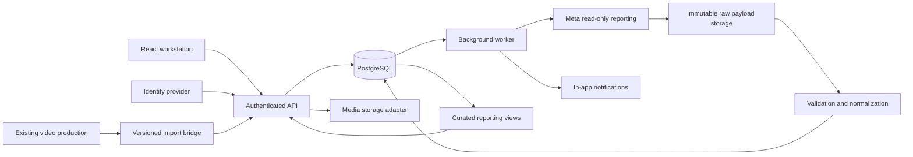

# TRD — Marketing & Creative Performance Workstation

Version: 1.0

Date: 2026-10-10

Status: Engineering specification for the accepted workflow. Technology and operating defaults are proposed; no database, connector or deployment has been created by this document.

Audience: Engineering, database, integration, QA and operations.

Product contract: [Product Requirements Document](creative-workstation-prd.md)

## 1. Technical objective and boundaries

Implement a shared creative record whose version lineage survives team handoffs, revision rounds, multiple launches and reporting corrections. The end-to-end identity chain is:

`workspace → brief version → creative → execution version → approved package → platform launch → reporting evidence → optimization output`

V1 coordinates creative work, registers external launches and reads Meta reporting. It does not publish posts, create ads or mutate ad budgets. Its internal “scheduled” state represents a confirmed plan, not a claim that Meta has scheduled content.

The related [ContentAI repository](https://github.com/garyyap13/ContentAI/tree/985d914e3caf125e0d344c1c22caf57063409977) contains React/Vite, a Fastify/TypeScript API, Zod contracts and SQLite production storage. Reuse those language/framework conventions where appropriate. The workstation is a separately bounded PostgreSQL subsystem; the current SQLite application is not automatically migrated or made multi-tenant. This requirements repository does not contain that application code.

## 2. System architecture

| Component | Responsibilities |
|---|---|
| Web client | Queues, six card tabs, previews, anchored comments, optimistic-concurrency UX, performance views |
| API | Authentication, workspace/brand authorization, typed commands, state transitions, package confirmation, launch registration |
| PostgreSQL | Durable business records, constraints, tenant policies, audit/outbox, reporting identity and revisions |
| Worker | Leased jobs, imports, connector refresh/retries, notifications and report refresh |
| Media adapter | Verified uploads/references, content hashes, private access and preview derivatives |
| Meta adapter | Capability discovery, account/object lookup, paginated read-only reporting, source/API context |
| Normalizer | Source definitions, explicit scope, validation, deduplication, revision ordering and quarantine |
| Reporting service | Compatible aggregates and exact evidence retrieval; no direct client access to raw tenant tables |

Start with one API deployment, one worker and one database; a PostgreSQL-backed job/outbox implementation is sufficient initially. Pin dependencies and the supported database/API versions during implementation. Provider choices remain configurable. No warehouse or microservice split is required for the pilot.

## 3. Identity, ownership and conventions

**T-01.** Use generated UUIDs for entity primary keys. Every tenant-owned entity has `workspace_id`; brand-owned entities also have `brand_id`. `creative.variants.id` is the creative primary key. `creative_code` is an immutable display/business identifier, unique on `(workspace_id, creative_code)`.

Generate codes transactionally from a workspace counter, format `CR-000123`, and allow the numeric portion to grow beyond six digits. Never recycle codes or require gapless numbering. API idempotency prevents a retried create from consuming another logical creative.

Use tenant-qualified foreign keys and unique parent keys. For brand-owned relationships enforce `(workspace_id, brand_id, parent_id)` compatibility. Do not rely on UI filtering or globally unique UUIDs to establish ownership. Store platform IDs as text and qualify uniqueness by workspace, platform, account and entity type.

Store timestamps as `timestamptz`; preserve source reporting dates, period boundaries and time zone. Store money/conversion values as exact `numeric`, with currency and unit; counts may be fractional where the source models attribution. Use `bigint` for exact whole counts when appropriate. Serialize large counts and decimals safely rather than relying on JavaScript floating-point precision.

Entity tables have `id`, ownership columns and timestamps unless immutable/event or composite-key rules below say otherwise. Mutable aggregate roots carry `lock_version`. Immutable records carry a content hash and creation time; updates/deletes are denied to ordinary runtime roles. Archive records referenced by history rather than deleting them.

## 4. Database model

The following table names and keys are the proposed physical model. This is a schema contract, not an applied migration. `→` denotes a relationship; all foreign keys include ownership as described above. Unless listed otherwise the primary key is UUID `id`.

### 4.1 Access, strategy and creative production

| Table | Required fields / relationships | Additional constraints |
|---|---|---|
| `core.workspaces` | name, default time zone, reporting currency | Root tenant |
| `core.users` | identity issuer, identity subject, display name | Unique issuer/subject; global identity, no tenant content |
| `core.memberships` | workspace, → user, role set, active state | Unique workspace/user |
| `core.brand_memberships` | → membership, → brand, permission scope | Composite ownership enforced |
| `core.brands` | workspace, name, archived time | Tenant-owned |
| `core.products` | → brand, name, external reference | Brand-owned |
| `strategy.audiences` | → brand, name, persona description | No individual customer profiles |
| `strategy.initiatives` | → brand, objective, primary KPI definition, dates | Business campaign; distinct from Meta campaign |
| `strategy.briefs` | → initiative, marketing owner, current draft/version references | Stable identity |
| `strategy.brief_versions` | → brief, version, → product/audience, angle, requested format, objective, KPI, initial copy, CTA | Unique brief/version; submitted snapshot immutable |
| `strategy.brief_assets` | → brief version, → asset version, role | PK `(workspace_id, brief_version_id, asset_version_id, role)` |
| `creative.concepts` | → originating brief version, title, angle | Origin immutable; execution pins actual brief below |
| `creative.variants` | → concept, creative code, optional parent variant, archived time | Unique workspace/code; parent same brand |
| `creative.variant_versions` | → variant, version, → exact brief version, storytelling, script/body, hook, CTA, format, optional presenter, content hash | Unique variant/version; immutable after submission |
| `creative.presenters` | → brand, display name, type, external reference | Optional human/AI presenter, distinct from persona |
| `creative.assets` | → brand, media type, source system | Stable media identity |
| `creative.asset_versions` | → asset, version, storage/file ID, checksum, MIME, byte size, dimensions/duration, verification state, rights state | Unique asset/version; exact content |
| `creative.variant_assets` | → variant version, → asset version, slot, position | PK `(workspace_id, variant_version_id, slot, position)` |
| `work.creative_jobs` | → variant, marketing/creative owners, deadline, production state/substage, active draft/review references, lock version | One job per variant |

Working brief/execution content may be held in `strategy.brief_drafts` and `creative.execution_drafts` with lock versions. Submission inserts immutable version snapshots; it does not continue mutating a submitted row. A submitted execution stores its exact brief version even if the creative concept's original brief later changes.

Versioned controlled tags for hook type, angle and format may use `creative.taxonomy_terms` and `creative.variant_tags`; tags used as analytical evidence must retain the assignment effective at the review time. Production cost allocation is an optional extension, not a dependency of the six-step V1.

### 4.2 Review and approval

| Table | Required fields / relationships | Additional constraints |
|---|---|---|
| `review.rounds` | → job, → exact execution version, round number, assigned marketer, status, submitted/decided times | Unique job/round; one active round per job |
| `review.comments` | → round, author, parent comment, text, blocking flag, → anchored asset version, anchor data | Parent/anchor must belong to compatible review context |
| `review.comment_resolutions` | → original comment, → resolving execution version, author, explanation, created time | Append-only; creative proposes resolution |
| `review.blocker_links` | → round, → original blocking comment, proposed/accepted resolution, state, reviewer | PK `(workspace_id, round_id, comment_id)`; carries unresolved blockers into later rounds |
| `creative.approvals` | → round, → exact execution version, reviewer, decision, reason, time | One terminal decision per round; append-only |
| `creative.approval_withdrawals` | → approval, actor, reason, time | At most one effective withdrawal per approval; original decision retained |

Video anchors use integer milliseconds with `0 ≤ start ≤ end ≤ duration`. Visual anchors use the exact asset/page/frame and normalized `x`, `y`, `width`, `height` bounded to the image. General comments need no anchor. Validate asset membership in the reviewed version, not just existence.

A resolution is accepted by marketing, not automatically by its creative author. Approval checks unresolved blockers across the current and carried-forward rounds. Reopening feedback after a terminal approval requires withdrawal/new review; old decisions and comment anchors are not rewritten.

### 4.3 Distribution and platform objects

| Table | Required fields / relationships | Additional constraints |
|---|---|---|
| `distribution.accounts` | → brand, platform, account type, external ID, time zone, currency | Unique workspace/platform/type/external ID |
| `distribution.campaigns` | → ad account, optional → initiative, external ID, objective | Unique account/external ID |
| `distribution.ad_groups` | → campaign, external ID, targeting/optimization snapshot | Unique account/external ID with inherited ownership |
| `distribution.publications` | → social account, external post ID, URL, published time | Unique account/external ID |
| `distribution.ads` | → ad group, external ad ID, optional → publication | Boost/reuse links do not merge metrics |
| `distribution.package_versions` | → execution version, package version, caption, → thumbnail asset version, destination/UTM fields, content hash | Immutable; unique execution/package version |
| `distribution.package_confirmations` | → package version, marketing actor, time | Confirmation of exact package |
| `distribution.plans` | owner, channel, current revision, lock version, archived time | Stable plan identity |
| `distribution.plan_revisions` | → plan, revision, → approved execution/approval/package/confirmation/account, schedule/time zone, budget/currency, target count | Immutable configuration; unique plan/revision |
| `distribution.plan_targets` | → plan revision, target ordinal, verification/status, optional platform object reference | Unique revision/ordinal; fixes scope of multi-ad launch |
| `distribution.plan_launches` | → target, exactly one → publication or → ad, confirmed time, evidence reference | Unique target; prevent duplicate launch per channel/account/object |
| `distribution.delivery_bindings` | exactly one → publication or → ad, → execution version, effective start/end, mapping basis, verifier | No overlapping effective intervals for static content |
| `distribution.binding_revisions` | → binding, revision, execution reference, effective interval, mapping basis, actor, reason, superseded revision | Immutable snapshots; unique binding/revision; evidence pins this ID |
| `distribution.registration_attempts` | → target, requested external ID, verification state, errors/evidence | Pending attempts are not confirmed launches |

Preserve platform configuration/status history in `distribution.entity_history`. A plan with multiple declared targets is launched only when every target is confirmed. Partial launch is a derived progress count and per-target state; unlaunched targets can fail without erasing successful launches. Additions after confirmation create another plan revision or plan, not retroactive edits to the launched configuration.

Effective binding correction is audited. If creative changes within a daily metric interval, classify that interval as ambiguous for creative-level attribution unless finer-grained source data resolves it. Dynamic/composite ads stay reportable at ad level but are excluded from exact single-creative ranking until component-specific support is implemented.

### 4.4 Reporting, evidence and workflow infrastructure

| Table | Required fields / relationships | Key / invariant |
|---|---|---|
| `ingest.connections` | → account, connector, secret reference, capabilities, authorization state | No raw access token in business tables |
| `ingest.sync_runs` | → connection, job scope, generation, API/adapter version, requested interval, state, coverage/counts | Serialized generation per comparable scope |
| `ingest.raw_batches` | → run, request/page identity, checksum, received time, payload reference | Immutable; replay deduplicates |
| `ingest.quarantine_rows` | → batch, row locator, validation error, resolution | No silent coercion of ambiguous rows |
| `measure.reporting_entities` | → account, entity type, exactly one typed source-object reference | Typed unique registry; no unchecked polymorphic IDs |
| `measure.metric_definitions` | source field, semantic key, version, unit, denominator, aggregation rule, availability constraints | Immutable versioned definitions |
| `measure.report_scopes` | account, entity level, channel scope, period kind, timezone, currency, attribution, date basis, breakdown schema, source definition version | Canonical non-null identity representation |
| `measure.observations` | → reporting entity, → scope, period start/end, canonical breakdown values, action type | Unique full grain defined in §8 |
| `measure.observation_revisions` | → observation, → raw batch/run, source time, generation, checksum, quality/completeness | Append-only; current view selects published generation |
| `measure.metric_values` | → revision, → metric definition, numeric value, availability/reason | PK `(workspace_id, observation_revision_id, metric_definition_id)` |
| `learning.performance_reviews` | → execution version, author, date/scope filters, narrative, evidence class, optional structured experiment protocol/evidence references | Submitted review immutable; revisions create new review version |
| `learning.performance_review_evidence` | → review, → observation revision, binding revision reference | Composite PK over workspace/review/evidence/binding identity |
| `learning.optimization_plans` | → review, optional parent creative, hypothesis, proposed change, controls, owner, priority, due date, state | No automatic media-buy mutation |
| `learning.optimization_outputs` | → optimization plan, → follow-up variant | PK `(workspace_id, optimization_plan_id, variant_id)` |
| `audit.events` | actor, entity/version, action, timestamp, reason, correlation ID, hashes | Append-only, access-controlled |
| `work.outbox_events` | event type/version, payload, aggregate ID, time, delivery state | Inserted in business transaction |
| `work.notifications` | → event, recipient, read time | Unique event/recipient |
| `work.jobs` | type, payload, state, lease, attempt count, next attempt, last error | At-least-once execution; handlers idempotent |
| `work.idempotency_keys` | actor/workspace, route scope, key, request hash, result | Unique actor/workspace/scope/key |

For evidence binding revisions, keep mapping history immutable and refer to the exact mapping used to associate results with a version. Correcting a mapping must not retroactively change a submitted performance review.

## 5. Workflow state machines and command rules

**T-02.** Treat transitions as domain commands, not arbitrary status updates.

| Command | Actor | Preconditions | Committed result |
|---|---|---|---|
| Submit brief | Marketing | Required fields, permitted assets, assignee | Immutable brief version; job ready for creative; notification |
| Start production | Assigned creative | Ready/changes requested | In production; applicable substage |
| Submit execution | Assigned creative | Verified media, exact brief, designated reviewer, no active round | Immutable execution version + round; job in review |
| Request changes | Assigned marketer | Active round and matching lock version | Terminal decision; job changes requested; creative notified |
| Resubmit | Assigned creative | New draft/version, responses to outstanding blockers | New immutable version/round; blockers carried forward |
| Approve | Assigned marketer | Active round; all blocking items accepted; exact version | Terminal approval; job approved for distribution |
| Begin new revision | Assigned creative | No unresolved active review | New draft; job in production; older approval/launches retained |
| Withdraw approval | Marketing | Active approval, reason | Withdrawal event; future confirmations blocked; existing external launches unchanged |
| Confirm plan | Marketing | Nonwithdrawn approval, confirmed package, account/schedule/required paid fields | Immutable plan revision and declared targets |
| Confirm launch | Marketing / authorized verification worker | Valid plan, matching verified platform object, approval/package still valid | Launch + effective binding + audit event |
| Create optimization output | Marketing or creative | Accepted optimization plan, permitted brand | New creative code, explicit parent/output links |

Draft plans may be saved incomplete. Pending external ID registration does not satisfy Confirm launch. No transition occurs from silence or a missing comment. Cancellation is explicit and records a reason. A rebrief closes/supersedes an active review before resubmission and never changes the brief pinned to an existing version.

### Transaction and concurrency requirements

**T-03.** For each transition: authenticate, authorize, validate request, check idempotency, lock aggregate, verify `lock_version`, validate related records, perform writes, append audit/outbox, increment lock version, commit. Return a conflict if another command already won; do not silently retry a conflicting user decision as a new action.

Enforce one active review with a partial unique index and terminal decision uniqueness at the database layer. Cross-row business rules are enforced inside locked transactions, not invalid cross-table CHECK expressions. Deferred constraints/triggers may be used where a relationship cannot be expressed with ordinary foreign keys.

Use `Idempotency-Key` for creation/submission/decision/import commands. Same key + same request returns the original result; same key + different request returns conflict. Retain command results for at least 30 days initially; permanent domain uniqueness continues to prevent duplicates after expiry.

## 6. API contract

**T-04.** JSON endpoints below are illustrative route names for implementation. Prefix all with `/api/v1/workspaces/{workspaceId}`. IDs are UUIDs, ownership is server-validated, and version labels are presentation fields. Pagination is cursor-based; default 50 and maximum 200 records per page.

| Endpoint | Purpose / required contract |
|---|---|
| `GET /creatives` | Code/title, brand, owner, format and state filters; scoped results |
| `POST /creatives` | Brand, concept/brief link and owners; returns ID/code |
| `GET /creatives/{id}` | Summary, actions allowed, active version/review and independent launch states |
| `PUT /briefs/{id}/draft` | Mutable draft with expected lock version |
| `POST /briefs/{id}/submit` | Freeze draft and hand off |
| `POST /creatives/{id}/rebrief` | Exact new brief version, reason, expected lock version |
| `PUT /creatives/{id}/execution-draft` | Script, storytelling, exact brief and asset references; lock version |
| `POST /creatives/{id}/submit-review` | Reviewer, draft ID/hash, blocker responses and expected lock version; creates response records against the new immutable version atomically |
| `POST /review-rounds/{id}/comments` | Text, blocking flag, asset/anchor and optional parent |
| `POST /comments/{id}/resolutions` | Existing immutable resolving execution version, response and author identity from session |
| `POST /review-rounds/{id}/decision` | Approve/request_changes, expected lock version, reason and accepted resolution IDs |
| `POST /approvals/{id}/withdraw` | Reason and expected aggregate lock version |
| `POST /distribution-packages` | Exact execution, caption, thumbnail, destination |
| `POST /distribution-packages/{id}/confirm` | Marketing confirmation of content hash |
| `POST /distribution-plans` | Draft plan with organic/paid channel |
| `POST /distribution-plans/{id}/confirm` | Immutable revision, schedule/budget and declared targets |
| `POST /distribution-targets/{id}/register` | External ID and evidence; returns pending/confirmed verification |
| `POST /assets/upload-intents` and `/assets/{id}/complete` | Private upload intent; server verification before ready |
| `POST /connections/{id}/sync` | Authorized bounded import job; returns job ID |
| `POST /imports/csv` | Validated file reference, mapping and report context; async job |
| `GET /creatives/{id}/performance` | Exact version(s), scope and date filters; data, definitions, coverage and warnings |
| `POST /performance-reviews` | Exact evidence revisions, binding revisions, assessment and evidence class |
| `POST /optimization-plans` and `/{id}/outputs` | Hypothesis/owner and linked follow-up creative creation |
| `GET /notifications` and `POST /notifications/{id}/read` | Recipient-only in-app notifications |
| `GET /jobs/{id}` | Authorized job state, coverage and actionable error |

A decision response includes round ID, exact execution version ID, decision ID, new workflow state, lock version and correlation ID. Actor IDs and approval claims are never trusted from request headers/body.

Errors use `{code, message, fieldErrors?, correlationId, currentLockVersion?}`. Use 401 for unauthenticated, 403 for disallowed actions on accessible records, 404 for absent or inaccessible tenant records, 409 for version/idempotency/state conflicts, 422 for invalid input, 429 for request throttling. Do not leak another tenant's record existence through detailed constraint errors. Async work returns 202; success is not implied until the job/verification completes.

## 7. Media and review implementation

**T-05.** Define a storage adapter for upload intent, verify, read access, metadata and retention. Use private object storage or verified Drive references; do not make arbitrary public URLs the source of truth. Avoid unrestricted server-side URL fetching. Uploaded filenames are display labels, never identity or executable paths.

Draft upload states: pending, verifying, ready, failed. Completion validates actual object size/type, checksum and media metadata. A ready original may have processing previews; submission requires a usable preview. Unsupported files return an actionable error. Preview failures retain original integrity and expose retry state.

Before ready, upload-processing state may change. Once ready, freeze the original content identity and metadata; track later preview jobs and asset-access/rights changes separately with history. A changed original becomes another asset version.

Proposed pilot limits: 1 GiB per video, 50 MiB per image, 25 MiB per brief PDF, configurable after capacity review. Accept agreed formats only; reject mismatched content. Object uploads bypass the API body limit through signed upload intents. Tokens and download access are short-lived and authorization-scoped.

Comment coordinates refer to the original media dimensions/timebase; responsive display translates them without changing the stored anchor. Re-encoding a proxy does not create a different reviewed source. If a Drive file changes checksum under the same external ID, register a new asset version and do not mutate the previous one.

## 8. Measurement contract and Meta ingestion

### 8.1 Observation grain

**T-06.** The canonical unique observation is:

`workspace + account + typed reporting entity + scope + period_start + period_end + canonical breakdown values + source action type`

Scope includes entity level, channel scope, period kind, timezone, currency, attribution window/model, action report-time basis, breakdown schema and source/metric definition version. Empty dimensions and inapplicable attribution are explicit normalized values; null semantics must not allow duplicate totals. Hashes accelerate lookup but equality is verified against the complete canonical identity.

Store raw source values, normalized values and provenance. Separate business metric semantics from platform field names. Source action categories that overlap are not added together; an approved metric mapping selects one conversion definition. Missing values have an availability reason such as unsupported, permission_denied, not_returned or not_applicable. Reported zero remains zero.

Daily intervals, rolling intervals and lifetime snapshots are different scopes. Never sum successive lifetime snapshots or infer authoritative daily values from their difference. Reach is nonadditive. Campaign/ad-group/ad totals and total/breakdown rows are separate aggregation paths, not components to sum together.

Channel scope is organic_only, paid_only, combined or unknown. A boosted post's combined metrics cannot be added to its ad metrics. Cross-platform attributed revenue is not deduplicated order revenue. Compare currencies and source reporting days explicitly; V1 does not silently convert currency or align daily buckets across time zones.

### 8.2 Connector and normalization pipeline

**T-07.** The Meta adapter declares supported object types, fields, breakdowns, permissions and reporting contexts for the connected account/API version. Unknown capabilities remain unavailable. Use read-only permissions; provider permission names, access review and account eligibility must be verified against current provider requirements during integration.

1. Allocate a sync generation and lease for an account/report scope. Prevent overlapping authoritative requests for that scope or ensure deterministic generation ordering.
2. Fetch platform identities and reporting pages; preserve raw request parameters, pagination and responses with checksums. Redact credentials.
3. Validate ownership, period, metric definitions and source scope. Stage normalized observations/revisions; quarantine invalid rows.
4. Reconcile page completeness, expected coverage and row counts. A partially fetched scope remains unpublished.
5. Publish the completed scope/window generation atomically. Its observations become current together; previous published data remains accessible.
6. Update coverage/freshness and refresh affected reporting views. Create actionable errors without deleting prior complete data.

Prefer source ordering when supplied; otherwise later serialized fetch generations win. An older backfill finishing late must not override newer current data. Identical normalized values do not require duplicate metric revisions; record the import provenance separately. Missing rows are not zero/deletion unless a source-specific complete-replacement contract explicitly proves that meaning; otherwise flag uncertain coverage and preserve the last valid row.

Proposed schedule: active accounts every 6 hours; daily overlapping re-fetch with a minimum 28-day lookback, extended to cover the configured attribution window and observed delays; weekly older reconciliation within source-supported retention. Backfill defaults to 90 days where supported. These are configurable application settings, not claims about Meta retention or delivery guarantees.

Use bounded exponential backoff with jitter and provider retry hints. After the configured retry budget, park the job for operator review with resumable cursor/state. Authorization errors require reconnect; rate limits remain retryable. Lease expiry permits recovery; handlers remain idempotent.

### 8.3 CSV/API coexistence

CSV rows must include or inherit a validated source account, entity ID, period kind/interval, scope and metric definitions. Reject locale/currency ambiguity. Imported data is marked with provenance and does not become “API verified” merely because it has an ad ID.

For matching observations, maintain one authoritative dataset selection. API takeover replaces the active CSV authority for its completed scope/window while retaining CSV history. If semantics differ or overlap is uncertain, keep datasets separate and require reconciliation; never union overlapping rows into a scorecard.

### 8.4 Reporting and reproducibility

**T-08.** Expose tenant-safe views for pipeline, paid daily, organic periods, creative scorecard, data health and optimization backlog. Aggregate metric facts before joining one-to-many assets/comments/reviews. Dynamic SQL filters must select compatible scopes.

Calculate CTR as compatible click sum/impression sum; CPA as spend sum/selected conversion sum; ROAS as selected attributed value sum/spend sum. Return null and reason when denominators or required inputs are zero/unavailable. Do not average row ratios. Currency and attribution must match before computing aggregates.

Submitted performance reviews retain exact observation revisions, metric-definition versions, filters and binding revisions. New data or corrected mapping creates an updated report/review; historical evidence does not silently change. Allow “experiment_supported” only with stored predeclared method, assignment/control evidence and decision rule; otherwise use observational or insufficient_evidence. Automated significance testing is later scope.

The structured experiment protocol includes hypothesis, registration time, primary metric definition, tested variable, comparison arms/launches, assignment method, controls, decision rule and supporting artifact references. A reviewer must confirm that the protocol predates evaluation and that evidence supports the claimed class; merely selecting the label cannot confer experimental support.

## 9. Security, audit and reliability

**T-09.** Use an identity provider integration with verified issuer/audience/signature and server-side membership lookup. Select a concrete provider before deployment. If browser authentication uses cookies, use secure/HttpOnly cookie settings, CSRF protection on state changes and restricted origins. Never expose connector secrets to the browser.

Set transaction-local tenant context only after authentication/authorization. Enable PostgreSQL row-level security for tenant tables, including reporting and worker access. Runtime roles must not own these tables or have bypass privileges; privileged maintenance uses separate credentials. Test pooled-connection reuse so one request cannot inherit another workspace's context. PostgreSQL's documented owner/privileged-role exceptions make this separation essential: [Row security policies](https://www.postgresql.org/docs/current/ddl-rowsecurity.html).

Workers run with explicitly scoped jobs and validated account ownership. File reads, exports, search, raw-payload access and evidence links use the same authorization boundary. Minimize logged content; redact access tokens and signed URLs. Audit domain mutations and access-sensitive administration.

**T-10.** Write audit and outbox events in the business transaction. Consumers deliver at least once, deduplicating by event ID/recipient or domain identity. An email/Slack integration is not included. Notifications are durable database records, not only transient browser messages.

Log correlation ID, workspace-safe identifiers, command/job type, latency, retries and outcome. Monitor queue age, sync lag, failed/quarantined rows, mapping coverage, API errors and database pool saturation. Distinguish job failure from source permission/rate-limit conditions.

## 10. Proposed nonfunctional acceptance budgets

These are engineering targets to validate on a provisioned environment, not current measured capabilities.

| Area | Proposed acceptance budget |
|---|---|
| Pilot dataset | 10 workspaces, 10,000 total creatives, 5 versions average, 1 million metric-value rows |
| Load | 25 concurrent authenticated users; a 90-day report over up to 1,000 ads in one workspace |
| Operational API | p95 < 2 seconds excluding file transfer/external provider time |
| Reporting API | p95 < 5 seconds for the stated report; expose pending generation if async refresh needed |
| In-app handoff | Durable notification visible within 60 seconds after commit under normal load |
| Worker recovery | Expired lease recovered within 5 minutes; no duplicated logical effects |
| Files | Configurable limits in §7; metadata mismatch never yields ready state |
| Availability | Initial service objective 99.5% monthly, excluding announced maintenance; monitor before committing SLA |
| Backup/recovery | Proposed RPO ≤ 24 hours and RTO ≤ 4 hours; verified restore drill before production |
| Accessibility | Keyboard-complete core flow, labelled controls, text status, usable 320px stacked layout |

Indexes: ownership-qualified FKs, workspace/code, owner/state/deadline queues, active-review uniqueness, external object identity, binding intervals, observation uniqueness and reporting account/entity/period. Use query plans and pilot-load tests before adding indexes indiscriminately. Defer partitioning until actual volume warrants it.

Proposed retention: operational versions, approvals and linked evidence retained while the workspace is active; normalized reporting at least 24 months; raw batches 90 days unless pinned as review evidence or needed for unresolved reconciliation. Pinned evidence retains its source provenance. Unreferenced draft uploads expire after 30 days. Workspace deletion/export and backup expiry must be defined with the workspace owner before production; scheduled deletion jobs must not remove referenced evidence accidentally.

## 11. Existing repository integration and deployment

**T-11.** Add workstation modules behind the existing API/client conventions, with explicit domain boundaries for strategy, production, review, distribution, ingestion and learning. API contracts belong in the shared contracts package. PostgreSQL migrations and repositories are separate from SQLite foundation migrations.

For importing current production data, register a unique source bridge `(workspace_id, source_system, entity_type, source_id, source_version)` pointing to a typed target. Transfer approved exact versions and checksums through an idempotent import contract. Preserve rights status and source approvals. Validate real user authority before treating a local pilot identity as a shared-workspace approver.

Begin with versioned exports/imports; later add a transactional source outbox. Avoid uncoordinated dual writes across SQLite and PostgreSQL. The local foundation remains usable while the workstation is built.

Deployment prerequisites: selected hosting, PostgreSQL, identity and media providers; database migrations tested from empty and previous schemas; secret manager; private storage; backup/restore; application and worker health checks; read-only Meta account access. Stage and production use separate credentials, databases and accounts where available.

Use additive migrations first, then backfill and validate before enforcing tighter constraints. A failed migration must stop startup safely. Recover destructive schema/data changes from a verified backup or forward repair; do not promise automatic reversible down-migrations. Release workflow UI, distribution and reporting behind capability flags until their respective acceptance tests pass.

## 12. Verification and release matrix

**T-12.** Test database and concurrency behavior against PostgreSQL, not only mocks or SQLite. Use fixed reporting fixtures with known totals; execute a real-account smoke test for the supported read-only Meta path before claiming automatic feedback is available.

| Test group | Required evidence | PRD acceptance |
|---|---|---|
| Domain transitions | Required-field handoff; video/visual paths; explicit approval; blocker carry-forward | AC-01–04 |
| Integrity | Approval/package substitution rejected; unique external launch; approval withdrawal | AC-05, AC-06, AC-16 |
| Concurrency | Two opposite review decisions race; one commits and the other conflicts | AC-12 |
| Idempotency | Command replay and duplicate pages/CSV do not duplicate logical objects or totals | AC-07 |
| Reporting correction | Partial generation not published; late correction preserves old evidence | AC-08, AC-10 |
| Metric semantics | Known fixtures for lifetime, combined scope, reach, attribution, currency, zero/null and weighted ratios | AC-09 |
| Authorization | Cross-tenant/brand API, raw data, file, worker and pooled-context tests | AC-13 |
| UX/E2E | Both roles complete all six tabs and follow-up; keyboard/mobile review; exact-version deep links | AC-11, AC-14 |
| Lineage | Rebrief, media replacement and corrected delivery binding preserve previous evidence | AC-03, AC-10, AC-15 |
| Connector contract | Capability/permission failures, pagination, rate limits, revoked access and verified ID mapping | AC-06–10 |
| Operations | Pilot-load timings, lease recovery, outbox deduplication and backup restore | PRD §8; TRD §10 |

Release evidence includes test results, schema version, fixture/report totals, supported connector capabilities, load-test configuration, restore report and known limitations. A mock UI and synthetic metrics alone do not satisfy connector acceptance.

## 13. Product-to-technical traceability

| PRD requirement | Technical contracts |
|---|---|
| FR-01 Identity and ownership | T-01; creative tables and unique code |
| FR-02 Marketing brief | T-02–04; immutable brief/version and rebrief command |
| FR-03 Creative production | T-02, T-05; drafts, execution snapshots and verified media |
| FR-04 Review and revision | T-02–04; rounds, blocker links, resolutions and concurrency |
| FR-05 Approval | T-02–03; exact-version decisions, withdrawals and confirmed packages |
| FR-06 Distribution | T-02, T-04; plan revisions, declared targets and verified launches |
| FR-07 Meta ingestion | T-06–07, T-10; staged generations, raw payloads and retryable jobs |
| FR-08 Performance | T-06, T-08; compatible metric scopes and curated views |
| FR-09 Optimization | T-08; pinned reviews and linked output creatives |
| FR-10 Handoffs | T-03, T-10; atomic audit/outbox and deduplicated notifications |
| FR-11 Access/files | T-05, T-09, T-11; authorization, integrity and imported rights |
| FR-12 Usability | T-04, T-12; searchable APIs, deep links and E2E acceptance |

## 14. Remaining deployment decisions and references

The workflow, ownership split, explicit review loop and creative-code linkage come from the accepted user workflow. The following remain deployment/design decisions: meaning of avatar; exact hosting/identity/storage providers; supported Meta account capabilities; pilot volume/file limits; and retention/backup settings. Defaults are specified so engineering can size the work, but are not represented as user-confirmed purchases or service guarantees.

References checked while writing:

- Existing repository package manifests establish the local React/Vite, Fastify, TypeScript and Zod conventions; the foundation README and storage module establish SQLite/local identity boundaries.
- PostgreSQL [constraints](https://www.postgresql.org/docs/current/ddl-constraints.html) document unique, foreign-key and row-check behavior. Use them for structural integrity; cross-row workflow decisions still require transactional application rules.
- PostgreSQL [row security](https://www.postgresql.org/docs/current/ddl-rowsecurity.html) documents role/policy behavior and bypass exceptions.
- Meta's [official generated Insights SDK](https://github.com/facebook/facebook-python-business-sdk/blob/main/facebook_business/adobjects/adsinsights.py) lists separate reporting identity, attribution, spend, click, conversion and video fields. Field presence in the SDK does not establish availability for a connected account or supported query combination.

This TRD and the companion PRD supersede earlier exploratory model details where they conflict. In particular, production cost analysis is optional, design-only database navigation is not a product requirement, and launch scheduling/registration does not imply platform publishing capability.
