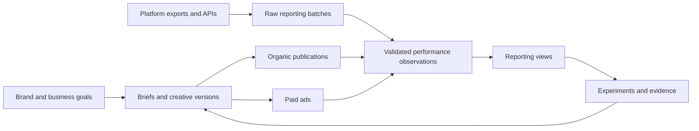

# Creative Marketing Performance — Database Backbone

Date: 2026-10-10
Status: Proposed architecture for review. No database has been provisioned and no application migrations have been applied.

Workflow refinement: the user's six-step marketing → creative → review → distribution → performance → optimization workflow is specified in [the workstation design](2026-10-10-marketing-creative-workstation-design.md). That document takes precedence for team ownership, review transitions, workstation screens and creative-code rules. This document supplies the measurement and ingestion backbone.

## 1. Outcome and assumptions

Connect the full loop: business objective → creative brief → creative versions → organic posts and paid ads → comparable performance → evidence → next creative brief.

The system must answer: Which creative worked, for which audience and objective, on which platform, at what cost, under what reporting conditions, and what should the team test next?

Provisional assumptions: a small team or agency with multiple brands; PostgreSQL as the system of record; read-only performance ingestion initially; Meta as the first connector, with other social platforms added through adapters. These are design defaults, not user-confirmed platform choices. CSV imports provide a first usable path without connected accounts.

The existing workspace implements a local SQLite video-production foundation, including versioned brand/product context, asset references, plans, approvals, and audit history. This proposal adds a performance subsystem. It does not require replacing that application or migrating its database as the first step.

## 2. Architecture choice

| Option | Good fit | Trade-off |
|---|---|---|
| PostgreSQL + ingestion worker + file storage — recommended | Versioned creatives, dependable relationships, reporting history, several brands | Requires development and database operations |
| Airtable or Notion workspace + separate analytics store | Team wants an editable content calendar quickly | Reporting grain, deduplication and attribution still need a separate analytical backbone |
| Warehouse first + separate content workspace | Large existing reporting estate and high data volume | More integration work before the creative workflow becomes useful |

Start with one PostgreSQL database, logical schemas, a scheduled worker, and existing media storage. Add a warehouse only after measured query volume or retention requirements justify it. Keep videos and images in Drive or object storage; store durable IDs, versions and checksums in the database.

Responsibilities:

- Operations API: briefs, assets, creative versions, approvals, distribution mappings, and decisions.
- Connector worker: imports accounts, campaign structures and metrics; retains source responses; retries safely.
- Normalization layer: validates source definitions, resolves IDs, enforces grain and handles revisions.
- Reporting layer: serves approved views with explicit metric definitions and freshness.
- Learning layer: records hypotheses and findings linked to immutable evidence.

## 3. Database conventions

Use UUID internal IDs and text external IDs. Every tenant-owned row includes `workspace_id`. Unless explicitly a junction or version table, each table has an `id`, `created_at`, and `updated_at`.

Use tenant-qualified foreign keys: `(workspace_id, parent_id)` references a unique `(workspace_id, id)`. Brand-scoped relationships must also enforce compatible brand ownership, using composite keys where needed. This prevents accidental cross-client or cross-brand links.

Store event timestamps as `timestamptz`; preserve source reporting dates and time zones separately. Use exact decimal amounts with currency codes, never floating-point money. Keep unavailable measurements null with a reason; zero means an observed zero. External platform IDs are unique within workspace, platform, account and object type, not globally by name.

Immutable versions preserve creative content, approved briefs, source payloads and reporting revisions. Mutable status and assignment records are separate from approved content. Deletion of referenced versions is restricted; archive operational entities instead.

JSONB is for source payloads and variable platform metadata. Relationships, frequently filtered creative attributes, money and canonical metrics belong in typed fields or controlled lookup tables.

## 4. Logical table catalogue

The fields below describe the schema contract; they are not executable SQL. `→` identifies a foreign key. All table names are proposed.

### Organisation and strategy

| Table | Record meaning and key fields |
|---|---|
| `core.workspaces` | Tenant: name, default time zone, reporting currency |
| `core.memberships` | User access: user ID, workspace ID, role; unique user/workspace |
| `core.brands` | Brand: workspace, name, status, external context reference |
| `core.products` | Product/service: → brand, name, SKU or service code, external context reference |
| `strategy.audiences` | Named segment: → brand, description, needs, market; no individual customer profiles |
| `strategy.initiatives` | Business campaign spanning platforms: → brand, name, objective, primary metric, dates, budget, currency |
| `strategy.briefs` | Stable brief identity: → initiative, owner, workflow status |
| `strategy.brief_versions` | Immutable brief: → brief, version, → product, → audience, promise, hypothesis, funnel stage, CTA, success metric, target, approval reference |

Business initiatives and platform ad campaigns are distinct: one launch initiative may include organic posts and several paid campaigns.

### Creative production and lineage

| Table | Record meaning and key fields |
|---|---|
| `creative.concepts` | Creative idea: → brief version, title, angle, content pillar, parent concept for iterations |
| `creative.variants` | Stable identity of an execution: → concept, variant code, owner, status |
| `creative.variant_versions` | Immutable execution: → variant, version, hook text, body copy, CTA, format, language, duration, aspect ratio, parent version, content hash |
| `creative.assets` | Stable media identity: → brand, media type, source system |
| `creative.asset_versions` | Exact media: → asset, version, file ID/URI, checksum, MIME type, dimensions, duration, rights status and expiry |
| `creative.variant_assets` | Assembly junction: → variant version, → asset version, slot (`hook`, `body`, `cta`, `audio`, `thumbnail`), position |
| `creative.taxonomy_terms` | Controlled descriptors: → brand, dimension, value; dimensions include angle, hook type, format, creator style, emotional driver, content pillar |
| `creative.variant_tags` | → variant version + → taxonomy term, origin (`human`/`model`), confidence, reviewer, assigned time |
| `creative.approvals` | Decision bound to exact → variant version, reviewer, decision, time, reason |
| `creative.cost_entries` | Production cost: → variant or asset, cost type, amount, currency, incurred date, external invoice reference |

Editing a caption, hook or exported asset creates a new version. Reusing a version in several ads does not create another production-cost entry. Shared asset costs require explicit allocations before calculating fully loaded profitability.

### Distribution and platform identity

| Table | Record meaning and key fields |
|---|---|
| `distribution.accounts` | Social profile or ad account: → brand, platform, account type, external ID, name, time zone, currency, status |
| `distribution.campaigns` | Platform campaign: → ad account, → initiative, external ID, objective, status |
| `distribution.ad_groups` | Ad set/group: → campaign, external ID, targeting metadata, optimization goal, status |
| `distribution.publications` | Organic/platform post: → social account, external post ID, URL, scheduled/published times, status |
| `distribution.ads` | Paid execution: → ad group, external ad ID, optional → publication for boosted/reused posts, status |
| `distribution.delivery_bindings` | Effective mapping to creative: exactly one of → publication or → ad, → variant version, valid-from/to, mapping basis, confidence |
| `distribution.tracking_links` | Destination and attribution labels: → delivery binding, destination URL, UTM fields, link ID |
| `distribution.entity_history` | Append-only imported status/config changes: entity type/ID, observed time, effective time if supplied, payload reference |

Static ads and posts have at most one active creative binding at a time. Enforce non-overlapping validity intervals. A creative can have many bindings, across platforms and channels.

Unmapped ads remain reportable at ad level and enter a mapping queue; do not infer a definitive match from a filename. If an ad changes creative within a daily reporting interval, keep its daily facts at ad level and flag the interval as ambiguous rather than allocating the whole day to either version.

Dynamic creative requires a separate candidate-membership junction and, where available, source-reported asset/combination facts. Ad-level totals must not be copied to every candidate. Until that capability exists, mark such ads as composite/unresolved for creative ranking.

### Ingestion and measurement

| Table | Record meaning and key fields |
|---|---|
| `ingest.connections` | → account, connector, secret-manager reference, scopes, status; no raw access tokens |
| `ingest.sync_runs` | → connection, requested range, API/connector version, cursor, state, start/end, row counts, error summary |
| `ingest.raw_batches` | → sync run, request fingerprint, page/cursor identity, received time, payload URI or JSONB, checksum |
| `ingest.quarantine_rows` | → raw batch, source row locator, validation error, resolution status |
| `measure.metric_definitions` | Immutable definition version: platform, source field, semantic name, unit, denominator, aggregation rule, supported breakdowns, definition notes |
| `measure.report_scopes` | Canonical reporting context: source account, entity level, period kind, channel scope, time zone, currency, attribution settings, action-report-time basis, breakdown set, source/API definition version |
| `measure.observations` | Report row identity: → scope, source entity, period start/end, canonical breakdown values, source action type where relevant |
| `measure.observation_revisions` | Immutable revision: → observation, revision, → raw batch, source timestamp, ingested timestamp, data-quality state, superseded revision |
| `measure.metric_values` | → observation revision + → metric definition, numeric value, availability state and reason; unique pair |

Use a typed entity registry or typed foreign keys to enforce the source entity relationship; an unchecked free-text entity ID is insufficient. A canonical definition and dimensional key must be verified before merging observations.

Metric-value rows accommodate platform-specific availability without adding columns every time a connector changes. Curated views pivot common metrics into convenient columns. If scale later requires wide fact tables, retain the same identity and revision contract.

### Learning and decisions

| Table | Record meaning and key fields |
|---|---|
| `learning.experiments` | → initiative, hypothesis, changed variable, primary metric definition, attribution context, dates, assignment method, predeclared decision rule, status |
| `learning.experiment_arms` | → experiment, → variant version, arm label, delivery IDs, allocation metadata |
| `learning.findings` | → experiment or concept, finding version, conclusion, evidence class, limitations, decision (`iterate`, `retest`, `scale_candidate`, `stop_candidate`), reviewer |
| `learning.finding_evidence` | → finding + → observation revision; exact evidence used |
| `learning.finding_followups` | → finding + → new brief or concept; closes the feedback loop |
| `audit.events` | Actor, action, typed entity reference, before/after hashes, timestamp, correlation ID |

Evidence classes: `insufficient_evidence`, `observational`, `experiment_supported`. Performance differences across different audiences, placements or spend levels alone do not establish that a hook caused the result. Scaling is a recorded recommendation; it does not change platform budgets.

## 5. Measurement contract: the critical part

An observation is unique by workspace, source account, entity type and ID, reporting interval, report scope, and canonical breakdown values. Scope includes attribution settings, channel scope, date basis, definition version and currency. Store canonical dimensions and enforce their equality; do not rely on a hash alone to establish identity. Represent the empty breakdown as an explicit total scope so nulls cannot create duplicate totals.

Separate entity levels: ad, ad group, campaign, post and account. Roll up ad rows or use campaign totals; never sum both. Similarly, choose a total report or a compatible breakdown report, never both.

Paid reporting defaults to daily intervals in the source account's time zone. Organic APIs/exports may return daily intervals, lifetime snapshots or rolling windows. Preserve the supplied period kind. Never sum successive lifetime snapshots; never present a lifetime-snapshot difference as an authoritative daily measurement. Different platform reporting days are not automatically aligned UTC days.

Post scope is explicitly `organic_only`, `paid_only`, `combined`, or `unknown`. A boosted post can have post-level combined metrics as well as linked ad metrics. Do not add them together. Produce a cross-channel total only when definitions and non-overlap are established; otherwise show channels side by side. Reach is not additive across posts, days or platforms.

Conversion counts retain source action types and may be fractional when the source provides modeled credit. Select one approved mapping for a business outcome; do not sum overlapping purchase categories. Preserve platform-attributed revenue separately from deduplicated order revenue. Cross-platform attributed revenue is not a deduplicated business total.

Repeated imports of the same payload produce no extra current facts. A changed payload produces a new immutable revision. Select current data using source revision ordering where supplied; otherwise serialize requests per scope and prevent older backfill jobs from replacing newer results. A missing row in a partial response is not a deletion or zero.

Late attribution and source corrections are expected. Re-fetch a configurable lookback covering the selected attribution window and observed source delay. Larger scheduled reconciliations handle older corrections. Record freshness and completeness for each account and reporting interval.

## 6. Reporting views and metric definitions

| View | What the team sees |
|---|---|
| `reporting.content_pipeline` | Brief → production → approval → scheduling → published; owner, deadlines and blocked items |
| `reporting.creative_library` | Exact creative versions, thumbnails/file links, creative tags, reuse and production cost |
| `reporting.paid_daily` | Ad/day totals with spend, impressions, defined clicks, selected conversions and attributed value |
| `reporting.organic_performance` | Post performance with explicit period and scope; compare posts at similar ages where available |
| `reporting.creative_scorecard` | Version-level metrics grouped by platform, channel, objective, attribution, currency and comparable period |
| `reporting.experiment_results` | Arms, exposure, metric, decision rule, uncertainty and evidence class |
| `reporting.learning_library` | Reviewed findings and linked follow-up briefs |
| `reporting.data_health` | Last successful sync, coverage, unmapped delivery, quarantined rows, unknown scopes and unavailable metrics |

Derive ratios from compatible aggregate numerators and denominators, never by averaging row-level ratios. A zero or unavailable denominator yields null with a reason.

| Metric | Definition |
|---|---|
| Link CTR | 100 × defined link clicks / impressions |
| CPC | spend / the same defined click count |
| CPM | 1,000 × spend / impressions |
| CPA | spend / selected attributed conversion outcome |
| ROAS | selected attributed conversion value / spend, same currency and attribution scope |
| Engagement rate | 100 × explicitly selected engagement actions / explicitly selected reach or impressions; label the denominator |
| Video retention | qualified view count / defined starting-view count, only when definitions and populations are compatible |

Do not define one universal creative score. Provide goal-specific comparisons, separate paid and organic cohorts, and display sample/exposure size. A high-engagement post is a candidate for paid testing, not proof of profitable acquisition.

## 7. Ingestion flow and operational controls

1. Register a connection or CSV import with account, reporting context and permissions.
2. Create a sync run, ingest platform entity identities, and checkpoint pages durably.
3. Preserve each raw batch with a checksum before normalization.
4. Validate entity ownership, metric definitions, reporting scope and period. Quarantine ambiguous rows.
5. Transactionally upsert observation identities and append revisions/value sets. Mark complete only after all expected pages succeed.
6. Refresh reporting views and publish freshness/coverage. Retry failures with backoff and source rate-limit handling.
7. Resolve unmapped creatives, review findings, and link decisions into the next brief.

Authentication must establish workspace membership before setting tenant context. Use least-privilege runtime roles and row-level security; the application role must not own tenant tables or have bypass privileges. PostgreSQL owners and privileged roles can bypass ordinary row security, so policies alone are not sufficient. See [PostgreSQL row security documentation](https://www.postgresql.org/docs/current/ddl-rowsecurity.html).

Keep credentials in a secret manager and expose signed or permission-aware media links. Index tenant foreign keys, account/external-ID lookup keys, creative bindings and reporting periods. Begin without partitions; add them after measuring volume. If partitioning facts by date later, include the partition key in unique keys as required by [PostgreSQL partitioning constraints](https://www.postgresql.org/docs/current/ddl-partitioning.html#DDL-PARTITIONING-DECLARATIVE-LIMITATIONS).

Back up the database and raw payload store. Require a successful restore drill before production use. Retention, account access and media permissions are deployment settings to agree before connecting live client data.

## 8. Existing video-orchestrator integration

Add a bridge registry with a unique `(workspace_id, source_system, entity_type, source_id, source_version)` mapped to a typed internal target. Import approved brand/product context, brief versions, exact asset versions and approved deliverables without discarding the source identifiers.

The first bridge may use versioned exports. A later transactional outbox can deliver committed production events with idempotent consumers. Avoid an uncoordinated dual write to SQLite and PostgreSQL. Keep current production approval rules authoritative; the reporting system references them.

The existing application has local trusted identities rather than multi-user authentication. A shared deployment requires authenticated users and workspace authorization before it can serve several clients.

## 9. Concrete example

Brand: Example Skincare. Initiative: moisturiser launch. Brief: demonstrate lightweight texture. Concept: product demonstration with a problem-led hook.

Create variant A version 1 and variant B version 1 with the same body and CTA but different hooks. Publish A organically and use A in two paid ads. The database contains one creative version A, three delivery bindings, one publication and two ads. Shared production cost is recorded once.

The organic post supplies a lifetime snapshot with combined scope. Each ad supplies daily paid results. The dashboard shows these separately. It does not add the post snapshot to ad impressions. A subsequent caption edit becomes version 2 with a new effective binding. A late purchase update creates a performance revision; a finding based on the earlier revision remains reproducible.

## 10. Setup sequence and acceptance criteria

**Stage 1 — Operational backbone:** create tenant, strategy, creative and distribution tables; constraints, roles and version rules; CSV import contracts; sample data and content-library views.

**Stage 2 — Reliable measurement:** create raw ingestion, metric definitions, scopes, observation revisions and reporting views; connect one source after account access is available.

**Stage 3 — Learning loop:** add experiments, evidence-linked findings and follow-up briefs; connect the production bridge. Additional platforms follow the same adapter contract.

Implementation must demonstrate:

- Cross-workspace and cross-brand references are rejected; runtime queries cannot read another tenant.
- One creative can be reused in several ads without duplicating its production record or cost.
- Duplicate import replay leaves current totals unchanged; corrected imports retain earlier revisions.
- A failed page does not silently make a partial report look complete.
- Lifetime snapshots, combined post totals and paid ad totals cannot enter one additive total.
- Currency, time-zone, attribution and metric-definition mismatches are surfaced.
- Missing metrics remain distinct from zero; ratio denominators and unsupported fields are visible.
- An intraday creative replacement cannot incorrectly attribute a full day's results to one version.
- Findings retain exact evidence and uncontrolled comparisons cannot become experiment-supported conclusions.
- A backup restores into a clean environment and produces the same sample report.

## 11. Source verification and limits

Meta's [official generated Insights SDK](https://github.com/facebook/facebook-python-business-sdk/blob/main/facebook_business/adobjects/adsinsights.py) exposes distinct account, ad, campaign, attribution, click, conversion and video fields. This supports retaining source definitions and reporting context. It does not establish that every field or breakdown is available for a particular connected account; connector implementation must verify supported combinations and permissions.

PostgreSQL references above were checked while preparing this proposal. Platform-specific connectors, metric mappings and live account access have not been tested. This deliverable is an architecture and logical database specification, not a running deployment.
