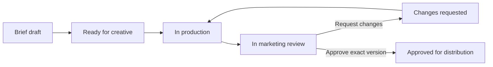

# Marketing and Creative Team Workstation

Date: 2026-10-10
Status: Revised design based on the user's six-step workflow. No application code or database migrations applied.

## 1. The workstation unit

One shared creative card follows the work from marketing brief to performance review. Marketing and creative teams see different action queues over the same records. Files, comments and results are accessible from the card; teams do not need to re-enter information during handoffs.

The card's human-facing identifier is `creative_code`, for example `CR-000123`. The database primary key is `creative.variants.id`, a generated UUID. Use a workspace-unique immutable creative code; keep brand, angle, owner and status in fields instead of encoding changeable meaning into the identifier. The earlier blueprint's `variant_code` is renamed to `creative_code`.

Each submitted execution has a separate UUID and version number, for example `CR-000123 / V03`. Comments, approval and performance mappings reference that exact version. Corrections during review produce V02, V03 and so on. A deliberate new hook/angle test produces a new creative code linked to its parent and optimization plan, preserving side-by-side comparison.

Avatar is a pending terminology choice: the user may mean target customer persona or the on-screen presenter. Keep `target_persona_id` and optional `presenter_id` distinct in the design; do not force one meaning into the other. Persona belongs in the marketing brief. A presenter, when needed, is linked to the creative execution.

## 2. Six steps and handoffs

| Step | Owner | Workstation action | Saved output | Handoff condition |
|---|---|---|---|---|
| 1. Marketing direction / 初稿 | Marketing | Select avatar/persona, angle, objective and video/visual format; write or attach the initial draft | Versioned brief, initial script/visual references, assigned creative owner, due date | Marketing submits a complete brief |
| 2. Creative execution / 叙述方式、剪辑、精剪 | Creative | Select storytelling approach, develop the execution, edit and polish; upload versioned previews | Storytelling method, script, assets, draft version, production substage | Creative submits an exact version for review |
| 3. Marketing review | Marketing | Watch/view the draft, add anchored comments, then choose changes requested or approved | Review round, comments, explicit decision and reviewer/time | A review decision is submitted |
| 4a. Revision | Creative | Address comments, upload a new version and explain resolutions | New immutable version, response/resolution records | Resubmission opens a new review round |
| 4b. Posting / advertising | Marketing | Choose organic, paid or both; set account, schedule, caption, placement and paid plan where applicable | Separate distribution plans with an approved version reference | Marketer confirms the plan; actual platform IDs are registered after launch |
| 5. Performance review | Both teams | Inspect Meta results against the exact code/version and each delivery | Performance views, source IDs, reporting scope and freshness | A team member records a performance review |
| 6. Refinement / optimization | Both teams | Record what worked, proposed change, rationale, owner and next test | Optimization plan linked to evidence and a follow-up creative/brief | Assigned owner creates the next iteration |

"No comments" means marketing has completed review and selected **Approve**. An empty comment thread or an unanswered review is not approval. A reviewer can leave non-blocking notes while approving, provided no blocking items remain.

## 3. Screens and fields

Use a board plus one creative detail page with six tabs. Separate team queues keep ownership visible while both teams retain access to shared context and performance.

| Tab | Fields / controls |
|---|---|
| Brief / 营销初稿 | Brand, product, initiative, target persona, marketing angle, objective, primary KPI, format (video/visual), hook idea, initial copy, CTA, reference attachments, marketer, creative assignee, due date |
| Production / 创意制作 | Storytelling approach (demo, testimonial, problem–solution, narrative, etc.), execution notes, script, presenter if used, media files, thumbnail, version, production substage |
| Review / 审核修改 | Exact version preview, review round, comments, anchors, blocking flag, assignee, responses, resolution, Request changes / Approve |
| Distribution / 发布投放 | Organic/paid/both, account, planned time and time zone, caption, thumbnail, destination URL, ad plan, approved version, platform post/ad IDs, actual launch status |
| Performance / 表现数据 | Channel, reporting interval, attribution, spend, delivery, available engagement/video/conversion metrics, KPI, source freshness, mapping quality |
| Optimization / 复盘优化 | Observation, evidence, hypothesis, proposed change, decision, priority, owner, due date, parent creative, next creative code |

Primary team views:

- Marketing: My briefs, Awaiting my review, Ready to publish/advertise, Performance to review.
- Creative: Assigned briefs, In production, Changes requested, Creative performance.
- Shared: All creatives, Performance comparison, Optimization backlog.

The first useful workstation can record posting/advertising decisions and external launch IDs. Direct publishing and ad creation are a later integration capability; these actions are not implied by storing a plan. Report actual connector capability in the UI.

## 4. Status model

Creative workflow:



Production substage: `storytelling`, `rough_edit`, `fine_edit`, `ready_to_submit`. For visual content, use applicable design stages instead of forcing video-edit stages. Submission freezes the reviewed version.

Keep distribution statuses per plan: `draft`, `scheduled`, `launched`, `failed`, `cancelled`, `ended`. A creative can be published organically while its ad is still scheduled. A single global "posted" status would lose that distinction. `launched` requires a confirmed external object ID and launch timestamp; scheduling a plan is not evidence of launch.

Performance review and optimization have separate records and statuses. New production can proceed while an older approved version is still running. Historical approval remains attached to the old version; it does not authorize the new version.

## 5. Table additions and exact keys

This extends the earlier backbone instead of creating a parallel database. Each tenant table includes `workspace_id`. UUIDs are primary keys unless the table uses the explicit composite junction key below. All references also enforce tenant/brand ownership.

| Table | Primary key | Main relationships and added fields |
|---|---|---|
| `strategy.briefs` | `id` | Existing brief identity, owner and initiative |
| `strategy.brief_versions` | `id` | `brief_id`, version; add `target_persona_id`, marketing angle, requested format, initial copy, KPI, CTA |
| `strategy.brief_assets` | `(workspace_id, brief_version_id, asset_version_id, role)` | Initial draft/reference attachments bound to the brief version |
| `creative.concepts` | `id` | `brief_version_id`; concept and angle |
| `creative.variants` | `id` | `concept_id`; `creative_code` unique within workspace |
| `creative.variant_versions` | `id` | `variant_id`, version; add storytelling approach, execution notes, optional presenter reference; unique `(workspace_id, variant_id, version)` |
| `work.creative_jobs` | `id` | `variant_id` unique within workspace, marketing owner, creative owner, due date, workflow status, production substage, active review ID, lock version |
| `review.rounds` | `id` | Exact `variant_version_id`, round number, assigned marketer, status, submitted/decided timestamps |
| `review.comments` | `id` | `round_id`, author, parent comment, text, blocking flag, assignee, anchor, status |
| `review.comment_resolutions` | `id` | `comment_id`, resolving version ID, response, resolver, timestamp; reviewer acceptance or reopening is retained |
| `creative.approvals` | `id` | Existing decision table; add `review_round_id`, exact `variant_version_id`, decision, reviewer, time, reason |
| `distribution.plans` | `id` | Exact approved `variant_version_id` and `approval_id`, organic/paid channel, account, schedule, caption/thumbnail/destination package reference, budget/currency if paid, status |
| `distribution.plan_launches` | `id` | `plan_id`, exactly one `publication_id` or `ad_id`, confirmed time; one plan can produce several ads |
| `distribution.delivery_bindings` | `id` | Existing exact-version-to-post/ad mapping with validity dates |
| `learning.performance_reviews` | `id` | `variant_version_id`, author/team, scope, date range, summary and assessment time |
| `learning.performance_review_evidence` | `(workspace_id, performance_review_id, observation_revision_id)` | Exact measurement revisions used in a performance review |
| `learning.optimization_plans` | `id` | `performance_review_id`, optional finding ID, hypothesis, proposed change, owner, priority, due date and status |
| `learning.optimization_outputs` | `(workspace_id, optimization_plan_id, variant_id)` | Connects a plan to one or more follow-up creatives |

Core creative metadata and execution content are versioned. Editing the brief after handoff creates a new brief version and an explicit rebrief event; it must not silently change the direction used by an existing execution. A concept adopts that version only through a recorded handoff, preserving prior version lineage.

Review anchors identify the precise asset version. Video anchors use a timestamp or interval; visual anchors use page/frame and normalized coordinates. Text-only comments are also supported. A resolution on V02 does not rewrite the original comment on V01.

Allow one active review per creative job, enforced transactionally. Approve/request-changes decisions are mutually exclusive terminal decisions for a round. Concurrent actions use a lock version; a stale client must reload rather than overwrite the newer state. Team permissions are checked server-side: creative submits and revises; marketing decides review and distribution; both teams can inspect results and propose optimization.

## 6. Approval and launch contract

Approval pins an exact creative version. Caption, thumbnail and destination are also saved as a versioned distribution package with the marketer's confirmation, either during review or when finalizing the distribution plan. Substitution of a different video/image requires another creative approval; changing launch content invalidates its previous package confirmation.

Launch registration validates the approved version and package. Once a launch exists, changes create history/new plan versions rather than rewriting what ran. A failed launch remains retryable, and a repeated request cannot create duplicate internal launches for the same platform object.

Review status and distribution decisions are persisted with audit events and actor identities. Notifications/outbox records can be added during implementation so handoffs are reliable; no messages are sent by this design.

## 7. Meta feedback linkage

```text
Meta account + post ID / ad ID
  → publication or ad record
  → effective delivery binding
  → exact creative version
  → creative code
  → marketing brief + storytelling approach + review history
```

Creative codes may be included in ad names for human recognition, but ingestion uses account-scoped platform IDs. Meta metrics do not automatically identify the workstation's code without this mapping. Manual launches therefore need ID registration or a verified import mapping.

Display paid and organic performance separately with explicit reporting period and scope. One creative version can have several launches; do not join metric rows through comments, assets or review rounds in ways that multiply totals. Aggregate performance first, then join unique creative identity and descriptive metadata.

Use the previous backbone's raw payload retention, immutable observation revisions, metric definitions, attribution scopes and freshness rules. Unmapped ads remain visible as unmapped. Missing metrics are unavailable, not zero. Meta account permissions and available metric combinations must be verified during connector implementation.

## 8. Example creative card

Illustrative values, not production records:

```text
Creative code:     CR-000123
Current version:   V03
Brand / product:   Example Skincare / Daily Moisturiser
Persona:          Office worker with dry skin (if avatar means persona)
Marketing angle:   Lightweight hydration
Format:           Video
Initial draft:    Show the problem, then demonstrate the product
Storytelling:     Problem → demonstration → benefit → CTA
Marketing owner:  Assigned marketer
Creative owner:   Assigned editor
Workflow status:  Approved for distribution

Review V02:       "Shorten the opening to two seconds" at 00:00–00:04
Revision V03:     Opening shortened; resolution linked to the comment
Review V03:       Marketing approved

Organic plan:     Instagram Reel — scheduled
Paid plan:        Meta ad — draft
Performance:      Awaiting confirmed launches and reporting sync
Optimization:     Later test a testimonial hook under a new creative code
```

Do not populate fictional spend or performance while awaiting data. Each launch can show its own status and freshness, while the card summarizes outstanding team actions.

## 9. Acceptance scenarios

1. Marketing submits persona/angle/initial draft; the assigned creative team sees the same brief and attachments.
2. Creative submits V01; marketing comments on the exact video timestamp or visual location.
3. Request changes returns the job to creative; V02 retains V01 and every original comment.
4. No submitted decision leaves the job in review even if there are no comments.
5. Marketing approves V02; an attempt to launch unapproved V03 is rejected.
6. One approved version supports an organic launch and several paid launches with separate IDs and statuses.
7. Importing the same Meta reporting batch twice leaves current totals unchanged.
8. Both teams open a creative code and see correctly mapped results, source scope, freshness and missing data.
9. A performance review pins its evidence; an optimization plan produces a linked new creative code.
10. Two simultaneous review decisions cannot produce conflicting approved/changes-requested states.

## 10. Implementation boundary

Build the shared board, card tabs, ownership, versioned review loop and distribution registry first. Add read-only Meta performance and the optimization loop against the same IDs next. The existing PostgreSQL recommendation remains provisional pending the user's platform choice. This document is a reviewable design, not a deployed workstation.
